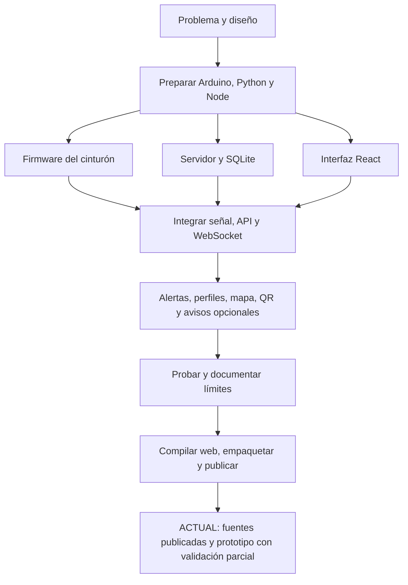

# SFA Asistencia

Sistema educativo de alerta anticaídas: cinturón Arduino con MPU6050 y panel local para cuidadores y familiares.

## Ampliación de Fuentes: Ubicación y Correo

### Candidata actual 1.2.0-rc3: GPS remoto sin cinturon y pruebas de alarmas

[Descargar APK actual](https://github.com/hfreedo/SFA-Asistencia-Anticaidas/releases/download/v1.2.0-rc3/SFA-Asistencia-1.2.0-rc3-Android-prototipo.apk)
| [Windows, APK y SHA-256](https://github.com/hfreedo/SFA-Asistencia-Anticaidas/releases/tag/v1.2.0-rc3)
| [GPS y pruebas de alarma](docs/PRUEBA_GPS_Y_ALARMAS.md)
| [Que abrir y que contiene cada carpeta](ABRIR_AQUI.md)

APK Android 12+, version **0.4.0-prototipo (4)**, misma firma debug que rc2.
En **Compartir > Por internet**, GPS directo a Supabase con Wi-Fi o datos moviles,
sin misma red ni cinturon. En **Pruebas**, alarma local, escenarios simulados y
push etiquetado solo al celular solicitante. La PC emisora debe usar rc3 para
las pruebas push; las versiones anteriores no las recogen. La validacion
fisica y visual en Android sigue pendiente; no equivale a un producto certificado.

El estado actual incluye centro de inicio unificado, base compartida entre
fuentes y EXE del proyecto, HTTPS asistido, geocerca con incertidumbre y aviso
persistente, historial sin purga automatica y un prototipo Android Kotlin/Compose.
Supabase aporta Auth, RLS y sincronizacion PC; la APK consulta eventos remotos,
con FCM y **GPS directo a Supabase implementados en rc3**. El editor cloud de
geocerca y el aviso remoto por salidas de zona siguen pendientes.
El emisor requiere credencial privada propia, nunca incluida en el repositorio
ni en el paquete; ver [configuracion y limites FCM](docs/FIREBASE_FCM.md).

- [Cambios de esta entrega](CHANGELOG.md).
- [Plan y estado de las etapas](docs/PLAN_AMPLIACION.md).
- [Android: construir, instalar y validar](docs/ANDROID.md).
- [Evidencia y condiciones pendientes](docs/VALIDACION_AMPLIACION.md).
- [Centro de inicio Windows](docs/INICIADOR.md).

El APK/EXE generado no demuestra que el GPS con pantalla bloqueada, HC-06 o
las alertas remotas hayan sido probados en un telefono fisico. La entrega es
un prototipo, no un servicio de emergencia certificado.

Las fuentes del 20 de octubre de 2026 incorporan vínculo de celular por QR,
recepción HTTPS de posiciones, geocercas por residente y correo SMTP alternativo
a Telegram. **Esta ampliación no está incluida en los portables anteriores.**

- [Activar geolocalización y geocerca](docs/GEOLOCALIZACION.md).
- [Preparación HTTPS asistida para PC y Android](docs/HTTPS_ANDROID.md).
- [Configurar correo y otros avisos](docs/NOTIFICACIONES.md).

La vista web local de envio requiere permanecer abierta. La APK rc3 usa servicio
foreground: modo remoto por internet o modo local hacia PC de la misma red.
Hace falta configurar HTTPS de confianza y,
para correos reales, una cuenta SMTP. El panel general sigue siendo solo para LAN
de confianza, no para exposición pública en Internet.

## De Cero al Estado Actual

**[Ver el mapa maestro completo](docs/MAPA_MAESTRO.md)**: conecta todas las etapas,
las herramientas utilizadas, los archivos construidos y el estado de validación.
Es el punto de entrada antes de consultar las guías por separado.

## Código Fuente y Guía Para Estudiantes

Ahora se incluye el código fuente del estado actual: firmware Arduino, servidor
Python, interfaz React, Android Kotlin/Compose y configuración de empaquetado. No se incluyen datos
personales, credenciales ni dependencias instaladas.

- [Empieza aquí: guía paso a paso para alumnos](docs/GUIA_ALUMNOS.md).
- [Manual de reproducción y verificación desde cero](docs/MANUAL_REPRODUCCION.md).
- [Ficha para registrar pruebas y evidencias](docs/REGISTRO_REPRODUCCION.md).
- [Stack tecnológico por etapas, programas y Mermaid](docs/STACK_TECNOLOGICO.md).
- [Instalación y desarrollo desde las fuentes](docs/DESARROLLO.md).
- [Hardware, pinout y protocolo](docs/HARDWARE_Y_PROTOCOLO.md).
- [Comprobaciones de las fuentes publicadas](docs/VALIDACION_FUENTES.md).

Para ejecutar las fuentes, primero instala las dependencias y compila la interfaz
siguiendo la guía. `interfaz_web/static` se genera localmente y no está versionado.

## Versión 1.1.0

Portable preparado para Windows de 64 bits. El release 1.1.0 está en borrador para revisión; las versiones públicas se consultan en [Releases](https://github.com/hfreedo/SFA-Asistencia-Anticaidas/releases).

No requiere instalar Python, Node.js ni dependencias del frontend. Incluye fuentes, iconos, generador QR y controlador opcional CH340/CH341.

## Funciones

- Monitoreo inercial por USB o Bluetooth serial, con estados de señal reciente y desconexión.
- Protocolo visual de caída, cronómetro y confirmación de atención.
- Perfiles con fotos, selección y edición sincronizada; feedback mediante toasts.
- Mapa y geocerca por residente, con estados de precisión, permanencia y antigüedad de la ubicación del celular.
- Preferencias de alertas y configuración de Telegram.
- Acceso móvil por Wi-Fi/hotspot y QR privado para vincular el emisor de ubicación.
- Exportación e importación de perfiles, fotos y preferencias.
- Interfaz adaptable a escritorio y celular.

La batería del cinturón sigue sin medición. La posición llega por un canal del
celular separado de la telemetría del UNO/MPU6050. El QR de acceso general y el QR
privado de ubicación tienen funciones distintas; no hay aún cuentas de cuidadores.

## Capturas

Capturas del ejecutable preparado con perfiles ficticios y configuración aislada. Sin datos personales del usuario. La caída es una simulación de interfaz, no una prueba física del sensor.

[Galería completa de pantallas y opciones](docs/GALERIA.md): selector, registro, fotos, notificaciones, geocerca, QR, dispositivo, copias, toasts, emergencia y vista móvil.

## Inicio

1. Extraer todo el ZIP en una carpeta con permiso de escritura.
2. Ejecutar `ABRIR_SFA_ASISTENCIA.bat` o `SFA_Asistencia.exe`.
3. Registrar o importar residentes.
4. Elegir el puerto real de la placa en Ajustes > Dispositivo.

USB: 115200 baudios. HC-06: 9600 baudios. Cierra el Monitor Serie antes de conectar.

Para el celular, cierra el modo local y ejecuta `ABRIR_ACCESO_MOVIL.bat`. Conecta ambos equipos a la misma red de confianza y abre Ajustes > Acceso móvil. Este modo permite acceso al panel a equipos de esa red, sin autenticación de usuarios. No modifica el firewall automáticamente.

## Datos y Migración

Perfiles, fotos, eventos y ajustes permanecen en `data/sfa_eventos.sqlite3`, junto al ejecutable. El paquete no incluye tu base personal.

Ajustes > Copias exporta/importa perfiles, fotos y preferencias JSON. Omite historial y credenciales de Telegram. Para respaldar todo, cierra SFA y copia `data`. Conserva esas copias en un lugar privado.

## Compatibilidad

Destino: Windows 10/11 x64 con navegador moderno. Verificado localmente en Windows 11 x64 desde una extracción limpia, sin Python/Node en el PATH del proceso de prueba. Windows 10, una segunda PC física y Windows ARM no fueron probados. No es nativo para macOS, Linux ni Windows de 32 bits.

Fuentes e iconos son locales. El mapa necesita Internet para sus calles; Telegram requiere Internet y credenciales válidas. El driver es opcional y se instala manualmente sólo si la placa lo requiere.

Consulta [las pruebas y límites de compatibilidad](docs/VALIDACION.md) y [las versiones](RELEASES.md).

## Alcance y Distribución

Prototipo educativo y experimental. No es un dispositivo médico certificado ni sustituye supervisión humana o servicios de emergencia. La validación física, un teléfono real y el driver con placa conectada requieren pruebas adicionales.

Este repositorio publica documentación, capturas, fuentes editables y firmware.
Las bases de datos, copias personales y credenciales permanecen privadas.
Los ejecutables se distribuyen en Releases. Publicar las fuentes no concede una
licencia libre ni modifica los permisos del ejecutable; consulta las condiciones
de uso y la declaración de autoría del repositorio.

Las licencias de terceros siguen vigentes. El símbolo gráfico fue retocado a partir de una imagen aportada por el usuario; el retoque no sustituye los permisos del original.
