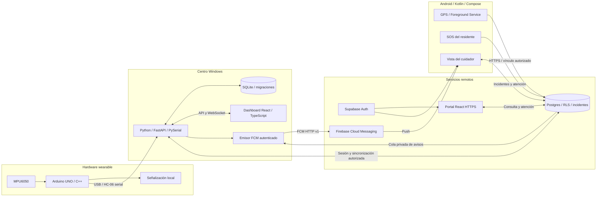

# SFA Asistencia
Teleasistencia distribuida que conecta señales del cinturón y ubicación del celular con alertas que un cuidador puede atender y resolver.


[](docs/VALIDACION_AMPLIACION.md)
[](LICENCIA_DE_USO_RESTRINGIDO.md)

[Descargar ejecutables](https://github.com/hfreedo/SFA-Asistencia-Anticaidas/releases) · [Portal HTTPS](https://hfreedo.github.io/SFA-Asistencia-Anticaidas/acceso.html) · [Recorrido del proyecto](docs/MAPA_MAESTRO.md) · [Stack tecnológico](docs/STACK_TECNOLOGICO.md)

## Del Sensor a la Atención

Una caída o una salida de la zona de cuidado no termina al detectar una señal:
hay que comunicarla, conservar el incidente y saber quién lo atendió.
SFA integra ese recorrido entre hardware, escritorio, nube y Android.

- **Monitoreo local:** telemetría inercial por USB o Bluetooth serial, residentes, historial y protocolo visual de atención.
- **Seguimiento por internet:** el celular comparte GPS con Supabase desde otra red, sin depender del hotspot de la PC.
- **Geocerca por residente:** zona configurable desde 5 m, evaluada según precisión, antigüedad y permanencia de las posiciones.
- **Atención compartida:** SOS y salidas confirmadas generan incidentes persistentes; reconectar o reingresar no equivale a resolverlos.
- **Acceso por roles:** administradores gestionan accesos; cuidadores consultan y atienden según los permisos de su espacio.

El cinturón aporta la señal inercial y el celular aporta la ubicación: son canales
independientes que pueden complementarse. La detección de caídas con el acelerómetro
del celular es una ampliación futura, no una función publicada.

## Arquitectura del Sistema



El panel local recibe WebSocket; las vistas remotas consultan los datos autorizados.
**El envío push actual necesita el emisor de la PC activo**, con sesión y credencial
FCM privada. El portal HTTPS permite consultar y atender sin alojar el panel local;
no es una demostración pública con datos de residentes.

## Aspectos Destacados de Ingeniería

| Capa | Decisiones y retos resueltos |
| --- | --- |
| **Embebido** | Lectura del MPU6050, estados inerciales, protocolo serial explícito y señalización autónoma del cinturón. USB y HC-06 conservan velocidades y conexiones diferenciadas. |
| **Desktop y backend** | FastAPI y PySerial integran señal, API y WebSocket. SQLite conserva perfiles, eventos y configuración mediante migraciones propias. Centro de inicio con control del servidor y empaquetado PyInstaller para Windows x64. |
| **Frontend** | React y TypeScript organizan residentes, telemetría y mapas Leaflet. Los incidentes se revisan en el panel principal y el menú mantiene un indicador desde otras secciones. Feedback mediante toasts y estados explícitos de conexión. |
| **Mobile** | Kotlin y Jetpack Compose, servicio de ubicación en primer plano, calidad y edad de la posición, filtrado de degradación de señal, SOS y registro del celular como receptor FCM. |
| **Cloud y seguridad** | Supabase Auth, espacios y roles, políticas RLS y comandos restringidos. Credenciales de envío fuera del cliente; registro privado de dispositivos y pruebas dirigidas al propio celular. |
| **Integridad del incidente** | Estado de ubicación y estado de atención son distintos. Resolver una atención no afirma que el residente haya vuelto a la zona; una posición incierta tampoco se presenta como reingreso confirmado. |
| **Entrega reproducible** | Dependencias declaradas, pruebas de lógica y permisos, builds aislados, paquetes sin perfiles personales y verificaciones SHA-256. |

Un radio de geocerca pequeño sirve para configurar escenarios, no para prometer
precisión GPS centimétrica. El sistema muestra la incertidumbre en lugar de
convertirla en una falsa certeza. La medición de batería del cinturón no está
implementada en el hardware actual.

## Interfaz en Acción

Capturas representativas con perfiles ficticios. Ilustran el panel y la configuración
del mapa; los controles y funciones posteriores se documentan en las guías actuales.


[Ver galería completa](docs/GALERIA.md) · [Probar el flujo GPS y alarmas](docs/PRUEBA_GPS_Y_ALARMAS.md) · [Probar atención de geocerca](docs/PRUEBA_GEOCERCA_INTERNET.md)

## Inicio Rápido

### Probar los Ejecutables

1. Descarga el **ZIP Windows** de [Releases](https://github.com/hfreedo/SFA-Asistencia-Anticaidas/releases) y extrae todo su contenido en una carpeta con permiso de escritura.
2. Abre `SFA_Asistencia.exe`: desde el Centro puedes iniciar o detener el servidor y abrir el panel. No necesitas Python ni Node.js instalados.
3. Crea o importa un perfil. Para el cinturón, selecciona su puerto en **Ajustes > Dispositivo**: USB a 115200 baudios o HC-06 a 9600.
4. Para GPS remoto instala la APK publicada, utiliza una cuenta invitada e inicia **Compartir > Por internet**. Vincula la PC al mismo residente desde **Acceso y sincronización** si vas a consultar en el panel local.

Destino de escritorio: Windows 10/11 x64; pruebas realizadas en Windows 11.
Android requiere **12 o posterior**. La APK **0.6.2 release** usa firma propia;
la 0.6.1 anterior conserva firma debug. El cambio inicial de firma exige revisar
la [guía de instalación y continuidad](docs/ANDROID_RELEASE.md) antes de reinstalar.
La validación física de esta nueva entrega sigue pendiente.

Los perfiles creados en el portable se guardan en `data/` junto al ejecutable.
No se distribuyen cuentas, bases personales ni claves privadas. Las funciones
remotas requieren internet y acceso autorizado; el panel local puede utilizarse
sin configurar Supabase. Las calles del mapa requieren conexión.

### Ejecutar Desde las Fuentes

Requisitos: Git, Python 3.13 y Node.js 24. Desde una copia autorizada del repositorio:

```powershell
py -3.13 -m venv .venv313
.\.venv313\Scripts\python.exe -m pip install -r .\servidor_pc\requirements.txt
cd interfaz_web
npm ci
npm run build
npm run build:access
cd ..
.\.venv313\Scripts\python.exe -m uvicorn servidor_pc.main:app --host 127.0.0.1 --port 8780
```

Abre [el panel local](http://127.0.0.1:8780). `Ctrl+C` detiene ese servidor.
Para desarrollo con recarga, Arduino, Android y configuración remota, continúa
con [Desarrollo](docs/DESARROLLO.md) y el [manual reproducible](docs/MANUAL_REPRODUCCION.md).

## Explorar el Proyecto

| Quiero... | Punto de entrada |
| --- | --- |
| Entender el recorrido de cero al sistema integrado | [Mapa maestro](docs/MAPA_MAESTRO.md) y [stack por etapas](docs/STACK_TECNOLOGICO.md) |
| Aprender o reproducirlo en clase | [Guía para alumnos](docs/GUIA_ALUMNOS.md) y [manual de reproducción](docs/MANUAL_REPRODUCCION.md) |
| Conectar el hardware | [Pinout y protocolo](docs/HARDWARE_Y_PROTOCOLO.md) |
| Configurar acceso remoto y avisos | [Sincronización](docs/SINCRONIZACION.md) y [Firebase FCM](docs/FIREBASE_FCM.md) |
| Ver pruebas, resultados y evolución | [Validación](docs/VALIDACION_AMPLIACION.md) y [changelog](CHANGELOG.md) |
| Preparar una entrega o firma Android | [Organización](docs/ORGANIZACION_Y_ENTREGA.md) y [release Android](docs/ANDROID_RELEASE.md) |

El código está separado en `arduino/`, `servidor_pc/`, `interfaz_web/`,
`android_app/` y `supabase/`. Las guías viven en `docs/`; `scripts/` reúne
construcción y verificaciones. Los ejecutables se descargan desde Releases,
no desde las carpetas de desarrollo.

## Autoría y Condiciones

La publicación de fuentes permite consultar la implementación, pero no convierte
el proyecto en software de licencia libre. Consulta la [declaración de autoría](AUTORIA.md)
y las [condiciones existentes del ejecutable](LICENCIA_DE_USO_RESTRINGIDO.md).
Las dependencias y recursos de terceros conservan sus propias licencias.
Para permisos adicionales, contacta al [responsable del repositorio](https://github.com/hfreedo).

---

**Nota técnica:** prototipo experimental de investigación y desarrollo educativo.
No es un dispositivo médico certificado ni sustituye supervisión humana o servicios de emergencia.
