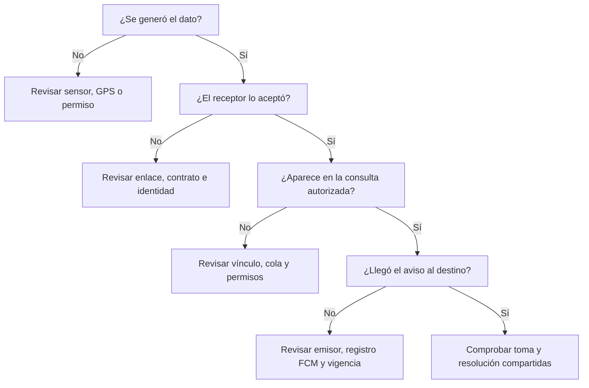

# Comprobación y diagnóstico

[Índice](README.md) · Anterior: [Exposición](GUIA_EXPOSICION.md)

Una demostración resulta más clara cuando tiene **un origen, un destino y un resultado observable**. Esta guía ayuda a revisar esos tres puntos sin confundir una pantalla atractiva con un recorrido comprobado.

## 1. Registrar qué se comprobó

Usa una copia de pruebas, fichas ficticias y destinatarios informados. Para probar el circuito utiliza las opciones identificadas como **PRUEBA**, no una emergencia real.

| Caso | Origen | Resultado esperado | Evidencia que falta si solo compila |
| --- | --- | --- | --- |
| Telemetría del cinturón | MPU6050 y firmware principal | Lecturas recientes en el panel y cambios físicos observados | Puerto real, sensor y salidas |
| Orden al cinturón | Acción local del panel | `RSP` correspondiente y estado físico coherente | Respuesta efectiva del dispositivo |
| GPS remoto | Android compartiendo | Posición de la misma persona visible en otra red, con hora y precisión | Seguimiento en el teléfono y consulta autorizada |
| Incidente compartido | SOS de prueba o escenario autorizado | Mismo ID y estado consultables desde dos clientes | Dos cuentas o equipos reales |
| Atención concurrente | Dos cuidadores con la misma revisión | El segundo no sobrescribe la atención tomada | Acción y conflicto comprobados |
| Aviso FCM | Prueba dirigida a una instalación autorizada | Mensaje de prueba visible en ese teléfono | Recepción física, no solo aceptación FCM |
| Geocerca | Posiciones recientes con incertidumbre conocida | Estados coherentes y salida/reingreso según reglas | Recorrido de campo y análisis de falsos cambios |

Anota versión, equipo, cuenta de prueba, fecha, pasos, resultado y si fue **aprobada, fallida o no ejecutada**. No copies tokens, contraseñas o ubicaciones personales a la evidencia pública.

## 2. Aislar el tramo que falla



**No cambies los umbrales del detector para corregir un fallo de comunicación.** Primero identifica el tramo que no produjo el resultado.

## 3. Fallos frecuentes

| Síntoma | Primera comprobación | Cómo continuar |
| --- | --- | --- |
| No se abre el panel | Centro de la entrega correcta y servidor iniciado | [Inicio y reproducción](MANUAL_REPRODUCCION.md) |
| No aparece telemetría | Puerto libre, firmware principal y baudios correctos | [Hardware y protocolo](HARDWARE_Y_PROTOCOLO.md) |
| Hay mapa pero no ubicación actual | Persona, fuente y fecha de la posición | [Portal y Android](MANUAL_PORTAL_Y_ANDROID.md) |
| Hay ficha local pero no datos remotos | Vínculo guardado y sesión de PC reanudada | [Manual de Windows](MANUAL_USO_PC.md) |
| El GPS funciona pero el cuidador no recibe push | Emisor PC activo, sesión y celular registrado | [Prueba FCM](PRUEBA_FCM_DESDE_PC.md) |
| No aparece una persona en la cuenta | Espacio y asignación autorizados | [Personas y equipo](PERSONAS_Y_EQUIPO.md) |
| Se cerró la atención pero sigue la situación exterior | Diferencia entre resolución y reingreso | [Geocerca persistente](PRUEBA_GEOCERCA_INTERNET.md) |
| Radio pequeño y estado incierto | Incertidumbre GPS frente al radio | Conservar controles de calidad; no forzar la salida |
| Un equipo LAN no ve el panel completo | Límite del puesto local desde rc12 | Usar el portal autenticado; [roles](ROLES_DEMOSTRACION.md) |

## 4. Comprobar la propia documentación

Desde la raíz del proyecto, con Python disponible:

```powershell
py -3.13 scripts/validar_documentacion.py
```

La comprobación revisa los enlaces locales y anclas de esta colección, cercos de código, archivos de capturas, hashes y extractos contrastados con las fuentes. **No evalúa automáticamente si una explicación resulta comprensible para una persona.**

Para esa revisión, recorre cada manual sin consultar otro archivo hasta que el paso lo pida. En cada tarea debes poder responder: ¿dónde entro?, ¿qué selecciono?, ¿qué resultado debo ver?, ¿qué significa si no aparece?

Las revisiones visuales adicionales de Markdown y Mermaid se describen en [Estado de la documentación](ESTADO_DOCUMENTACION.md). Las pruebas de la aplicación, SQL y Android tienen su propia evidencia; no se vuelven a dar por aprobadas por editar una guía.
