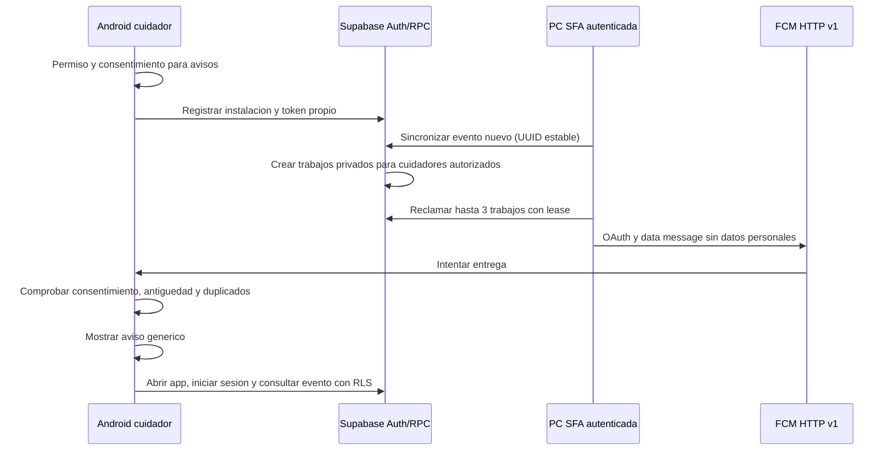

# Firebase Cloud Messaging: configuracion de SFA

## Estado y alcance

Proyecto Firebase `sfa-asistencia`, app Android `org.sfa.asistencia`.
En consola se verifico Spark (USD 0 al mes), sin vincular facturacion,
Analytics ni Gemini. No activar Blaze, Cloud Functions, Storage o servicios
adicionales para este flujo. Firebase se usa solamente como transporte FCM.

El codigo cliente y emisor esta preparado. No equivale a una alerta entregada:
la migracion ya se aplico con autorizacion al proyecto de pruebas; falta configurar una identidad de envio e
instalar y registrar un telefono real. La APK 1.2.0-rc1 publicada no contiene
esta ampliacion. No se reemplaza un release anterior silenciosamente.



## 1. Configuracion Android

Descargar `google-services.json` de la app Android correcta y colocarlo en
`android_app/app/`. El archivo ya fue verificado localmente: proyecto y paquete
coinciden. No es una cuenta de servicio. Se excluye de Git por convencion local.
El plugin Google Services se aplica solo cuando existe; sin el JSON se puede
compilar la app, pero sus controles FCM indicaran que falta configuracion.

La app no incluye Firebase Analytics. La inicializacion automatica de Messaging
esta desactivada hasta que la persona inicia sesion y pulsa Activar avisos.
Android 13+ requiere POST_NOTIFICATIONS. Android 12 debe permitir notificaciones
en los ajustes del sistema. Desactivar y cerrar sesion intentan revocar el
registro; si no hay red, los mensajes locales se bloquean y debe reintentarse
la revocacion. El JWT Supabase no se guarda en disco. Si FCM renueva el token,
se solicita actualizar el registro desde una sesion autenticada.

## 2. Migracion Supabase (aplicada con autorizacion)

Revisar y aplicar una sola vez, despues de las dos migraciones anteriores:
`supabase/migrations/202610210003_push.sql`.

En el proyecto de pruebas se verifico su ejecucion exitosa y cinco controles
alojados: RLS activo, anonimo sin lectura, cliente sin lectura directa, RPC
de registro disponible y RPC de envio bloqueada para anonimos. No se migraron
perfiles ni se generaron eventos reales durante esta aplicacion.

- Tokens y cola en `sfa_private`, con RLS y sin lectura directa del cliente.
- `sfa_register_push`: solo admin/cuidador activo, instalacion propia, hasta
  cinco registros activos por usuario. No permite apropiarse de otra instalacion.
- `sfa_claim_push`: solo administrador del espacio; verifica acceso vigente
  de cada destinatario. Lease de dos minutos, tres trabajos por lote.
- `sfa_ack_push`: exige mismo administrador y lease; nunca admite una confirmacion
  de otro usuario. Cinco intentos como maximo por trabajo.
- Solo nuevos SOS, CAIDA_CONFIRMADA y GEOCERCA_SALIDA, reales y recientes.
  El puente actual todavia excluye geolocalizacion de su captura cloud; este
  canal no habilita por si solo envio remoto de geocercas.
- Los eventos simulados, historicos y de mas de cinco minutos no disparan avisos.
  No hay borrado automatico de eventos ni de trabajos. Trabajos vencidos o con
  intentos agotados quedan conservados y ya no se reclaman.

La revocacion se verifica al reclamar. Un mensaje ya enviado o en vuelo no
puede retirarse de FCM; por eso no contiene nombres, coordenadas, notas ni telefonos.

## 3. Credencial del emisor (NO es google-services.json)

Hace falta una cuenta de servicio dedicada del proyecto `sfa-asistencia`.
Antes de crearla o asignar permisos se requiere confirmacion del propietario.
Preferir un rol personalizado solo con `cloudmessaging.messages.create`, no
Owner, Editor, Firebase Admin ni una cuenta service_role de Supabase.
La creacion y descarga de la clave privada debe realizarla el propietario.

Ya creada y asignada con autorizacion: `sfa-fcm-sender@sfa-asistencia.iam.gserviceaccount.com`,
rol `projects/sfa-asistencia/roles/sfaFcmSender` (SFA FCM Solo Envio), con el unico
permiso `cloudmessaging.messages.create`. No se genero clave. No se activaron
pruebas promocionales, suscripciones ni vinculacion de facturacion.

Actualizacion local: el propietario genero y descargo la clave. Se verificaron
proyecto e identidad, se copio a `secrets/firebase-service-account.json` con ACL
restringida al usuario Windows y SYSTEM, y se configuro su ruta en el `.env`
privado preservando una copia anterior. Google acepto el intercambio OAuth;
no se envio ningun push ni se declara entrega real por esa comprobacion.

No pegar claves privadas en el chat. Guardar el JSON en una carpeta privada de
esta PC (por ejemplo `secrets/firebase-service-account.json`), no compartida,
sin acceso para otros usuarios. No incluirlo en APK, ZIP, capturas o Git.
Si una politica de Google bloquea claves, no desactivar la politica: revisar
una alternativa de identidad administrada antes de continuar.

En `.env`, definir la ruta local del archivo:

```dotenv
SFA_FCM_CREDENTIALS_FILE=secrets/firebase-service-account.json
```

Se recomienda usar una ruta absoluta local en el `.env` privado para evitar
ambiguedades de carpeta al iniciar. Nunca distribuir ese `.env`.
Reiniciar desde el centro de inicio y reanudar la sesion de sincronizacion PC
con el administrador del espacio. Sin sesion activa no se reclama ningun trabajo.
El emisor usa cryptography ya instalada y OAuth HTTP v1; no abre puertos ni
implementa un endpoint publico de envio. Clave y access token permanecen en la PC.

El campo `push.configured` del estado cloud indica solo una ruta configurada,
no validez de credenciales. `push.last_error=push_unavailable` indica fallo que
requiere diagnostico. No se registran claves, tokens ni respuestas privadas.

## 4. Prueba real pendiente

Validacion de software: 71 pruebas Python, 26 comprobaciones SQL aisladas,
12 pruebas unitarias Android, compilacion APK con configuracion Firebase y lint
sin errores. Los controles de permisos alojados no sustituyen una entrega
FCM real. Las advertencias de versiones del lint se conservan en el informe.

1. Compilar APK configurada e instalar en Android 12+ con Google Play services.
2. Iniciar sesion como cuidador autorizado y activar avisos; verificar permiso.
3. Mantener PC encendida, internet y sincronizacion autenticada activa.
4. Generar un evento real controlado sin poner a una persona en riesgo.
   Las simulaciones se conservan como eventos, pero no generan push.
5. Comprobar con app visible, en segundo plano y pantalla bloqueada.
6. Desactivar avisos, revocar acceso y repetir: no debe generar nuevos trabajos.
7. Probar desconexion y reintento sin duplicar el aviso en el mismo celular.

FCM aceptado (`sent`) NO significa mostrado, leido ni atendido. La app no envia
acuse de lectura ni confirma atencion por el solo hecho de recibir un push.
No se garantiza entrega con detencion forzada, sin red, permiso denegado o
restricciones de bateria. No reemplaza un servicio de emergencia.

## Fuentes oficiales

- [FCM Android](https://firebase.google.com/docs/cloud-messaging/android/get-started).
- [Envio OAuth HTTP v1](https://firebase.google.com/docs/cloud-messaging/send/v1-api).
- [Permisos IAM FCM](https://docs.cloud.google.com/iam/docs/roles-permissions/firebasecloudmessaging).
