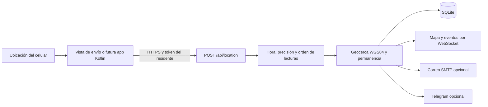

# Geolocalización y Geocerca: Puesta en Marcha

Ampliación de fuentes del 20 de octubre de 2026. No está incorporada en los
ejecutables 1.0.0/1.1.0 previamente preparados. No cambia el firmware del cinturón.

## Qué Está Implementado

- Recepción de posiciones mediante `POST /api/location`, separada del MPU6050.
- Vínculo revocable entre un celular y un residente. El servidor conserva solo
  el hash del token; el QR contiene el token en un fragmento, no en el URL HTTP.
- Geocerca propia por residente, última posición, precisión, antigüedad y eventos.
- Distancia geodésica WGS84 calculada con GeographicLib.
- Confirmación de salida/reingreso, tratamiento de incertidumbre y falta de señal.
- Vista `/compartir-ubicacion` que obtiene la ubicación del teléfono con permiso.
- Alertas en el panel, avisos del navegador compatibles, correo SMTP y Telegram opcional.

**Ubicamos el celular, no el cinturón ni directamente a la persona.** Si se deja
el teléfono en otro lugar, su posición no prueba dónde está el residente.



## 1. Preparar las Fuentes

Desde la raíz de una copia de trabajo con datos de práctica:

```powershell
py -3.13 -m venv .venv313
.\.venv313\Scripts\python.exe -m pip install -r servidor_pc/requirements.txt
cd interfaz_web
npm ci
npm run build
cd ..
```

La migración crea tablas nuevas sin borrar perfiles existentes. Respaldar la base
antes de actualizar. No iniciar pruebas con teléfonos, ubicaciones o correos reales
sin autorización. Las tablas mantienen la ultima posicion y, desde esta revision,
tambien cada posicion aceptada en position_history y los eventos sin purga
automatica. La consulta de historial esta limitada por pagina, no su retencion.

## 2. Preparar HTTPS de Confianza

**Alternativa avanzada por fuentes, solo LAN:** ejecutar `herramientas/compatibilidad/iniciar_geolocalizacion.bat`.
Para el GPS remoto de rc3 usar [la guia actual](PRUEBA_GPS_Y_ALARMAS.md), sin misma red.
Ahora incluye un asistente que usa OpenSSL local para generar los archivos.
Seguir [HTTPS en PC y Android](HTTPS_ANDROID.md) para aceptar expresamente la CA.
Preparar archivos y confiar en ellos son pasos distintos. Lo siguiente conserva
la alternativa manual con mkcert; no mezclar dos CA diferentes por accidente.

La ubicación web requiere un contexto seguro y permiso del usuario. Abrir el panel
con `http://192.168...` no satisface este requisito. No desactivar la seguridad del
navegador ni ignorar avisos de certificados como solución.

Para una demostración LAN se puede utilizar [mkcert](https://github.com/FiloSottile/mkcert).
Es una herramienta adicional, no una dependencia de npm/Python del proyecto.
Su instalación y confianza deben hacerse conscientemente en los equipos de prueba.
Desde la raíz, después de instalar mkcert según su documentación:

```powershell
mkcert -install
New-Item -ItemType Directory -Force certs
$addresses = @(& .\.venv313\Scripts\python.exe -c "from servidor_pc.red_local import local_addresses; print('\n'.join(local_addresses()))")
mkcert -cert-file certs/sfa.pem -key-file certs/sfa-key.pem localhost 127.0.0.1 @addresses
if (-not (Test-Path .env)) { Copy-Item .env.example .env }
```

No sobrescribir un `.env` existente: editarlo conservando sus valores. Las variables
`SFA_TLS_CERT` y `SFA_TLS_KEY` del ejemplo corresponden a esos archivos.
El certificado debe cubrir la IP que se usará. Si cambia la red/IP, regenerarlo.

En el teléfono de prueba hay que instalar y confiar el certificado de CA público
`rootCA.pem`, localizado con `mkcert -CAROOT`, siguiendo las instrucciones oficiales
y del fabricante. **Nunca transferir `rootCA-key.pem` ni la clave privada del servidor.**
No se instala ningún certificado automáticamente desde SFA. Si el teléfono no
confía correctamente en HTTPS, la geolocalización web puede seguir bloqueada.
Retirar la CA de pruebas de los dispositivos cuando deje de ser necesaria.

## 3. Iniciar y Vincular sin Escribir Direcciones

1. Detener la instancia anterior del servidor, identificándola; no cerrar procesos ajenos.
2. Ejecutar `herramientas/compatibilidad/iniciar_geolocalizacion.bat`. También puede ejecutarse
   `.\.venv313\Scripts\python.exe -m servidor_pc.acceso_movil --https`.
3. En la PC abrir `https://localhost:8780`. El certificado debe ser de confianza.
4. Registrar/seleccionar un residente y abrir Ubicación.
5. Elegir el centro real y el radio, y guardar. No usar la zona inicial de ejemplo
   para evaluar una ubicación real.
6. Elegir la red del celular si la PC tiene varias interfaces. Pulsar
   `Vincular celular por QR` y escanear con la cámara.
7. En el teléfono, comprobar HTTPS, pulsar `Comenzar a compartir` y conceder permiso.
8. Mantener la página abierta; revisar precisión, hora del envío y estado del panel.

La generación de vínculos, revocación y edición de zonas nuevas se autorizan desde
la PC del servidor, no desde cualquier cliente de la LAN. Un QR nuevo invalida el
vínculo anterior del mismo residente. Es una credencial privada: no publicarlo en
capturas ni documentos. Al recargar la vista del teléfono hay que escanear de nuevo.

La vista envía la posición nueva disponible aproximadamente cada 10 segundos. No
es una app Android en segundo plano. Al bloquear la pantalla, cambiar de aplicación
o cerrar la pestaña, el navegador puede dejar de entregar posiciones. Ese caso
debe aparecer como falta de ubicación, nunca como permanencia segura.

## 4. Reglas de la Geocerca

| Regla del prototipo | Comportamiento |
| --- | --- |
| Validez espacial | Latitud -90..90, longitud -180..180, números finitos |
| Tiempo | Zona horaria obligatoria; rechaza lecturas de más de 90 s o más de 30 s futuras |
| Orden | Rechaza lecturas repetidas o anteriores a la última aceptada |
| Precisión | Mayor a 50 m o a la mitad del radio: estado impreciso, no confirma transición |
| Límite | Considera el círculo de precisión y un margen de hasta 10 m; cerca del borde queda incierto |
| Confirmación | Al menos dos lecturas consistentes separadas por 10 s, sin un hueco mayor de 90 s |
| Salida | Una alerta al confirmar estar fuera; no una por cada lectura |
| Primera ubicación fuera | También genera aviso al confirmarse, aunque no se haya visto previamente dentro |
| Reingreso | Evento al confirmar dentro después de haber estado fuera |
| Pérdida | A los 90 s sin una observación reciente; revisión del servidor cada 5 s |
| Cambio de zona | Descarta la clasificación anterior hasta obtener nuevas lecturas |

Estos parámetros son iniciales de demostración, no umbrales médicos certificados.
Las alertas no son instantáneas y dependen de mediciones, red y evaluación.
No se evalúa una ruta: se evalúa una región circular alrededor del centro.

## 5. Contrato Preparado Para una App Kotlin

La futura APK puede usar la misma API, sin modificar el formato del MPU6050:

```http
POST /api/location
Authorization: Bearer TOKEN_DEL_VINCULO
Content-Type: application/json

{
  "latitude": -25.3000,
  "longitude": -57.6000,
  "accuracy_m": 12,
  "observed_at": "2026-10-20T15:00:00Z"
}
```

Las coordenadas/hora son solo un ejemplo de formato; la app debe obtener valores
reales y recientes. No enviar un `resident_id` para elegir a quién seguir: el token
determina el residente. HTTPS es obligatorio para envío remoto; HTTP solo se permite
en loopback para pruebas locales de la API.

| Ruta | Uso |
| --- | --- |
| `POST /api/residents/{id}/location-device` | Crear/reemplazar vínculo desde la PC |
| `DELETE /api/residents/{id}/location-device` | Revocar vínculo desde la PC |
| `POST /api/location` | Recibir posición autenticada por token |
| `GET /api/residents/{id}/location` | Última posición, estado y eventos |
| `GET/PUT /api/residents/{id}/geofence` | Consultar/guardar zona individual |

Errores relevantes: 401 vínculo ausente/revocado, 403 transporte/origen no permitido,
404 residente inexistente, 409 lectura repetida/fuera de orden, 422 datos inválidos.
La API no demuestra que las coordenadas enviadas sean auténticas: confía en el
dispositivo vinculado. No proporciona detección de ubicaciones simuladas.

La APK aún requiere implementación de permisos Android, ciclo de vida, seguimiento
visible en segundo plano, emparejamiento y almacenamiento seguro de la credencial.
El contrato ya tiene una APK Kotlin/Compose de prototipo; consultar ANDROID.md.
Las pruebas fisicas de pantalla bloqueada y HC-06 siguen pendientes.

## 6. Copias y Privacidad

La exportación JSON incluye las zonas por residente, pero no tokens de vínculo,
posiciones ni historial de ubicación. Importar reemplaza perfiles y revoca los
vínculos: hay que volver a emparejar los teléfonos. Copias antiguas sin zonas
individuales siguen siendo aceptadas y usan su zona de referencia general.

SMTP se configura en `.env`, no se incluye en la exportación. Una copia completa
del archivo SQLite sí contiene posiciones y hashes de vínculo. Mantenerla privada.
Los certificados y `.env` están excluidos de Git; revisar siempre antes de publicar.

## 7. Límites Antes de Utilizarlo Fuera de la Demostración

- Acceso solo en red local de confianza. El panel general conserva su modelo de
  confianza LAN y no tiene cuentas/roles para cuidadores; el token protege la
  recepción de posiciones, no todos los endpoints existentes.
- No abrir puertos del router ni publicar el servidor actual en Internet. Para
  salir de la LAN hacen falta backend accesible, autenticación completa y permisos
  por cuidador/residente, además de una política de privacidad/retención.
- La geocerca no reemplaza supervisión. Si el adulto mayor no lleva el teléfono,
  no se conoce su posición por este canal.
- Sin rutas ni tiempo estimado de llegada en esta ampliación.
- La recepción real por celular y el seguimiento con pantalla apagada requieren
  pruebas separadas. La vista web no promete seguimiento en segundo plano.

## 8. Comprobaciones

```powershell
.\.venv313\Scripts\python.exe -m unittest discover -s tests -v
```

En esta revisión se ejecutaron 23 pruebas locales: geocerca, tiempos/precisión,
separación de residentes, autenticación/revocación, HTTP, exportación/importación,
SMTP simulado, HTTPS y WebSocket seguro. La prueba TLS utiliza OpenSSL opcional y
una confianza aislada del proceso de prueba; no instala una CA en Windows ni en
un teléfono. Si falta OpenSSL, esa prueba se omite explícitamente.

El build web pasó. No se verificó visualmente la UI en navegador ni la ubicación
real desde una cámara/teléfono. No se envió correo real. Registrar esas pruebas
con consentimiento antes de afirmar funcionamiento integral.

Fuentes técnicas: [Geolocation API](https://developer.mozilla.org/en-US/docs/Web/API/Geolocation_API),
[mkcert](https://github.com/FiloSottile/mkcert),
[GeographicLib Python](https://geographiclib.sourceforge.io/html/python/).
# Cambios de vinculacion y geocerca (20/10/2026)

- El historial de actividad se muestra despues del mapa, no antes de sus controles.
  El QR permanece junto a la vinculacion del celular. Ocultar el QR no
  desvincula el celular. Cambiar de residente elimina el QR anterior de la vista.
- El vinculo de ubicacion no tiene caducidad temporal automatica. Reiniciar
  el servidor con la misma base o perder lecturas no debe revocarlo.
- Generar un QR de reemplazo exige confirmacion explicita. El endpoint rechaza
  reemplazos sin `replace_existing: true`, conservando el vinculo vigente.
- Si se confirma reemplazar o desvincular, el celular debe escanear el QR nuevo.
  Cambiar de base tambien puede hacer que un vinculo deje de corresponder.
- El editor unico esta en Ubicacion; Ajustes > Geocerca muestra un resumen y
  abre ese editor. El nombre, centro y radio pertenecen al residente seleccionado.
- Radios desde 5 metros, presets 5/10/25/50/100/200/500 y valor personalizado.
  La regla actual compara distancia menos/mas incertidumbre con el limite y
  margen; no rechaza una salida concluyente solo porque el radio sea pequeno.
  El limite absoluto de precision es 50 m y se mantienen dos lecturas y 10 s
  de permanencia, antiguedad y rechazo de relojes incorrectos.
- El panel explica intervalos inciertos y permanencia pendiente. Una salida
  confirmada mantiene un aviso visible; el sonido respeta las preferencias y
  puede requerir interaccion del usuario por la politica del navegador.
- position_history conserva cada posicion aceptada. No hay purga automatica
  de posiciones ni de eventos de ubicacion. El borrado explicito de un perfil
  o la restauracion sustitutiva siguen siendo operaciones destructivas.
- GET /api/location/context requiere el token del celular y devuelve solo su
  residente y geocerca. La APK lo utiliza para evaluar tambien sin conexion.
- GPS en APK hacia PC requiere la misma red/hotspot y confianza TLS dentro de
  la app. No confundirlo con el envio remoto de posiciones a Supabase.
