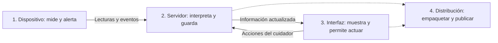

# SFA Paso a Paso: Guía Para Alumnos

El [Mapa maestro](MAPA_MAESTRO.md) muestra el proyecto completo desde cero.
Esta guía simplifica sus bloques y propone actividades para estudiarlos.

## Primero: Qué Estamos Construyendo

Un cinturón produce lecturas de movimiento. Una computadora recibe esas lecturas
y un panel permite al cuidador consultar el estado y atender una alerta.
No es una única aplicación hecha con un único programa: son partes conectadas.

Para comenzar no hace falta memorizar todos los nombres del stack. Primero hay
que reconocer estos cuatro bloques:

| Bloque | Pregunta que resuelve | Qué construimos | Herramientas principales |
| --- | --- | --- | --- |
| 1. Dispositivo | ¿Qué está midiendo el cinturón? | Firmware del Arduino | Arduino IDE + C/C++ |
| 2. Servidor | ¿Cómo recibe, interpreta y guarda datos la PC? | Programa Python | Python + PySerial + FastAPI + SQLite |
| 3. Interfaz | ¿Cómo lo ve y utiliza el cuidador? | Panel del navegador | React + TypeScript + estilos; Node/npm y Vite para construirlo |
| 4. Distribución | ¿Cómo lo entregamos para que otro lo use? | Portable, fuentes y guías | PyInstaller + Git/GitHub |

Las flechas continuas representan comunicación al usar el sistema. Las punteadas
representan preparación de la entrega: GitHub no recibe la telemetría del cinturón.

## No Confundir las Categorías

| Categoría | Qué significa | Ejemplo en SFA |
| --- | --- | --- |
| Programa o entorno | Herramienta que abrimos para trabajar | Arduino IDE, editor, terminal, navegador |
| Lenguaje | Forma de escribir instrucciones | C/C++, Python, TypeScript |
| Biblioteca o framework | Código reutilizable que nuestro programa utiliza | PySerial, FastAPI, React, Leaflet |
| Herramienta de construcción | Prepara dependencias o genera archivos de entrega | npm, Vite, PyInstaller |
| Almacenamiento | Conserva información al cerrar el programa | SQLite |
| Comunicación | Permite intercambiar datos entre partes | Serial, HTTP, WebSocket |
| Control y publicación | Conserva versiones y comparte entregas | Git y GitHub |

Por ejemplo, **Python no es FastAPI**: Python es el lenguaje y su entorno de
ejecución; FastAPI es un framework utilizado por nuestro programa Python.
**Node.js no es React**: Node ejecuta las herramientas de construcción y React
forma parte de la interfaz que luego funciona en el navegador.

## Recorrido de Aprendizaje

Las siguientes etapas son una propuesta para estudiar y reconstruir el proyecto,
no una afirmación de pruebas físicas ya realizadas. Los comandos están en la
[guía de desarrollo](DESARROLLO.md).

### Etapa 1. Conseguir una Lectura

**Pregunta:** ¿el sensor está enviando información?

**Usamos juntos:** Arduino IDE, placa UNO, MPU6050 y Monitor Serie.

Abrimos `arduino/Test_MPU6050/Test_MPU6050.ino`, revisamos el cableado con el docente
y observamos el diagnóstico. Después se utiliza el firmware principal.

**Actividad:** distinguir una lectura de aceleración de un estado de caída.
**Evidencia esperada:** lecturas reales identificadas; si no llegan, se registra
el error y se revisa la conexión antes de seguir.

### Etapa 2. Recibir en la PC

**Pregunta:** ¿cómo pasa la lectura del cable al programa?

**Usamos juntos:** USB o HC-06, Python y PySerial.

Revisamos el mensaje `TEL` y buscamos su interpretación en
`servidor_pc/main.py`. El Monitor Serie y el servidor no deben disputar el puerto.

**Actividad:** señalar qué campo representa tiempo, estado y aceleración.
**Evidencia esperada:** explicar una línea del protocolo sin confundirla con
un texto visual de la página.

### Etapa 3. Organizar y Conservar

**Pregunta:** ¿qué información se pierde al cerrar y cuál se guarda?

**Usamos juntos:** Python, FastAPI, Pydantic, Uvicorn y SQLite.

Estos nombres pertenecen al mismo bloque. Python implementa la lógica; FastAPI
organiza las operaciones; Pydantic valida datos; Uvicorn ejecuta el servidor y
SQLite conserva los registros. No hay que abrir cinco aplicaciones diferentes.

**Actividad:** crear un perfil ficticio de práctica, reiniciar y comprobar si
permanece. No utilizar datos personales de compañeros.
**Evidencia esperada:** distinguir configuración persistida de telemetría en vivo.

### Etapa 4. Construir lo que Ve el Cuidador

**Pregunta:** ¿cómo convertimos datos en información útil para actuar?

**Usamos juntos:** editor, Node.js/npm, Vite, React, TypeScript y CSS/Tailwind.

Buscamos en `interfaz_web/src/` las vistas y estilos. React organiza la pantalla;
TypeScript describe tipos; CSS/Tailwind definen presentación. npm prepara los
paquetes y Vite ofrece la vista de desarrollo o genera el build.

**Actividad:** cambiar una etiqueta o espaciado en una copia de práctica y
comprobar el resultado. No modificar umbrales de detección como ejercicio visual.
**Evidencia esperada:** distinguir un cambio de interfaz de un cambio del sensor.

### Etapa 5. Conectar y Ampliar

**Pregunta:** ¿cómo se actualiza la pantalla y cómo accede el celular?

**Usamos juntos:** HTTP/WebSocket para conectar web y servidor; Leaflet para el
mapa; red local y `qrcode` para acceso móvil. Telegram es un canal externo opcional.

**Actividad:** dibujar por separado el camino del dato del Arduino y el camino
del QR. Explicar por qué escanear un QR no conecta automáticamente al Wi-Fi.
**Evidencia esperada:** identificar qué necesita Internet y qué funciona en la
red local. El mapa dibujado no demuestra que el cinturón tenga GPS.

### Etapa 6. Probar, Empaquetar y Compartir

**Pregunta:** ¿qué entregamos y cómo sabemos qué funciona?

**Usamos juntos:** pruebas Python, compilación Arduino/web, PyInstaller y GitHub.

Primero comprobamos las partes. Después compilamos la web y construimos el EXE.
Finalmente documentamos y publicamos. Git registra cambios durante todo el
trabajo; GitHub aloja fuentes y guías; Releases contiene paquetes de entrega.

**Actividad:** comparar el repositorio de fuentes con un ZIP portable e identificar
qué necesita el desarrollador y qué necesita el usuario final.
**Evidencia esperada:** una lista de pruebas realizadas, resultados y pendientes,
sin afirmar que compilar equivale a probar una caída real.

## Qué Instalar Primero

Para estudiar documentos y diagramas basta el navegador. Para modificar las
fuentes completas se prepara Python y Node.js/npm, además de un editor.
Arduino IDE se necesita para trabajar con el firmware y cargar la placa.
Git/GitHub Desktop ayuda a gestionar versiones; no sustituye esos entornos.
PyInstaller se incorpora al llegar al empaquetado, no al empezar con el sensor.
Quien solo usa el portable no necesita instalar todo el entorno de desarrollo.

## Dónde Seguir

- [Manual de reproducción](MANUAL_REPRODUCCION.md): instalación por pasos y resultados esperados.
- [Ficha de pruebas](REGISTRO_REPRODUCCION.md): registro de resultados y pendientes.
- [Stack por etapas](STACK_TECNOLOGICO.md): responsabilidades y herramientas con más detalle.
- [Desarrollo](DESARROLLO.md): comandos para preparar y ejecutar.
- [Hardware y protocolo](HARDWARE_Y_PROTOCOLO.md): cableado y mensajes.
- [Galería](GALERIA.md): pantallas del programa.
- [Validación de fuentes](VALIDACION_FUENTES.md): qué está comprobado y qué no.

Nunca realizar ejercicios haciendo caer a una persona. El sistema es un
prototipo educativo y no sustituye supervisión o atención profesional.
