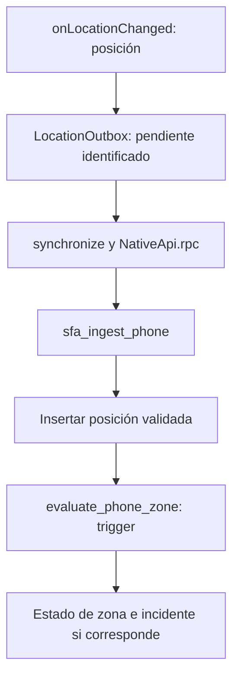

# Código y puntos de nexo

[Índice](README.md) · Anterior: [Stack](GUIA_STACK_TECNOLOGICO.md) · Siguiente: [Exposición](GUIA_EXPOSICION.md)

Esta guía se lee con el repositorio abierto. Elige un recorrido y sigue sus archivos en orden. **El objetivo es reconocer dónde cambia de forma un dato y quién valida la siguiente operación.**

## 1. Del movimiento a la pantalla local

| Paso | Archivo | Función o recurso | Qué entra y qué sale |
| --- | --- | --- | --- |
| 1 | [Sketch](../arduino/SFA_Cinturon_Alerta/SFA_Cinturon_Alerta.ino) | `leerMPU()` | Registros del sensor → magnitud e inclinación |
| 2 | Mismo sketch | `actualizarEstado()`, `confirmarCaida()` | Secuencia temporal → estado y evento |
| 3 | Mismo sketch | `emitirEvento()` | Tipo y detalle → línea `EVT` |
| 4 | [main.py](../servidor_pc/main.py) | `SerialBridge._reader_loop()`, `parse_serial_line()` | Línea serial → objeto Python |
| 5 | Mismo módulo | `save_record()`, `broadcast()` | Objeto → persistencia y WebSocket |
| 6 | [SfaDashboard.tsx](../interfaz_web/src/SfaDashboard.tsx) | Estado y componentes del panel | Datos recibidos → presentación y acciones |

**El nexo es el contrato `TEL/EVT/RSP`, no la apariencia de la pantalla.** Si cambias el orden de campos, debes revisar Python y [BeltProtocol.kt](../android_app/app/src/main/java/org/sfa/asistencia/BeltProtocol.kt).

Para comprobar que lo entendiste: explica por qué una `RSP` no debe dibujarse como una nueva medición. Luego localiza dónde se añade `received_at` y distingue esa hora del contador `device_ms` del Arduino.

## 2. Del registro local a la consulta remota

Lee `save_record()` en [main.py](../servidor_pc/main.py) y continúa en [nube.py](../servidor_pc/nube.py):

1. `capture()` comprueba el tipo de dato y el vínculo habilitado del perfil local.
2. Prepara un paquete en `cloud_outbox` con UUID y datos seleccionados.
3. `flush()` intenta enviar lo pendiente usando la identidad autorizada.
4. [La migración de ingesta PC](../supabase/migrations/202610200002_pc_sync.sql) comprueba el paquete y registra lo permitido.
5. [RemoteMonitor.tsx](../interfaz_web/src/RemoteMonitor.tsx) consulta la información remota.

**Sin vínculo no se debe deducir el destino por el nombre del perfil.** La cola tampoco es un espejo de toda la base SQLite: `capture()` excluye tipos de eventos y limita frecuencia de telemetría.

Pregunta de revisión: si se reinicia la PC, ¿qué persiste y qué debe reanudarse? El vínculo y pendientes están en almacenamiento; el JWT de envío se conserva en memoria. Consulta [sincronización](SINCRONIZACION.md), que describe esa etapa y sus límites.

## 3. Del GPS Android al incidente de geocerca

Lee [TrackingService.kt](../android_app/app/src/main/java/org/sfa/asistencia/TrackingService.kt), [Storage.kt](../android_app/app/src/main/java/org/sfa/asistencia/Storage.kt) y [Network.kt](../android_app/app/src/main/java/org/sfa/asistencia/Network.kt). Después continúa en [ingesta móvil](../supabase/migrations/202610210004_phone_location.sql), [motor persistente](../supabase/migrations/202610210008_persistent_geofence.sql) y [situación de zona](../supabase/migrations/202610210009_zone_situation.sql).

**Una posición guardada no siempre produce un incidente.** El trigger descarta muestras no aptas para una emergencia actual y necesita calidad y permanencia para confirmar. Busca por qué evita duplicar una salida mientras ya existe una pendiente.

La app también usa [GeofenceEngine.kt](../android_app/app/src/main/java/org/sfa/asistencia/GeofenceEngine.kt) para evaluación local. Explica qué ocurre si Android recibe posiciones nuevas pero no puede enviarlas: la evaluación local y el incidente remoto no son el mismo objeto.

## 4. De dos pantallas a una sola atención

| Pieza | Responsabilidad |
| --- | --- |
| [IncidentWorkspace.tsx](../interfaz_web/src/IncidentWorkspace.tsx) | Presentación y recorrido común |
| [IncidentPanel.tsx](../interfaz_web/src/IncidentPanel.tsx) | Adaptador del portal: RPC con sesión verificada |
| [LocalIncidentPanel.tsx](../interfaz_web/src/LocalIncidentPanel.tsx) | Adaptador de PC: rutas locales de FastAPI |
| [CloudSync.remote_incidents](../servidor_pc/nube.py) | Valida el vínculo de la PC y solicita la operación remota |
| [sfa_attend_incident](../supabase/migrations/202610210006_incidents.sql) | Verifica permisos, revisión y titular de la atención |
| [IncidentFeed.kt](../android_app/app/src/main/java/org/sfa/asistencia/IncidentFeed.kt) | Cliente Android del mismo estado compartido |

**Reutilizar una vista no significa saltarse permisos en uno de sus accesos.** El cliente manda `p_event`, `p_expected` y `p_outcome`; la función SQL decide si el cambio es válido.

Ensayo de comprensión: dos cuidadores abren la misma revisión. Uno toma la atención. Explica por qué la siguiente acción del otro no debe sobrescribirla y localiza la comparación de `updated_at`.

La atención remota tampoco es el mismo comando que el cierre del cinturón local. En [main.py](../servidor_pc/main.py), `alert_action()` selecciona `MUTE` o `RESET` y espera `confirm_alert_command()` cuando hay conexión al dispositivo. **Una respuesta física del cinturón y una resolución remota necesitan sus comprobaciones respectivas.**

## 5. Del incidente al teléfono cuidador

1. El evento persistido activa el mecanismo de cola de las [migraciones push](../supabase/migrations/202610210003_push.sql) y [de incidentes](../supabase/migrations/202610210006_incidents.sql).
2. `CloudSync.flush_push()` reclama trabajo mediante `sfa_claim_push_v2`.
3. [FcmSender.send](../servidor_pc/fcm.py) obtiene autorización y envía a HTTP v1.
4. El emisor registra el resultado mediante `sfa_ack_push`.
5. [SfaMessagingService.kt](../android_app/app/src/main/java/org/sfa/asistencia/SfaMessagingService.kt) procesa el aviso; [PushEnvelope.kt](../android_app/app/src/main/java/org/sfa/asistencia/PushEnvelope.kt) interpreta sus datos.
6. El cuidador consulta el incidente antes de actuar.

**El token FCM identifica un destino de envío, no concede autorización para leer una ficha.** El aviso y la consulta autenticada tienen responsabilidades distintas.

Para comprobar este recorrido, distingue una prueba dirigida a un teléfono propio de un SOS real. La [migración de destinos de prueba](../supabase/migrations/202610210010_push_test_targets.sql) y [PushTestSettings.tsx](../interfaz_web/src/PushTestSettings.tsx) delimitan la selección permitida.

## Qué cambiar junto cuando se modifica un contrato

| Si cambias… | Revisa también… |
| --- | --- |
| Campos seriales o estados | Receptores Python y Android, diagnóstico y pruebas de protocolo |
| Parámetros de una RPC | Adaptadores web, NativeApi, puente Python que la use y pruebas SQL |
| Estado de una atención | Presentación web/Android, reglas de conflicto y auditoría |
| Roles o asignaciones | Comprobaciones SQL, políticas de UI y recorridos de revocación |
| Formato push | Emisor, PushEnvelope y presentación de prueba frente a incidente real |

Una prueba útil debe poder fallar si el contrato se rompe. Empieza por los casos de [comprobación](COMPROBACION_Y_DIAGNOSTICO.md) antes de añadir una prueba que solo repita la implementación.
