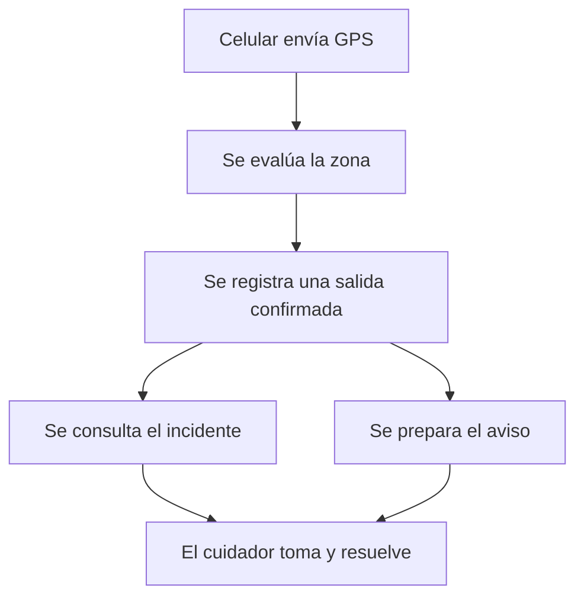

# Guía para explicar SFA

[Índice](README.md) · Anterior: [Código y nexos](GUIA_CODIGO_Y_NEXOS.md) · Siguiente: [Comprobaciones](COMPROBACION_Y_DIAGNOSTICO.md)

La exposición puede sostenerse con una idea: **seguir un dato hasta que una persona pueda actuar sobre él**. El público no necesita conocer todos los archivos para comprender ese recorrido.

## Una apertura posible

“Nuestro proyecto combina un cinturón y un celular para reunir señales de movimiento y ubicación. Esas señales se muestran al cuidador, se registran y pueden originar avisos. La parte importante es que podamos saber qué pasó, a quién corresponde y quién lo está atendiendo.”

Usa esa apertura como base y adáptala a tu forma de hablar. No afirmes que se probó un recorrido que todavía está pendiente.

## Seis ideas para seis tecnologías

| Tecnología | Lo esencial que conviene decir | Función o recurso que lo demuestra |
| --- | --- | --- |
| Arduino | Interpreta el movimiento y conserva el aviso local | `leerMPU()`, `actualizarEstado()`, `emitirEvento()` |
| Python | Recibe el mensaje del cinturón y lo vuelve utilizable por la aplicación | `parse_serial_line()` y `SerialBridge` |
| React y TypeScript | Presentan la información y las acciones; permiten reutilizar vistas | `IncidentWorkspace` y sus adaptadores |
| Kotlin y Android | Aportan GPS, Bluetooth y operación móvil | `TrackingService.synchronize()` |
| Supabase y PostgreSQL | Conservan el estado compartido y validan quién puede actuar | `sfa_ingest_phone`, `sfa_attend_incident` |
| FCM | Transporta un aviso hacia el celular cuidador | `FcmSender.send()` y `SfaMessagingService` |

**La biblioteca es importante por el trabajo que resuelve, no por su nombre.** Por ejemplo: “PySerial nos permite leer el USB” comunica más que recitar una lista de dependencias.

## Dos ejemplos de código son suficientes

Del [firmware](../arduino/SFA_Cinturon_Alerta/SFA_Cinturon_Alerta.ino):

```cpp
emitirEvento("CAIDA_CONFIRMADA", "impacto_postura_inmovilidad");
```

Permite explicar que Arduino produce un evento con un nombre reconocible. A continuación muestra dónde Python interpreta `CAIDA_CONFIRMADA`. No es necesario presentar toda la máquina de estados en una diapositiva.

Del [adaptador web](../interfaz_web/src/IncidentPanel.tsx), extracto con saltos ajustados:

```typescript
const result = await accessDataClient(session.access_token)
  .rpc("sfa_attend_incident", {
    p_event: id, p_expected: expected, p_outcome: outcome
  });
```

Permite explicar el otro extremo: la pantalla solicita una acción sobre un incidente, con una identidad y una revisión. **La decisión final se confirma en el servidor.**

## Un caso completo para el centro de la exposición



Cuenta el caso siguiendo las flechas. Aclara que la salida requiere calidad y permanencia y que el aviso actual se envía desde la PC. Si enseñas una captura ficticia, identifícala antes de describirla.

Después plantea la distinción principal: **registrar el incidente, mostrar la notificación y atenderlo no son el mismo resultado**. Esa idea une la arquitectura con la utilidad para el cuidador.

## Orden sugerido

1. Presentar el problema y a quién ayuda el sistema.
2. Mostrar el mapa y distinguir la ruta del cinturón de la del GPS.
3. Explicar el papel de las seis tecnologías con un ejemplo por capa.
4. Seguir un caso completo y mostrar una captura legible.
5. Cerrar con la evidencia obtenida y la próxima comprobación necesaria.

Para seis minutos, reserva aproximadamente un minuto a cada paso y uno al caso completo. Ensaya con cronómetro: la duración depende del grupo y de cuánto se explique el código.

## Preguntas para ensayar

- Si se apaga la PC, ¿qué continúa y qué deja de funcionar?
- ¿Por qué SQLite y Supabase no contienen exactamente lo mismo?
- ¿Qué impide que un cuidador consulte a cualquier persona?
- ¿Por qué cerrar la atención no garantiza que alguien volvió a su zona?
- ¿Qué prueba una simulación y qué hace falta comprobar con dispositivos reales?

Si una respuesta necesita leer diez nombres de funciones, vuelve al [stack](GUIA_STACK_TECNOLOGICO.md) y busca la responsabilidad que cumplen. Para exponer, esa responsabilidad es el punto de partida.
