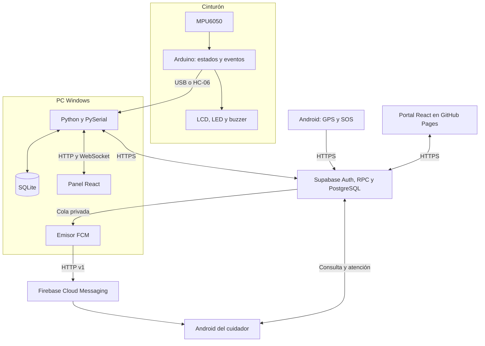
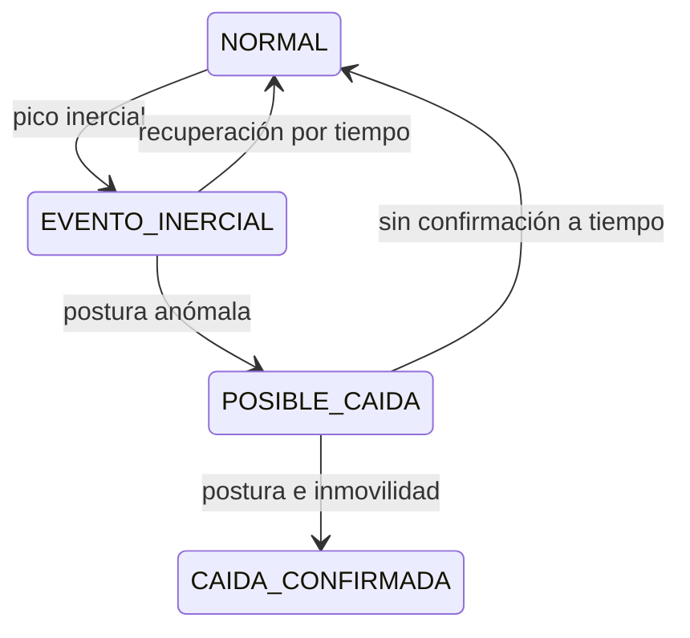
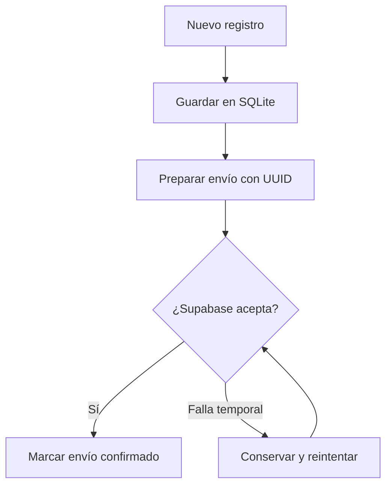
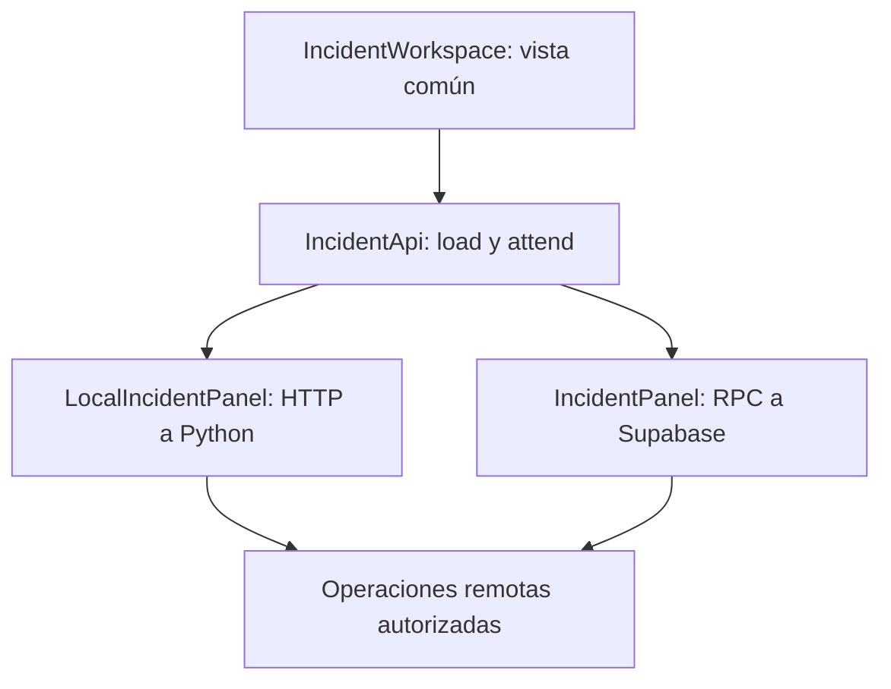
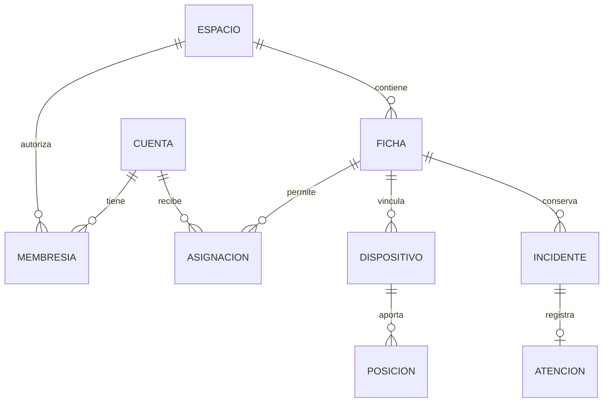
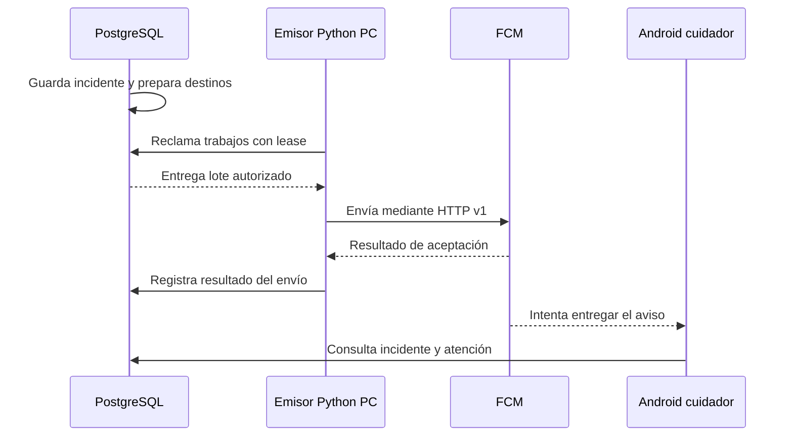

# Guía del stack tecnológico de SFA Asistencia

[Índice](README.md) · Anterior: [Uso remoto](MANUAL_PORTAL_Y_ANDROID.md) · Siguiente: [Código y nexos](GUIA_CODIGO_Y_NEXOS.md)

Esta guía explica cómo colaboran las tecnologías del proyecto. Se puede estudiar por partes: primero el mapa, después un recorrido completo y, por último, los fragmentos de código. Las funciones se eligieron por su importancia en la integración, no para enumerar todo el repositorio.

Referencia de lectura: fuentes de la colección revisadas el 29 de octubre de 2026; Windows rc13.1 y Android 0.7.1. Las versiones exactas de bibliotecas se consultan en los manifiestos y archivos de bloqueo. [Alcance y comprobaciones de esta documentación](ESTADO_DOCUMENTACION.md).

## Contenido

1. [Qué significa stack](#1-qué-significa-stack)
2. [Mapa y dependencias](#2-mapa-y-dependencias)
3. [Lenguajes y herramientas](#3-lenguajes-y-herramientas)
4. [Arduino](#4-arduino-del-movimiento-al-evento)
5. [Python y SQLite](#5-python-y-sqlite-del-puerto-al-panel)
6. [React y TypeScript](#6-react-y-typescript-una-vista-y-dos-adaptadores)
7. [Android](#7-android-ubicación-y-continuidad)
8. [Supabase](#8-supabase-identidad-y-estado-compartido)
9. [FCM](#9-fcm-el-aviso-no-es-el-incidente)
10. [Nexos](#10-los-contratos-que-unen-el-sistema)
11. [Construcción y pruebas](#11-construir-no-es-lo-mismo-que-validar)
12. [Conceptos y lecturas](#12-conceptos-para-volver-a-consultar)

## 1. Qué significa stack

El **stack tecnológico** es el conjunto de lenguajes, bibliotecas, entornos y servicios con los que se construye una aplicación. En SFA importa, además, dónde se ejecuta cada pieza y qué información entrega a la siguiente.

| Concepto | Significado | Ejemplo en SFA |
| --- | --- | --- |
| Lenguaje | Forma de escribir instrucciones | C++, Python, TypeScript, Kotlin y SQL |
| Biblioteca | Código reutilizable para una tarea | PySerial lee un puerto; Leaflet dibuja el mapa |
| Framework | Estructura para organizar una aplicación | FastAPI organiza rutas y validación HTTP |
| Entorno | Lugar o programa que ejecuta el código | Arduino UNO, Python en Windows, navegador y Android |
| IDE | Herramienta de desarrollo | Arduino IDE o Android Studio |
| API | Operaciones por las que se comunican programas | Consultar incidentes o guardar una geocerca |
| SDK | Herramientas de una plataforma para integrarla | Firebase Messaging para Android |

**El programa con el que desarrollamos no siempre es una dependencia del usuario.** Node.js construye la web; el cuidador abre el JavaScript generado en su navegador. Android Studio construye la APK; el teléfono ejecuta la app.

## 2. Mapa y dependencias



Las flechas hacia Supabase representan solicitudes de su API; el navegador **no abre una conexión SQL directa** a PostgreSQL. GitHub Pages sirve archivos del portal: no ejecuta Python ni guarda fichas privadas como archivos del sitio.

| Si falta… | Qué puede continuar | Qué queda limitado |
| --- | --- | --- |
| Enlace USB/Bluetooth | Señalización autónoma del cinturón | Llegada de lecturas nuevas al receptor desconectado |
| PC encendida | GPS Android directo a Supabase y consulta remota, con internet | Puente de cinturón de esa PC y emisor push actual |
| Internet | Funciones locales disponibles y evaluación local que conserve contexto válido | Nuevos envíos y consultas remotas |
| Permiso de notificaciones | Consulta autorizada de incidentes | Presentación del aviso de sistema correspondiente |

**La función de la PC cambia según el recorrido.** No debe anunciarse independencia total de la PC por haber recibido una ubicación remota.

## 3. Lenguajes y herramientas

| Pieza | Se escribe con | Se ejecuta en | Fuente para empezar |
| --- | --- | --- | --- |
| Firmware | C++ con entorno Arduino | ATmega328P del UNO | [Sketch](../arduino/SFA_Cinturon_Alerta/SFA_Cinturon_Alerta.ino) |
| Puente, API y sincronización | Python | PC | [main.py](../servidor_pc/main.py), [nube.py](../servidor_pc/nube.py) |
| Estado local | SQL mediante `sqlite3` | Archivo SQLite de la PC | [Inicialización y registros](../servidor_pc/main.py) |
| Panel y portal | TypeScript, React y CSS | Navegador | [Dependencias web](../interfaz_web/package.json) |
| App móvil | Kotlin y Compose | Android | [Proyecto y dependencias](../android_app/app/build.gradle.kts) |
| Reglas compartidas | SQL y PL/pgSQL | PostgreSQL en Supabase | [Migraciones](../supabase/migrations) |
| Invitaciones | TypeScript y Deno | Edge Function | [Handler de invitación](../supabase/functions/sfa-team-invite/handler.ts) |
| Emisor push actual | Python, HTTP v1 y firma criptográfica | PC de confianza | [fcm.py](../servidor_pc/fcm.py) |

Las dependencias Python están en [requirements.txt](../servidor_pc/requirements.txt); las versiones web resueltas, en [package-lock.json](../interfaz_web/package-lock.json). Son la referencia para reproducir esta copia, no una recomendación de instalar siempre lo más reciente.

## 4. Arduino del movimiento al evento

El firmware hace tres trabajos principales: **leer, interpretar y avisar**. `leerMPU()` obtiene aceleración y giro; `actualizarEstado()` evalúa la secuencia; `confirmarCaida()` activa la alerta y comunica el evento.

| Recurso | Para qué se usa |
| --- | --- |
| `Wire` | Comunicarse por I2C con MPU6050 y LCD |
| `SoftwareSerial` | Puerto serial del HC-06 |
| `LiquidCrystal_I2C` | Mostrar el estado en la pantalla |
| `millis()` | Coordinar intervalos y permanencia sin un reloj UTC propio |

**El MPU6050 se lee mediante registros con `Wire`, sin una biblioteca MPU6050 adicional.** El diagnóstico independiente está en [Test_MPU6050](../arduino/Test_MPU6050/Test_MPU6050.ino). La instalación de bibliotecas y el cableado se explican en [Hardware y protocolo](HARDWARE_Y_PROTOCOLO.md).

Extracto real de `leerMPU()`; antes de normalizar, el sketch limita una magnitud demasiado pequeña:

```cpp
float zNormalizado = constrain(az / accelTotal, -1.0, 1.0);
tiltDeg = acos(zNormalizado) * 57.2958;
```

`constrain` evita entregar a `acos` un valor fuera de su dominio. La inclinación es una estimación a partir de la aceleración; su interpretación depende del montaje y el movimiento. La decisión no se toma por este cálculo aislado.



El diagrama selecciona la secuencia de detección; no muestra todos los comandos ni el silenciamiento. El firmware también implementa `ALERTA_SILENCIADA`. En la revisión leída, los umbrales incluyen 0,55 g, 2,35 g, 55° y 2500 ms de inmovilidad. **Son parámetros del prototipo, no criterios médicos.**

### El mensaje que sale del cinturón

Esquema del contrato, no mediciones de una persona:

```text
TEL,ms,estado,ax,ay,az,g,tilt,mov,caidas
EVT,ms,tipo,detalle
RSP,comando,resultado
```

`TEL` transporta telemetría; `EVT`, un hecho significativo; `RSP`, la respuesta a una orden. Cada línea termina en salto de línea. USB utiliza **115200 baudios** y el HC-06 del montaje, **9600**. El sketch inicia con transmisión habilitada; `STREAM OFF` y `STREAM ON` permiten controlarla.

Una llamada real de `confirmarCaida()`:

```cpp
emitirEvento("CAIDA_CONFIRMADA", "impacto_postura_inmovilidad");
```

El nombre del evento se convierte en el **primer contrato entre lenguajes**: Python y Android deben reconocerlo exactamente.

## 5. Python y SQLite del puerto al panel

[SerialBridge en main.py](../servidor_pc/main.py) abre el puerto con PySerial. Su hilo `_reader_loop()` recibe líneas, `parse_serial_line()` las interpreta y `save_record()` las guarda. Después, `publish_from_thread()` coordina la publicación con el bucle asíncrono de la aplicación y `broadcast()` informa a los navegadores conectados.

| Biblioteca o módulo | Responsabilidad |
| --- | --- |
| PySerial | Leer y escribir el puerto COM |
| FastAPI | Definir rutas HTTP y WebSocket |
| Pydantic | Comprobar cuerpos y tipos de solicitudes |
| Uvicorn | Escuchar conexiones y ejecutar la aplicación FastAPI |
| `sqlite3` | Persistencia local; forma parte de Python |
| `threading` y `asyncio` | Coordinar lectura serial y trabajo web |

Extracto real de la rama `EVT` de `parse_serial_line()`:

```python
if parts[2] == "CAIDA_CONFIRMADA":
    payload["priority"] = "critical"
return payload
```

La línea ya interpretada contiene campos con nombre, como `event_type` y `received_at`. **El tiempo de recepción de la PC no es un reloj UTC medido por Arduino.**

### HTTP y WebSocket tienen trabajos diferentes

HTTP se usa para consultar fichas, guardar ajustes o solicitar acciones. `/ws` mantiene una conexión por la que llegan novedades locales sin recargar la página. **Esto no convierte al portal remoto en un cliente WebSocket del cinturón:** las vistas remotas consultan Supabase.

Una orden enviada no equivale a una orden aceptada. `confirm_alert_command()` espera la respuesta `RSP` correspondiente y comprueba el resultado. Esa confirmación evita anunciar un cierre físico del cinturón solo porque se pulsó un botón.

### SQLite y la bandeja de salida

SQLite guarda datos en archivos de la instalación. `CloudSync.capture()` de [nube.py](../servidor_pc/nube.py) prepara nuevos registros para el vínculo activo y `flush()` intenta enviarlos.



**SQLite local y PostgreSQL remoto no son copias idénticas.** Se sincronizan datos seleccionados, mediante vínculos e identificadores; no se fusionan todas las fotos, notas o fichas. Pausar envíos no borra registros ni revoca por sí solo el dispositivo remoto.

## 6. React y TypeScript una vista y dos adaptadores

React divide la interfaz en componentes. TypeScript ayuda a expresar los datos y operaciones esperadas. Vite prepara los archivos que sirve Python o GitHub Pages; Node.js y npm intervienen en ese trabajo de construcción.

| Pieza | Papel en la aplicación |
| --- | --- |
| [SfaDashboard.tsx](../interfaz_web/src/SfaDashboard.tsx) | Panel de la PC y navegación local |
| [AccessApp.tsx](../interfaz_web/src/AccessApp.tsx) | Acceso remoto y navegación autenticada |
| [IncidentWorkspace.tsx](../interfaz_web/src/IncidentWorkspace.tsx) | Vista compartida de incidentes y atención |
| [RemoteLocation.tsx](../interfaz_web/src/RemoteLocation.tsx) y Leaflet | Mostrar posición, incertidumbre y zona |
| [CloudGeofence.tsx](../interfaz_web/src/CloudGeofence.tsx) | Editor con contrato `ZoneApi` |
| [TeamPanel.tsx](../interfaz_web/src/TeamPanel.tsx) | Cuentas, roles y asignaciones |
| Lucide, Radix Select, CSS y fuentes locales | Iconos, controles y presentación |
| `qrcode` | Generar códigos QR en la interfaz |

### La reutilización se ve en los adaptadores

`IncidentWorkspace` necesita consultar y atender, pero no decide si habla con Python o con Supabase. Esas operaciones llegan mediante `IncidentApi`.



Extracto real de [IncidentPanel.tsx](../interfaz_web/src/IncidentPanel.tsx), con saltos de línea ajustados:

```typescript
const result = await accessDataClient(session.access_token)
  .rpc("sfa_attend_incident", {
    p_event: id, p_expected: expected, p_outcome: outcome
  });
```

`p_event` identifica el incidente; `p_expected`, la revisión que conoce la pantalla; `p_outcome`, la acción solicitada. **La interfaz solicita la atención; el servidor autoriza y confirma el cambio.**

La sesión web usa `sessionStorage` en [accessClient.ts](../interfaz_web/src/accessClient.ts). Conocer una clave publicable o el nombre de una RPC no concede acceso a los datos. Las consultas quedan ligadas a la identidad verificada.

## 7. Android ubicación y continuidad

La app es nativa: **Kotlin con Jetpack Compose, no una WebView del panel**. El Android SDK permite usar GPS, proveedores de red, Bluetooth y servicios. Compose presenta estados; las coroutines ayudan a realizar E/S sin bloquear la interacción. ZXing participa en la lectura del QR.

Los siguientes archivos están en [el paquete Kotlin de SFA](../android_app/app/src/main/java/org/sfa/asistencia).

| Archivo Kotlin | Qué conviene estudiar |
| --- | --- |
| `TrackingService.kt` | `onLocationChanged()` recibe; `synchronize()` entrega pendientes y consulta contexto |
| `Network.kt` | `NativeApi.request()` y `rpc()` realizan HTTPS |
| `CloudGpsSession.kt` | Sesión en memoria y renovación del acceso |
| `Storage.kt` | `LocationOutbox` conserva trabajo local |
| `GeofenceEngine.kt` | Evaluación local de calidad, distancia y permanencia |
| `BeltProtocol.kt` | Interpretación serial recibida por Bluetooth |
| `IncidentFeed.kt` | Consulta y acciones de atención compartida |
| `RolePolicy.kt` | Capacidades visibles por cuenta, espacio y persona |

Extracto real de `TrackingService.synchronize()`, con saltos de línea ajustados:

```kotlin
val result = api.rpc("sfa_ingest_phone", token!!,
    JSONObject().put("p_device", cloud).put("p_id", id)
        .put("p_sample", JSONObject(payload)))
check(result.optString("accepted") == id)
```

La muestra conserva un identificador para sus reintentos. La app comprueba que el servidor reconozca ese identificador antes de marcarla enviada. Las posiciones de más de **90 segundos** se marcan históricas en el recorrido de pendientes y no se reenvían como posición actual. La cola no promete publicar indefinidamente todas las muestras capturadas offline.

El seguimiento usa un servicio en primer plano con notificación persistente. Android consulta contexto y evalúa localmente; PostgreSQL evalúa las muestras recibidas para generar incidentes remotos persistentes. **Son dos responsabilidades, no dos pruebas independientes de que una persona cruzó físicamente una frontera.**

Recibir `EVT` por HC-06 en el teléfono tampoco acredita automáticamente la subida remota completa de ese evento. Ese recorrido debe probarse en su origen y destino. [Comprobaciones](COMPROBACION_Y_DIAGNOSTICO.md).

## 8. Supabase identidad y estado compartido

Supabase proporciona Auth y acceso a PostgreSQL mediante su API. Las reglas de negocio compartidas se escriben en SQL y PL/pgSQL para que PC, portal y Android consulten el mismo estado y obedezcan los mismos permisos.

Este esquema es conceptual; selecciona relaciones del sistema, no sustituye las migraciones:



Una ficha representa a la persona; una cuenta permite entrar; una asignación delimita a quién puede cuidar. **No toda persona cuidada necesita cuenta.** Los nombres reales incluyen `sfa_residents`, `sfa_memberships`, `sfa_devices`, `sfa_positions`, `sfa_events` y `sfa_event_attention`.

### Autenticación y autorización

Auth responde quién inició sesión. Las políticas **RLS** y las comprobaciones SQL delimitan qué filas y comandos puede utilizar. Algunas funciones usan `SECURITY DEFINER` para operaciones controladas: revisan identidad, contexto y permisos explícitos y restringen su ejecución. No es una cláusula para copiar como solución a un error de acceso.

### RPC y reglas que deben ser comunes

| Función o familia | Conecta | Responsabilidad |
| --- | --- | --- |
| `sfa_ingest_pc` | Python → PostgreSQL | Ingesta del puente autorizado |
| `sfa_ingest_phone` | Android → PostgreSQL | Ingesta móvil identificada |
| `sfa_phone_context` | PostgreSQL → Android | Contexto del emisor y zona |
| `sfa_get_geofence`, `sfa_save_geofence` | Web/PC → PostgreSQL | Consultar y guardar zona remota |
| `sfa_incidents` | PostgreSQL → clientes | Consulta de incidentes autorizados |
| `sfa_attend_incident` | Clientes → PostgreSQL | Tomar y resolver con revisión y permisos |
| `sfa_team` y comandos de equipo | Web → PostgreSQL | Membresías, invitaciones y asignaciones |

El motor `sfa_private.evaluate_phone_zone()` se ejecuta mediante trigger al insertar una posición. Usa **haversine**, precisión, margen y permanencia; no requiere PostGIS en esta implementación. Una salida confirmada puede crear `GEOCERCA_SALIDA`. El estado exterior persistente y el trabajo de atención se consultan por separado.

### Resolver una atención no confirma una ubicación

Extracto real de [la migración de incidentes](../supabase/migrations/202610210006_incidents.sql), expandido para lectura:

```sql
if p_expected is distinct from current_attention.updated_at then
  raise exception 'Attention changed' using errcode='40001';
end if;
```

La función rechaza actuar sobre una revisión antigua. Además comprueba quién tomó la atención y registra auditoría. **El evento no desaparece al cerrar el aviso, y el reingreso no resuelve automáticamente el incidente.**

La Edge Function existente `sfa-team-invite` envía invitaciones después del comando autorizado de preparación. Que exista una función en la nube **no significa que ya exista un emisor push cloud**. La clave privilegiada permanece en el backend, nunca en el navegador.

## 9. FCM el aviso no es el incidente

FCM transporta un aviso hacia la instalación Android registrada. La persistencia y atención viven en PostgreSQL; el push ayuda a que alguien las revise.



En [nube.py](../servidor_pc/nube.py), `flush_push()` reclama mediante `sfa_claim_push_v2`, llama a `FcmSender.send()` y confirma con `sfa_ack_push`. El *lease* reserva temporalmente el trabajo para un emisor; no es un comprobante de lectura.

[fcm.py](../servidor_pc/fcm.py) obtiene un token OAuth y usa `cryptography` para firmar la solicitud de autenticación. No utiliza `firebase-admin` como dependencia Python de esta entrega. En Android, `PushRegistration` registra la instalación y `SfaMessagingService` recibe el mensaje.

**Registrado, aceptado por FCM, mostrado en el teléfono y atendido son resultados diferentes.** El portal con página abierta también puede mostrar avisos autorizados del navegador; eso no prueba Web Push con el navegador cerrado.

## 10. Los contratos que unen el sistema

| Contrato | Origen y destino | Error que evita comprenderlo |
| --- | --- | --- |
| Línea `TEL/EVT/RSP` | Firmware → receptores Python/Android | Cambiar campos sin adaptar los lectores |
| JSON HTTP y WebSocket | FastAPI ↔ panel React | Confundir respuesta a una acción con novedad en vivo |
| `IncidentApi` y `ZoneApi` | Adaptadores → componentes React | Duplicar vistas para cada transporte |
| RPC con JWT | Web, PC y Android ↔ Supabase | Suponer que el rol de una pantalla concede permisos |
| UUID estable | Colas → ingesta | Crear duplicados en cada reintento |
| Revisión esperada | Clientes → comando de atención o zona | Sobrescribir el trabajo más reciente de otra persona |
| Trabajo FCM con lease | PostgreSQL ↔ emisor de PC | Confundir un trabajo reservado con una entrega leída |

Una contraseña, un token de sesión, un vínculo GPS local y un token FCM **no son intercambiables**. Cumplen funciones y tienen alcances distintos.

## 11. Construir no es lo mismo que validar

| Herramienta | Produce o comprueba | No demuestra por sí sola |
| --- | --- | --- |
| Arduino IDE/CLI | Firmware compilado | Sensor y salidas físicas correctas |
| TypeScript, Vite y npm | Panel/portal construidos | Flujo completo entre cuentas |
| Vitest y pruebas Python | Lógica y contratos bajo escenarios | GPS o recepción real en Android |
| Pruebas SQL aisladas | Funciones, permisos y conflictos ensayados | Configuración idéntica del proyecto alojado |
| Gradle y lint | APK y comprobaciones Android | Seguimiento con pantalla bloqueada |
| PyInstaller | Ejecutable Windows | Funcionamiento del ZIP completo en otra PC |

Para ejecutar desde fuentes, usa los [comandos de desarrollo](DESARROLLO.md). Para validar el sentido del recorrido, utiliza [Comprobación y diagnóstico](COMPROBACION_Y_DIAGNOSTICO.md).

No se implementa en esta revisión un detector anticaídas basado únicamente en los sensores del celular ni un medidor físico de batería del cinturón. No deben explicarse como funciones activas.

## 12. Conceptos para volver a consultar

| Palabra | Idea concreta |
| --- | --- |
| Telemetría | Mediciones de estado; no toda lectura es una emergencia |
| Incidente | Hecho persistente que requiere revisión |
| Atención | Acción humana registrada sobre un incidente |
| Geocerca | Zona de referencia con reglas de evaluación |
| Histéresis | Margen que evita alternar continuamente junto al límite |
| Permanencia | Tiempo y muestras exigidos antes de confirmar un cambio |
| Idempotencia | Repetir el mismo envío no crea otro registro del mismo hecho |
| Outbox | Bandeja durable de trabajo pendiente |
| Polling | Consultar periódicamente; es el mecanismo de estas vistas remotas |
| Realtime | Capacidad de otra forma de recibir cambios; no se presume utilizada por tener Supabase |

Lecturas para profundizar: [WebSockets en FastAPI](https://fastapi.tiangolo.com/advanced/websockets/), [RLS en Supabase](https://supabase.com/docs/guides/database/postgres/row-level-security) y [envío FCM HTTP v1](https://firebase.google.com/docs/cloud-messaging/send/v1-api). Las fuentes locales enlazadas arriba determinan qué está usando SFA.
