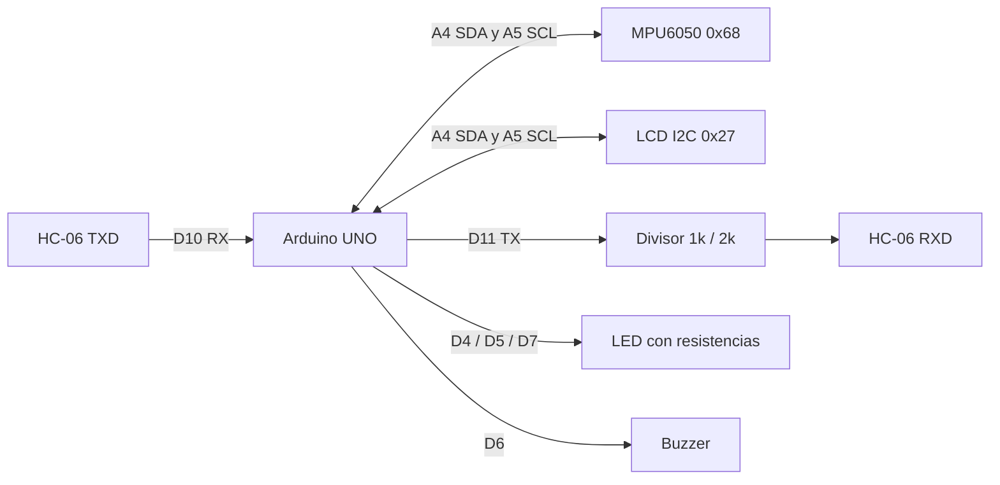

# Hardware y Protocolo

## Firmware

- Principal: `arduino/SFA_Cinturon_Alerta/SFA_Cinturon_Alerta.ino`.
- Diagnóstico: `arduino/Test_MPU6050/Test_MPU6050.ino`.

Abre el sketch correspondiente en Arduino IDE, selecciona Arduino Uno y el
puerto de tu placa. El principal usa `Wire`, `SoftwareSerial` y
`LiquidCrystal_I2C`. Las dos primeras forman parte del core AVR de Arduino;
instala una biblioteca `LiquidCrystal_I2C` compatible con el constructor
`LiquidCrystal_I2C(direccion, 16, 2)` y las llamadas `init()` y `backlight()`.
La compilación comprobada utiliza `LiquidCrystal I2C` 1.1.2 y
`Arduino AVR Boards` 1.8.8. Otras bibliotecas con el mismo nombre de cabecera
pueden tener una API diferente.
El MPU6050 se consulta por I2C desde el sketch, sin biblioteca MPU externa.

La prueba independiente sirve para revisar el sensor por Monitor Serie a 115200.
Después vuelve a cargar el firmware principal para utilizar el panel: los mensajes
de diagnóstico no sustituyen su protocolo de telemetría.

## Cableado del Firmware Actual

| Módulo | Señal | Arduino UNO |
| --- | --- | --- |
| MPU6050 | SDA / SCL | A4 / A5 |
| MPU6050 | GND | GND |
| MPU6050 | VCC | Según el breakout; no asumir tolerancia de un chip sin regulador |
| LCD I2C | SDA / SCL | A4 / A5 |
| LCD I2C | VCC / GND | 5 V / GND |
| HC-06 | TXD | D10, recepción del Arduino |
| HC-06 | RXD | D11 mediante adaptación de nivel |
| HC-06 | VCC / GND | Según módulo; breakout habitual 5 V / GND común |
| LED verde | Ánodo | D4 con resistencia |
| LED amarillo | Ánodo | D5 con resistencia |
| Buzzer | Señal | D6 |
| LED rojo | Ánodo | D7 con resistencia |

Los cátodos de los LED van a GND. El RXD del HC-06 no debe recibir 5 V directos:
el divisor propuesto utiliza 1 kOhm desde D11 al nodo RXD y 2 kOhm del nodo a GND.
Comparte GND y comprueba el módulo real antes de alimentar.
Direcciones del sketch: MPU6050 `0x68`, LCD `0x27`.



## Mensajes

Cada mensaje termina en salto de línea. USB utiliza 115200 baudios; HC-06, 9600.

```text
BOOT,SFA,1.0
TEL,ms,estado,ax,ay,az,g,tilt,mov,caidas
EVT,ms,tipo,detalle
RSP,comando,resultado
```

`TEL` comunica milisegundos desde el arranque, estado, aceleraciones, magnitud,
inclinación, movimiento y contador de caídas. `EVT` identifica eventos y `RSP`
responde a comandos. Los valores concretos se obtienen del dispositivo.

Comandos del firmware:

```text
PING
STATUS
STREAM ON
STREAM OFF
CAL
MUTE
RESET
TEST FALL
```

`TEST FALL` es una prueba del flujo de alerta, no una caída física. No realizar
pruebas haciendo caer a una persona. El algoritmo usa aceleración, inclinación e
inmovilidad y requiere validación de banco; no equivale a detección médica certificada.
