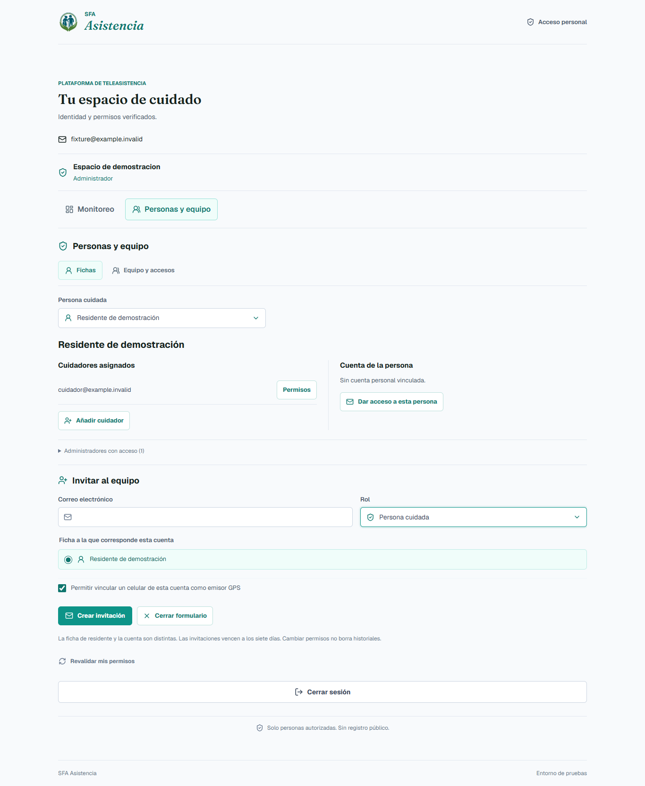
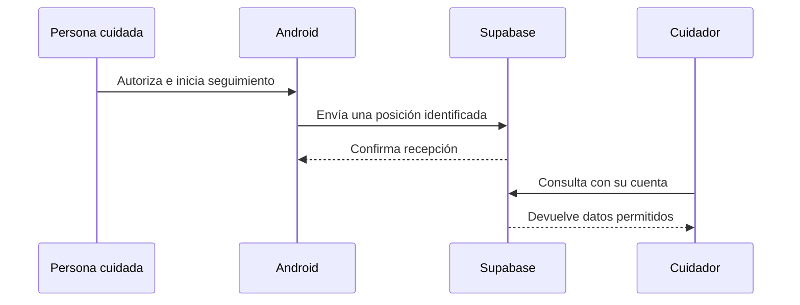

# Portal y Android

[Índice](README.md) · Anterior: [Windows](MANUAL_USO_PC.md) · Siguiente: [Stack tecnológico](GUIA_STACK_TECNOLOGICO.md)

Aquí se prepara el recorrido **celular de la persona cuidada → datos compartidos → cuidador**. Primero identifica el rol de cada cuenta. La misma APK puede ofrecer controles diferentes según sus permisos.

## 1. Qué necesita cada persona

| Uso | Preparación | Acceso habitual |
| --- | --- | --- |
| Administrar | Cuenta administradora de su espacio | Portal o acceso integrado de la PC |
| Compartir GPS y SOS | Cuenta vinculada a la persona, permiso de emisión y consentimiento | Android → Compartir |
| Cuidar | Cuenta cuidadora con personas asignadas | Portal o Android → Cuidar |
| Recibir push | Lo anterior, más instalación registrada y permiso de notificaciones | Android → Alertas en este celular |

**Poder compartir ubicación no concede administración. Tener cuenta tampoco concede acceso a todas las personas.** [Roles y límites del puesto local](ROLES_DEMOSTRACION.md).

## 2. Entrar al portal

Abre el [portal HTTPS de SFA](https://hfreedo.github.io/SFA-Asistencia-Anticaidas/acceso.html). Si te invitaron, acepta el acceso y establece tu contraseña mediante el recorrido recibido. No existe un registro público para convertirse en administrador.

*Figura 1. Portal ejecutado con respuestas de demostración. Sirve para ubicar fichas y cuentas; no muestra una sesión real ni prueba un envío de invitación.*

Consulta solo las personas que tienes autorizadas. El administrador revisa fichas y asignaciones en **Personas y equipo**. Si no aparece alguien, verifica la asignación y el espacio antes de crear otra ficha.

El portal permite cuidar desde otra red. **No abre ni administra directamente el puerto USB de la PC**. GitHub Pages entrega la interfaz; las consultas y acciones se realizan en Supabase.

## 3. Instalar Android

Descarga la **APK firmada** desde [Releases](https://github.com/hfreedo/SFA-Asistencia-Anticaidas/releases). La referencia de esta guía es Android 0.7.1, para Android 12 o posterior.

Actualiza sin desinstalar cuando la firma sea compatible. Si vienes de una APK debug, revisa primero la [guía de firma y migración](ANDROID_RELEASE.md). Desinstalar o borrar datos puede eliminar vínculos y Recuerdos del dispositivo.

Las instrucciones siguientes se contrastaron con las pantallas y políticas declaradas en el código. **No se incluyen capturas Android inventadas**: la colección no dispone todavía de una captura nativa verificada de esta revisión. La prueba en el celular se registra separadamente del navegador.

## 4. Compartir ubicación por internet

1. Inicia sesión en la app con la cuenta autorizada para emitir.
2. Abre **Compartir**, elige **Por internet** y confirma la persona correspondiente.
3. Completa el vínculo y acepta compartir ubicación.
4. Inicia el seguimiento y concede los permisos solicitados. Mantén la ubicación precisa cuando el dispositivo la ofrezca.
5. Comprueba la notificación persistente de seguimiento y la hora del último envío.
6. Desde el portal o la PC vinculada, verifica **esa misma persona**, la fecha de posición y la precisión.

**No hace falta hotspot ni compartir Wi-Fi para esta ruta.** La modalidad local con QR es diferente y tiene sus propios certificados y condiciones. No uses el QR local como contraseña de Supabase.

Si dice que Supabase recibió la posición, comprueba después su consulta en el destino. Una solicitud enviada, un dato aceptado y un dato visible son puntos de control distintos.

## 5. Configurar y entender la geocerca

Desde el portal o **Ubicación → Por internet** en la PC, consulta la persona y abre el editor. Puedes usar su posición recibida como centro o elegirlo en el mapa. Ajusta el nombre y el radio y guarda.

**La zona remota no es la zona local de SQLite.** Cambiar una no copia automáticamente la otra. Si otro operador guardó antes, recarga la revisión y vuelve a comprobarla.

La app consulta el contexto mientras sigue activa; no esperes que dibujar el círculo cambie instantáneamente lo que recibió el teléfono. Comprueba el estado después de una nueva lectura útil.

| Estado | Cómo leerlo |
| --- | --- |
| Dentro o fuera confirmado | Se cumplieron los controles del algoritmo para la revisión evaluada |
| Confirmando | Aún falta permanencia o muestras suficientes |
| Incierto o GPS impreciso | La calidad no permite afirmar un cruce fiable |
| Posición desactualizada | No hay dato suficientemente reciente para afirmar la situación actual |

Un radio permitido de **5 m no garantiza una precisión de 5 m**. El algoritmo utiliza precisión, margen y permanencia. No reduzcas esas comprobaciones para provocar una salida en la demostración. [Prueba de geocerca](PRUEBA_GEOCERCA_INTERNET.md).

## 6. Preparar al cuidador

En Android abre **Cuidar → Alertas en este celular → Activar o actualizar avisos**, con la cuenta cuidadora. Concede permiso de notificaciones cuando corresponda y verifica el registro.

La PC debe tener el emisor FCM configurado y la sincronización reanudada. La credencial privada se configura en el puesto autorizado; **no se comparte por correo, QR ni capturas**.

Para ensayar, utiliza la prueba dirigida al celular registrado o **Probar SOS con mis cuidadores** cuando esté disponible y los destinatarios hayan aceptado pruebas. Una cuenta residente no obtiene los controles de laboratorio del cuidador.

## 7. Consultar y atender

Revisa la persona, el tipo de incidente y si está marcado como prueba. Toma la atención antes de registrar el resultado. Los cambios se consultan desde la misma base compartida.

**Descartar la notificación no resuelve el incidente.** Abre la app o el portal para comprobar el estado. Si no hay conexión, conserva el último dato como referencia y espera una consulta confirmada antes de anunciar una resolución.

## 8. Detener y conservar

Detén el seguimiento desde su control o notificación persistente. Comprueba que haya cambiado de estado. Cerrar una pantalla no siempre detiene un servicio Android.

**Recuerdos pertenece al celular y no se sincroniza con los cuidadores.** Cerrar sesión no borra el álbum; desinstalar sí puede hacerlo. [Manual de Recuerdos](RECUERDOS_ANDROID.md).

Para la demostración completa, continúa en [Comprobación y diagnóstico](COMPROBACION_Y_DIAGNOSTICO.md).
