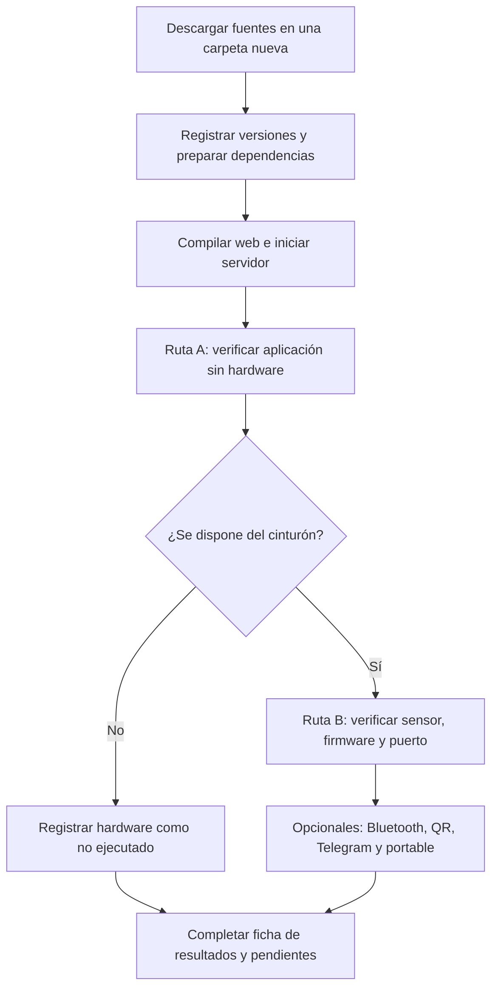

# Manual de Reproducción y Verificación

## 1. Propósito y Alcance

Este manual permite instalar las fuentes en una carpeta independiente, ejecutar
la aplicación y comprobar cada parte con resultados observables. Está dirigido
a estudiantes, docentes y lectores que necesiten reproducir el prototipo como
anexo técnico de un trabajo académico.

No promete compatibilidad con cualquier PC ni demuestra eficacia clínica.
La ruta documentada es Windows x64, Python 3.13 y Node.js 24. Las comprobaciones
locales ya realizadas están en [Validación de fuentes](VALIDACION_FUENTES.md).
La reproducción por un tercero y las pruebas físicas se deben registrar por separado.

Hay dos recorridos:

- **A. Sin hardware:** instalación, web, API, perfiles y alerta simulada.
- **B. Con hardware:** lo anterior más cableado, firmware, sensor y enlace serial.



## 2. Preparar una Reproducción Independiente

No trabajar sobre la carpeta que contiene los perfiles reales. Elegir una
carpeta nueva con permiso de escritura. No copiar `.venv313`, `node_modules`,
`data` ni bases SQLite del equipo original. No se necesitan permisos de
administrador para la instalación normal de paquetes del proyecto.

Desde PowerShell, en la carpeta elegida:

```powershell
git clone https://github.com/hfreedo/SFA-Asistencia-Anticaidas.git
cd SFA-Asistencia-Anticaidas
git rev-parse HEAD
git status --short
py -3.13 --version
node --version
npm --version
```

**Esperado:** se muestra el identificador completo del commit, Git no informa
cambios y las herramientas responden. Registrar las salidas en la
[ficha de reproducción](REGISTRO_REPRODUCCION.md). Si se descarga un ZIP de fuentes,
registrar el commit de origen y su SHA-256; no confundir ese ZIP con el portable.
Para repetir una revisión conocida en una copia de práctica, usar
`git checkout IDENTIFICADOR_DEL_COMMIT`, sustituyendo el identificador registrado.

| Recurso | Necesidad | Referencia de esta implementación |
| --- | --- | --- |
| Windows x64 | BAT y portable | Pruebas locales anteriores en Windows 11; otra PC pendiente |
| Python | Servidor | Rama 3.13; anotar revisión exacta |
| Node.js y npm | Construir interfaz | Rama Node 24; anotar versiones exactas |
| Git | Descargar y registrar revisión | GitHub Desktop es alternativa gráfica |
| Navegador | Utilizar panel | Registrar nombre y versión |
| Arduino IDE o CLI | Solo ruta B | UNO, Arduino AVR Boards 1.8.8 |
| Biblioteca LCD | Firmware principal | LiquidCrystal I2C 1.1.2, cabecera `LiquidCrystal_I2C.h` |
| Internet | Primera instalación, calles del mapa y Telegram | El panel local no requiere nube |

Un editor como VS Code facilita la edición, pero no es obligatorio para ejecutar
las fuentes. Arduino CLI es opcional si se compila y carga desde Arduino IDE.
Las versiones son referencias comprobadas, no una promesa de que todas las
versiones alternativas sean compatibles.

## 3. Instalar Dependencias del Backend

Desde la raíz del repositorio:

```powershell
py -3.13 -m venv .venv313
.\.venv313\Scripts\python.exe -m pip install -r .\servidor_pc\requirements.txt
.\.venv313\Scripts\python.exe -m pip check
.\.venv313\Scripts\python.exe -c "import sys; print(sys.executable)"
```

**Esperado:** instalación sin errores, `pip check` sin incompatibilidades y una
ruta de intérprete que termina en la `.venv313` de esta copia. No utilizar un
`pip` global ni trasladar un entorno virtual creado en otra computadora.

El archivo de requisitos fija dependencias principales, pero no todas las
transitivas. Para registrar lo realmente instalado, conservar la salida de:

```powershell
.\.venv313\Scripts\python.exe -m pip freeze
```

## 4. Instalar y Compilar la Web

```powershell
cd interfaz_web
npm ci
npm run build
Test-Path .\static\index.html
cd ..
```

**Esperado:** instalación y compilación terminan correctamente; `Test-Path`
devuelve `True`. Conservar `package-lock.json` y usar `npm ci` para reproducir sus
dependencias. La advertencia de bundle mayor a 500 kB no equivale a un error de
compilación. No se requiere XAMPP ni un servidor MySQL.

## 5. Iniciar y Comprobar HTTP

En una terminal, desde la raíz:

```powershell
.\.venv313\Scripts\python.exe -m uvicorn servidor_pc.main:app --host 127.0.0.1 --port 8780
```

Dejar esa terminal abierta y abrir `http://127.0.0.1:8780` en el navegador.
En otra terminal se puede verificar:

```powershell
(Invoke-WebRequest http://127.0.0.1:8780/).StatusCode
Invoke-RestMethod http://127.0.0.1:8780/api/status
Invoke-RestMethod http://127.0.0.1:8780/api/ports
Invoke-RestMethod http://127.0.0.1:8780/api/residents
```

**Esperado:** HTTP 200 para la página y respuestas JSON de la API. En una copia
que nunca se inició, no hay residentes precargados. Sin dispositivo, el estado
no debe afirmar conexión al cinturón. Un puerto Bluetooth del sistema puede
aparecer aunque el wearable no esté conectado: listar un COM no prueba recepción.

Si 8780 está ocupado, no terminar procesos desconocidos. Detener la instancia
propia o usar otro puerto para la prueba local y ajustar las URL. El BAT LAN
está preparado para 8780; no asumir que cambia al variar este comando.

## 6. Ruta A: Verificar sin Hardware

Realizar las pruebas con datos ficticios y Telegram sin configurar.

### A1. Perfil y Persistencia

1. Abrir Ajustes > Residentes y añadir un perfil llamado `Residente de prueba`.
2. Completar campos ficticios y no utilizar teléfonos de personas reales.
3. Vincularlo si no queda activo y editar un dato de la ficha.
4. Guardar: verificar el toast, la ficha, el selector y el panel principal.
5. Detener el servidor con `Ctrl+C`, iniciarlo de nuevo y revisar el dato.

**Esperado:** las vistas reflejan la edición guardada y el perfil persiste al
reiniciar. La base de esta copia se crea en `servidor_pc/sfa_eventos.sqlite3`.
Si se añade foto, usar una ilustración propia o con permiso, no un retrato privado.

### A2. Flujo de Alerta Simulada

1. Con el panel abierto, usar `Probar alerta de caída`.
2. Verificar pantalla de emergencia y cronómetro; observar que avanza, no solo
   que aparece un número.
3. Pulsar `Confirmar atención` y revisar el registro de eventos.

Si se necesita activar la simulación desde terminal, con el navegador abierto:

```powershell
Invoke-RestMethod -Method Post http://127.0.0.1:8780/api/simulate/fall
Invoke-RestMethod 'http://127.0.0.1:8780/api/records?limit=10'
```

**Esperado:** evento `CAIDA_CONFIRMADA` con detalle `simulacion_interfaz`; la
confirmación registra `ALERTA_ATENDIDA`. Guardar captura del cronómetro y evidencia
del registro. Esta prueba incluye servidor, canal de actualización y pantalla;
no utiliza el MPU6050 y no prueba el algoritmo físico ni el buzzer del cinturón.

### A3. Exportación de Configuración

En Ajustes > Copias, exportar la configuración. Comprobar que el archivo identifica
el formato `sfa-configuration` y contiene el perfil de prueba. No debe exportar
el token de Telegram ni el historial de eventos.

La importación reemplaza perfiles/configuración: ensayarla únicamente en una copia
de práctica después de respaldar. Exportar JSON no equivale a respaldar toda la
base. No publicar la exportación si contiene fotografías o información personal.

## 7. Ruta B: Incorporar el Cinturón

### B1. Revisar y Preparar Hardware

Seguir [Hardware y protocolo](HARDWARE_Y_PROTOCOLO.md). Con alimentación
desconectada, revisar GND común, SDA/SCL A4/A5, resistencias de LED y adaptación
del RXD del HC-06. Confirmar voltajes del breakout real, dirección I2C del LCD
y polaridad antes de energizar. No sustituir esta revisión por el diagrama lógico.

**Registro obligatorio:** módulos y modelos, resistencias utilizadas, alimentación,
foto o esquema de la conexión real y cambios frente al pinout publicado.
El esquema eléctrico completo del montaje y su validación siguen siendo evidencia
que debe aportar quien reproduce el hardware.

### B2. Diagnosticar MPU6050

En Arduino IDE, seleccionar Arduino Uno y el puerto real. Cargar
`arduino/Test_MPU6050/Test_MPU6050.ino`; abrir Monitor Serie a 115200.

**Esperado:** `OK: MPU6050 detectado y configurado.` seguido de lecturas. En reposo,
la magnitud total debe ser aproximadamente 1 g, con variaciones propias del
sensor. Eso es una comprobación orientativa, no una calibración certificada.
`ERROR: MPU6050 no detectado en 0x68.` requiere revisar conexiones y dirección.

No continuar con el panel hasta resolver errores I2C. Este sketch es de
diagnóstico; su salida no es el protocolo del firmware principal.

### B3. Cargar el Firmware Principal

Preparar el core y la biblioteca indicados en la tabla de requisitos. Abrir y
cargar `arduino/SFA_Cinturon_Alerta/SFA_Cinturon_Alerta.ino`.
Con Monitor Serie a 115200 y terminación de línea, comprobar mensajes de arranque
`BOOT,SFA,1.0` y líneas `TEL,...`. Se pueden enviar `PING`, `STATUS` y `STREAM ON`.

**Esperado:** respuestas `RSP` y telemetría legible. El HC-06 trabaja a 9600;
no confundir el baudrate USB con el del módulo.

Si se utiliza Arduino CLI, la compilación sin carga puede comprobarse desde la raíz:

```powershell
arduino-cli compile --fqbn arduino:avr:uno arduino/Test_MPU6050
arduino-cli compile --fqbn arduino:avr:uno arduino/SFA_Cinturon_Alerta
```

Estos comandos no instalan bibliotecas, no cargan la placa y no prueban el sensor.

### B4. Verificar USB y Panel

1. Cerrar Monitor Serie y cualquier otro programa que ocupe el COM.
2. Iniciar el servidor y abrir Ajustes > Dispositivo.
3. Seleccionar el puerto real y 115200; conectar y esperar el reinicio del UNO.
4. Sin una persona usando el dispositivo, moverlo suavemente y observar cambios.
5. Desconectar USB y verificar que no se sigan presentando lecturas como actuales.

**Esperado:** conexión y lecturas recientes identificables; al perder comunicación
debe reconocerse la falta de señal. Conservar evidencia antes/después. Un botón
`Conectado` por sí solo no demuestra que el sensor esté enviando datos válidos.

### B5. Probar el Canal de Alerta del Firmware

Con el panel conectado por USB, desde otra terminal de la misma PC:

```powershell
Invoke-RestMethod -Method Post http://127.0.0.1:8780/api/command -ContentType 'application/json' -Body '{"command":"TEST FALL"}'
```

**Esperado:** evento de alerta recibido por la PC. Observar y registrar por
separado LED, LCD, buzzer, pantalla y persistencia. Una respuesta HTTP de comando
enviado no confirma por sí sola que el hardware haya actuado.

`TEST FALL` fuerza el flujo del firmware: no valida los umbrales ni una caída
real. Confirmar atención en la web registra una acción del operador; no asumir
que eso reinicia el estado del Arduino. Para terminar el ensayo, enviar `MUTE`
o `RESET` según corresponda y comprobar el estado resultante.
Nunca provocar una caída en una persona ni golpear el dispositivo para demostrarlo.

## 8. Pruebas Opcionales

| Prueba | Procedimiento | Resultado que se debe comprobar |
| --- | --- | --- |
| HC-06 | Emparejar en Windows, obtener COM serial, liberar USB si procede y conectar el COM del módulo a 9600 | Telemetría real por Bluetooth; no basta emparejar |
| QR/red local | Detener modo local, ejecutar `iniciar_acceso_movil.bat`, compartir red, seleccionar interfaz y escanear QR | Panel accesible desde el teléfono, no solo QR visible en PC |
| Geocerca | Cambiar centro/radio, guardar y recargar | Configuración conservada; no demuestra posición GPS del residente |
| Telegram | Configurar bot/chat en la copia de práctica y usar la prueba disponible | Mensaje recibido en el celular y hora registrada, sin exponer token |
| EXE | Seguir el empaquetado de Desarrollo y ejecutar desde otra carpeta | Inicio, web y escritura de datos locales correctos |

El panel LAN no tiene autenticación. Utilizar una red de confianza, sin exponer
el puerto del router ni desactivar el firewall completo. Si Internet está
deshabilitado, no esperar calles nuevas del mapa ni entrega de Telegram.

## 9. Pruebas Automáticas y Criterio de Cierre

```powershell
.\.venv313\Scripts\python.exe -m unittest discover -s tests -v
```

**Esperado para el estado actual:** dos pruebas de red correctas. No representan
cobertura de todos los módulos. Registrar resultado y revisión del código.

Se puede declarar **reproducción de la aplicación sin hardware** cuando se
completan instalación, build, HTTP, perfil persistido y alerta simulada. Para
declarar **integración con el cinturón**, añadir diagnóstico MPU, telemetría real
y prueba del canal de alerta, con evidencia de cada salida observada.

La **validación del detector de caídas** es otro trabajo: requiere protocolo
seguro, criterios definidos, casos positivos/negativos, repeticiones y análisis
de errores. No se obtiene por completar este manual.

## 10. Diagnóstico de Fallos

| Síntoma | Revisar primero | Acción segura |
| --- | --- | --- |
| `py` o Python 3.13 no disponible | Instalación y lanzador Python | Preparar Python 3.13; no reutilizar un venv ajeno |
| PowerShell bloquea `npm.ps1` | Restricción de ejecución | Utilizar `npm.cmd ci` y `npm.cmd run build`; no desactivar políticas globales |
| `npm ci` falla | Versión de Node, conexión y mensaje exacto | Conservar lockfile y registrar error; no borrarlo para ocultar el problema |
| Paquetes Python ausentes | Intérprete usado | Ejecutar pip con `.venv313\Scripts\python.exe` |
| Carpeta `static` inexistente | Se omitió build | Completar el paso 4 antes de iniciar Python |
| Puerto 8780 ocupado | Instancia previa | Detener solo la instancia identificada o cambiar puerto en la prueba manual |
| COM ausente o acceso denegado | Cable de datos, driver y Monitor Serie | Identificar placa real; instalar driver correcto solo si hace falta |
| Conexión sin telemetría | Firmware, baudrate, I2C y stream | Cargar principal, revisar sensor y `STREAM ON` |
| Celular no abre QR | LAN activo, red seleccionada y aislamiento | Revisar permiso de red privada; no abrir acceso público |
| Telegram falla | Internet, token/chat y respuesta | Revisar en privado; nunca pegar tokens en capturas o issues |
| Perfil desaparece | Copia/EXE utilizado y ruta de base | Identificar base correcta; no sobrescribirla con otra vacía |

## 11. Evidencia y Uso Académico

Completar [Registro de reproducción](REGISTRO_REPRODUCCION.md) con identificadores
de prueba, entorno, procedimiento, esperado, observado y evidencia. Marcar
`No ejecutada` cuando falte hardware o permiso; no reemplazarlo por `Aprobada`.
No inventar resultados, latencias, porcentajes de acierto ni capturas.

Este manual puede servir como anexo de reproducción. La tesis debe describir
además problema, antecedentes, decisiones de diseño, metodología, resultados y
conclusiones, y referenciar el commit estudiado. Una URL a `main` sin revisión
no identifica de forma estable el software evaluado.

Guardar evidencias con datos ficticios. Si se generan bases, exportaciones o
logs de práctica, mantenerlos fuera de lo publicado, por ejemplo dentro de
`copias_privadas/`, que está excluida por Git. Para una copia completa, detener el
servidor antes de respaldar la base; exportar JSON no incluye todo el historial.
