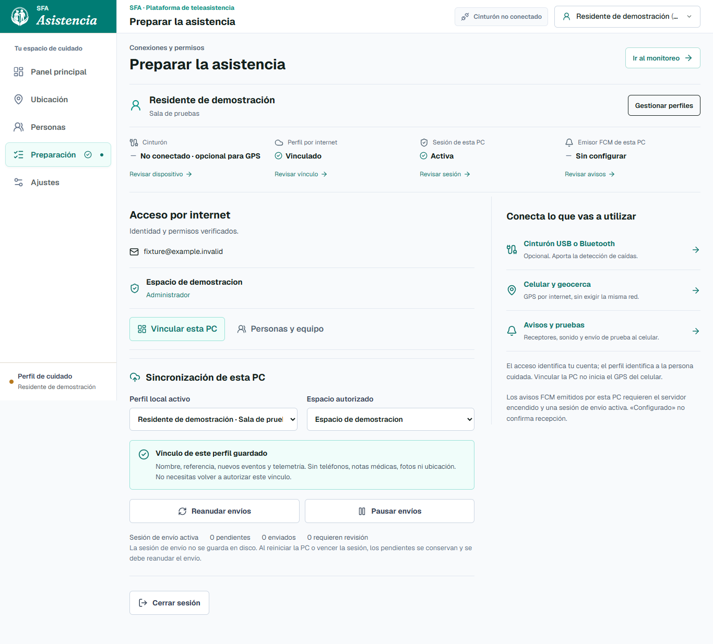
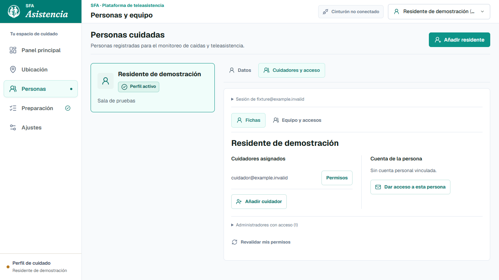
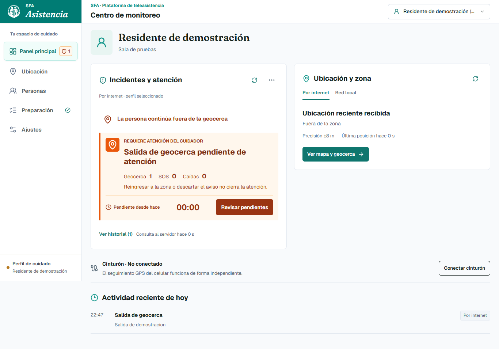
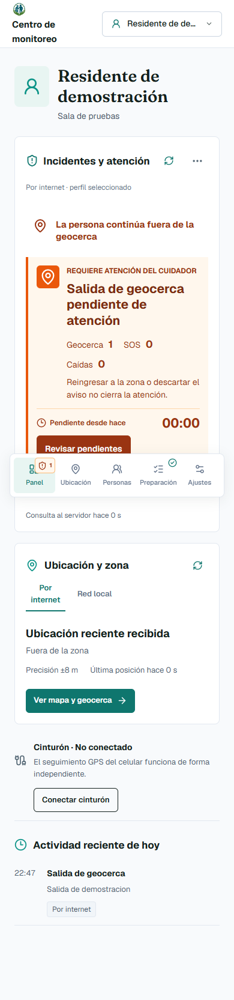

# Manual de uso en Windows

[Índice de manuales](README.md) · Siguiente: [Portal y Android](MANUAL_PORTAL_Y_ANDROID.md)

Este recorrido prepara una PC de demostración y permite comprobar qué información llega de cada fuente. No requiere programar. Si necesitas construir el sistema desde las fuentes, sigue el [manual de reproducción](MANUAL_REPRODUCCION.md).

## 1. Abrir la entrega correcta

1. Descarga el **ZIP de Windows** desde [Releases](https://github.com/hfreedo/SFA-Asistencia-Anticaidas/releases). *Code → Download ZIP* descarga fuentes, no el portable listo para usar.
2. Extrae el ZIP completo en una carpeta propia. Abre `SFA_Asistencia.exe` desde allí.
3. En el Centro elige **Preparar sistema** para la primera configuración; después usarás **Abrir SFA**.

**Conserva la carpeta `data/` al actualizar.** Allí se guardan datos de esa instalación. Cierra el Centro antes de sustituir el ejecutable y conserva también sus configuraciones y certificados propios. No mezcles datos de dos instalaciones por coincidencia de nombre. [Actualización y entrega](../ABRIR_AQUI.md).

La PC desbloqueada es un **puesto de operador de confianza**. El panel local no identifica por separado a todas las personas que usan la misma sesión de Windows. Desde otra computadora se utiliza el portal con cuenta propia, no la IP del panel completo.

## 2. Preparar a quién se va a cuidar

Selecciona la ficha de la persona en el panel. Si no existe, entra en **Personas** y crea sus datos. Luego vuelve a **Preparación**.

*Figura 1. Pantalla ejecutada con datos ficticios. El vínculo guardado y la sesión de envío son estados diferentes.*

Para el uso por internet:

1. Inicia sesión en **Acceso por internet**, dentro de Preparación.
2. Un administrador revisa la ficha y el espacio remoto y autoriza su vinculación cuando corresponda.
3. Si el vínculo ya existe, usa **Reanudar envíos**. No hace falta volver a crear la ficha.
4. Comprueba el estado antes de volver al panel.

**Vincular la ficha no inicia el GPS del celular.** El teléfono debe compartir para la misma persona. Una ficha local y una cuenta no son lo mismo: la primera representa a la persona cuidada; la segunda permite entrar al sistema.

## 3. Asignar cuidadores y accesos

En **Personas → abrir ficha → Cuidadores y acceso**, el administrador puede consultar las asignaciones o invitar una cuenta. Un cuidador puede tener varias personas asignadas; una cuenta de persona cuidada representa su propia ficha.

*Figura 2. La selección es un borrador hasta guardar. Las cuentas de la captura pertenecen al entorno ficticio de prueba.*

Revisa **a qué persona se aplica la asignación** y qué permisos se conceden. Si vas a modificar permisos distintos entre varias fichas, lee la confirmación antes de aceptar. No uses el correo ni el nombre para deducir automáticamente una identidad remota.

Resultado esperado: la cuenta aparece asociada a las fichas seleccionadas y conserva las otras asignaciones que no se hayan quitado. [Recorrido completo de personas y equipo](PERSONAS_Y_EQUIPO.md).

## 4. Elegir la fuente de datos

| Para observar… | Preparación | Qué comprobar |
| --- | --- | --- |
| Movimiento del cinturón | Ajustes → Dispositivo; USB o HC-06 emparejado | Puerto conectado **y telemetría nueva**, no solo una luz encendida |
| GPS por internet | Android compartiendo, sesión de PC activa y ficha vinculada | Persona correcta, hora de posición y precisión |
| Ubicación local avanzada | Vínculo GPS local y HTTPS | Es otra ruta; no sustituye automáticamente al GPS remoto |

Por USB se usan **115200 baudios**; para el HC-06 del montaje, **9600**. Cierra el Monitor Serie de Arduino antes de conectar desde SFA. [Cableado y diagnóstico](HARDWARE_Y_PROTOCOLO.md).

No es necesario conectar el cinturón para consultar GPS remoto. Tampoco debe interpretarse una telemetría estable del cinturón como garantía de que la persona está dentro de su zona.

## 5. Leer el panel principal

*Figura 3. Escenario de interfaz simulado. Permite estudiar la atención pendiente; no representa una salida física ni un aviso enviado.*

Ver el mismo panel en una pantalla estrecha

Es la web del panel a 390 píxeles de ancho, **no una captura de la app Android**.

Lee en este orden:

1. **Persona seleccionada**: evita actuar sobre otra ficha.
2. **Atención pendiente**: qué ocurrió y si alguien está atendiendo.
3. **Ubicación y zona**: fuente, hora de posición y precisión.
4. Preparación y diagnóstico, si un dato falta o no se puede consultar.

Una posición antigua es historia, no ubicación actual. Un fallo de consulta no significa que no existan incidentes.

## 6. Atender un incidente

Abre **Revisar pendientes** y lee el detalle. Con una cuenta autorizada, toma la atención y confirma el resultado cuando corresponda. La aplicación registra quién actuó; otro cuidador puede ver ese estado.

**Cerrar la atención no confirma el regreso a la zona.** Si la persona continúa fuera, la situación de zona sigue visible. Tampoco un reingreso resuelve por sí solo un incidente pendiente.

Si otro cuidador tomó el incidente o la revisión cambió, actualiza la consulta. No repitas clics suponiendo que la primera acción se perdió.

## 7. Probar avisos sin crear una emergencia

En **Ajustes → Notificaciones → Avisos al celular - Firebase**, selecciona un celular propio registrado, revisa que sea una **PRUEBA** y confirma el envío. Espera un minuto antes de repetir. La PC emisora y su sesión deben permanecer activas.

**Aceptada por FCM significa que el servicio aceptó el envío; no demuestra lectura ni atención.** Comprueba por separado el aviso en el teléfono. [Prueba guiada](PRUEBA_FCM_DESDE_PC.md).

Para continuar: [comprobaciones y fallos frecuentes](COMPROBACION_Y_DIAGNOSTICO.md).
