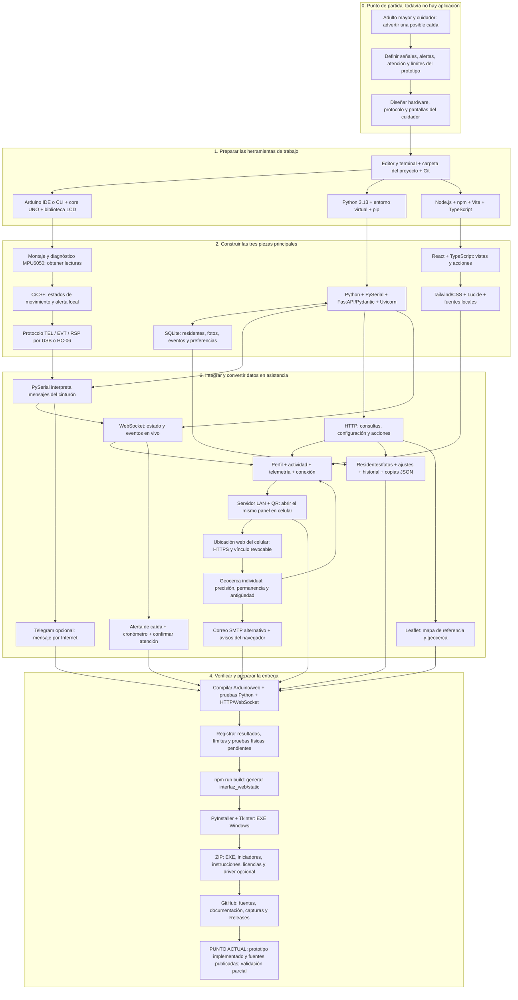
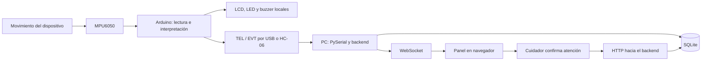
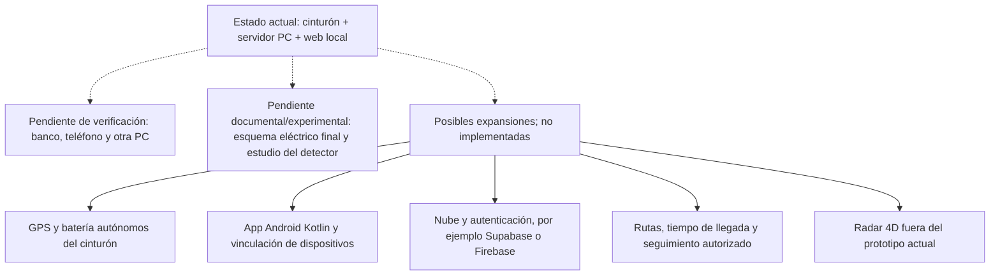

# Mapa Maestro: de Cero al Estado Actual

**Este es el punto de entrada del proyecto completo.** El mapa reúne el problema,
las herramientas, las piezas construidas, su integración y la entrega. Las otras
guías amplían sus etapas; no hace falta leerlas todas antes de entenderlo.

Referencia: recorrido base del 16 de octubre y ampliación de fuentes del
20 de octubre de 2026. Es una reconstrucción pedagógica, no una cronología exacta
de cada sesión de trabajo. Se distingue lo implementado de lo efectivamente probado.

## 1. El Proyecto Completo en un Solo Mapa

Leer de arriba hacia abajo. Las ramas del dispositivo y de la aplicación se
construyen por separado y después se integran. No hay que instalar un programa
por cada casilla: varias casillas son bibliotecas del mismo entorno.

El mapa muestra qué se construye y cómo se relaciona, no declara aprobadas todas
sus funciones. La señalización local del Arduino puede funcionar sin PC; el
panel, la persistencia y sus accesos sí dependen del servidor.

## 2. Del Mapa a las Herramientas y Archivos

Esta tabla convierte cada etapa en algo que el alumno puede localizar. La columna
de salida indica qué se produce, no un resultado experimental garantizado.

| Etapa | Qué hacemos y con qué | Qué obtenemos | Dónde continuar |
| --- | --- | --- | --- |
| 0. Problema y alcance | Identificar usuario, situación y respuesta esperada; documentos Markdown | Requisitos y límites, sin afirmar capacidades médicas | [Presentación](../README.md), [guía inicial](GUIA_ALUMNOS.md) |
| 1. Diseño | Definir pinout, mensajes y flujo visual; editor y Mermaid | Separación entre dispositivo, servidor e interfaz | [Hardware](HARDWARE_Y_PROTOCOLO.md), [stack](STACK_TECNOLOGICO.md) |
| 2. Entornos | Preparar Arduino, Python y Node; terminal, pip y npm | Herramientas y dependencias locales, no rutas del autor | [Manual, pasos 2 a 4](MANUAL_REPRODUCCION.md) |
| 3. Sensor | Cablear y cargar diagnóstico; UNO, MPU6050 y Arduino IDE/CLI | Lecturas de aceleración y giro para inspección | `arduino/Test_MPU6050/` |
| 4. Firmware | Programar estados, telemetría y salidas; C/C++, Wire, SoftwareSerial, LCD | Sketch principal del cinturón | `arduino/SFA_Cinturon_Alerta/` |
| 5. Transporte | Definir TEL/EVT/RSP, USB 115200 o HC-06 9600; PySerial | Lecturas interpretadas en la computadora | `servidor_pc/main.py`, [protocolo](HARDWARE_Y_PROTOCOLO.md) |
| 6. Servidor | Python + FastAPI + Pydantic + Uvicorn | Operaciones `/api` y canal `/ws` | `servidor_pc/main.py` |
| 7. Persistencia | SQLite mediante `sqlite3` | Perfiles/fotos, registros y configuración locales | Base creada al ejecutar, no publicada |
| 8. Interfaz | React/TypeScript, Tailwind/CSS, Lucide y fuentes; Node/npm y Vite | Panel, emergencia, formularios y estados visuales | `interfaz_web/src/`, [galería](GALERIA.md) |
| 9. Integración | HTTP para operaciones, WebSocket para actualizaciones | Cambios del sistema reflejados en pantalla | Backend y `SfaDashboard.tsx` |
| 10. Funciones de cuidado | Perfil activo, actividad, alertas, atención, fotos, historial y copias | Flujos para el operador, no solo números | Dashboard y endpoints del backend |
| 11. Extensiones actuales | Leaflet, QR/LAN y API Telegram | Mapa/geocerca, panel móvil local y canal opcional de avisos | `red_local.py`, `acceso_movil.py`, dashboard y backend |
| 12. Verificación | Compilación, unittest, API, WebSocket y procedimientos de banco | Evidencia registrada con alcances distintos | [Validación](VALIDACION_FUENTES.md), [ficha](REGISTRO_REPRODUCCION.md) |
| 13. Compilación/paquete | Vite genera web; PyInstaller incluye servidor y recursos; Tkinter inicia | EXE y después ZIP de distribución | `SFA_Asistencia.spec`, `sfa_portable.py`, [desarrollo](DESARROLLO.md) |
| 14. Publicación | Git/GitHub, documentación y capturas saneadas | Fuentes consultables y paquetes separados por versión | [Repositorio](https://github.com/hfreedo/SFA-Asistencia-Anticaidas), [Releases](../RELEASES.md) |

**Para no confundir los grupos:** Arduino IDE se ocupa del firmware; Python/pip
del backend; Node/npm/Vite construyen la web; el navegador utiliza esa web;
PyInstaller arma el EXE; Git/GitHub conservan y publican el trabajo. No utilizamos
XAMPP. Un editor como VS Code o GitHub Desktop son opciones de trabajo, no
dependencias que el cuidador deba instalar.

## 3. Qué Camino Sigue un Dato al Usar el Sistema

El mapa anterior describe la construcción. Este describe el funcionamiento:

Una confirmación del cuidador queda registrada; no implica que se haya comprobado
el estado clínico de la persona ni que automáticamente se reinicie el Arduino.
En modo móvil se abre el mismo panel desde otra pantalla: el teléfono no sustituye
al servidor. GitHub no participa en este recorrido de telemetría.

## 4. Dónde Estamos Realmente

| Área | Estado en el código/entrega | Evidencia y límite |
| --- | --- | --- |
| Firmware principal y diagnóstico | Publicados | Compilan para UNO; no demuestra detección física |
| Servidor, web y dependencias | Publicados | Instalación nueva, build y respuestas HTTP comprobados localmente |
| Perfiles y persistencia | Implementados | Edición y conservación al reiniciar comprobadas por API en base temporal |
| Alerta y atención | Implementadas | Simulación, WebSocket y registro comprobados; no es una caída real |
| Exportación de configuración | Implementada | Comprobada sin token/chat ni historial; no es backup completo |
| Fotos, interfaz y formularios | Implementados | Hay capturas previas; no equivalen a revisión visual de cada versión |
| USB/HC-06 y salidas del cinturón | Implementados en firmware/servidor | Validación física integral del montaje pendiente |
| QR y LAN | Acceso general y vínculo privado de ubicación implementados | HTTPS/WSS y autenticación probados localmente; cámara/teléfono pendientes |
| Mapa/geocerca | Zonas individuales y motor de entrada/salida implementados | Precisión, permanencia y caducidad probadas con datos de prueba; no demuestra GPS real ni rutas |
| Correo | SMTP cifrado, reintentos y registro implementados | SMTP simulado comprobado; entrega a un buzón real pendiente |
| Telegram | Integración disponible | Entrega real en un celular pendiente de documentar |
| Portable | Preparado | Pruebas locales documentadas, no garantía para toda PC |
| GitHub | Fuentes y guías publicadas | Release 1.0.0 público; 1.1.0 sigue en borrador a fecha de esta revisión |
| Reproducción independiente | Manual y ficha disponibles | Ejecución completa por otra persona/PC pendiente |

Por eso el final del mapa es **prototipo implementado con validación parcial**, no
producto médico terminado. La información de Releases puede cambiar después de
esta revisión; consultar su estado antes de citarlo como entrega pública.

## 5. Qué Queda Fuera del Punto Actual

La interfaz contempla batería y GPS, pero el UNO/MPU6050 no los proporciona por
sí solo. Ahora existe un emisor web del celular, pendiente de prueba real y sin
garantía en segundo plano. [Activación y límites](GEOLOCALIZACION.md).
No confundir ese canal con GPS incorporado al wearable.
Los pendientes de prueba no son lo mismo que las funciones futuras.

## 6. Cómo Usar Este Mapa Para Reconstruir o Explicar

1. **Comprender:** leer este mapa completo y la [guía de alumnos](GUIA_ALUMNOS.md).
2. **Reconocer herramientas:** ampliar los grupos en [Stack tecnológico](STACK_TECNOLOGICO.md).
3. **Reproducir:** seguir el [manual](MANUAL_REPRODUCCION.md); empezar por ruta A
   sin hardware, después ruta B con el cinturón.
4. **Verificar:** completar la [ficha](REGISTRO_REPRODUCCION.md) y contrastar con
   [resultados ya documentados](VALIDACION_FUENTES.md).
5. **Explicar académicamente:** referenciar commit, mapa, hardware y evidencias;
   separar decisiones de diseño de resultados experimentales.

La tesis todavía necesita sus capítulos de problema, antecedentes, metodología,
resultados y conclusiones. Este mapa conecta los anexos técnicos; no inventa esa
investigación ni sustituye el esquema eléctrico definitivo del montaje.
