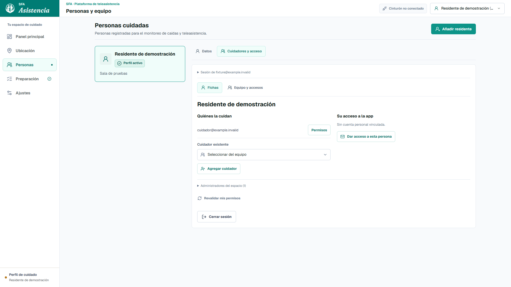
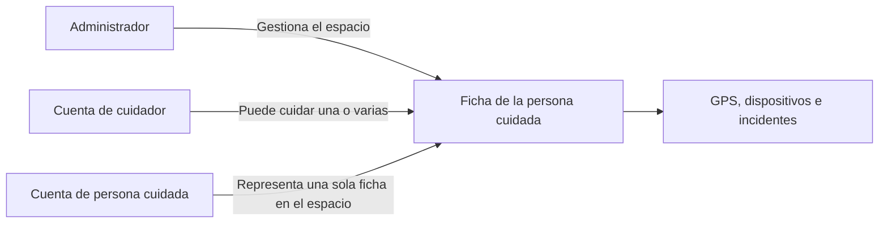

# Personas y equipo

## Dos conceptos, un recorrido

La **ficha** representa a la persona cuidada. La **cuenta** permite entrar.
No todas las personas cuidadas necesitan una cuenta.

En el panel local: **Personas > abrir ficha**.

- **Datos**: nombre, referencia, telefonos, notas y foto guardados en esa PC.
- **Cuidadores y acceso**: cuidadores asignados y cuenta personal de esa ficha.
- **Equipo y accesos**: lista general de cuentas e invitaciones del espacio.

En el portal remoto: **Personas y equipo > Fichas**. Las fichas de esta vista
son referencias sincronizadas, no una copia completa de los datos locales.

Los controles de rc13.1 mantienen el lenguaje visual del panel: superficies
blancas, bordes suaves, iconos, foco teal y opciones de ficha con seleccion
visible. Los selectores siguen siendo nativos para conservar teclado y el
selector del sistema en el celular. No se cambiaron permisos ni asignaciones.

## Quien puede hacer que

| Acceso | Alcance |
| --- | --- |
| Administrador | Gestiona equipo, asignaciones y fichas de su espacio. |
| Cuidador | Monitorea y atiende las personas asignadas. Configura solo si tiene permiso. |
| Persona cuidada | Comparte su GPS/SOS si se autoriza. No administra ni cuida a otras fichas. |
| Operador local | La PC desbloqueada sigue siendo un puesto de confianza de demostracion. No identifica por separado a cada operador. |

La gestion local esta restringida a localhost. Desde otro equipo se usa el
portal autenticado. Iniciar sesion como residente no convierte toda la PC
en un puesto limitado: el modo local de confianza es una excepcion consciente
de esta etapa, no una garantia de aislamiento entre usuarios de Windows.

## Asignar un cuidador

1. Abrir la ficha y entrar en **Cuidadores y acceso**.
2. Elegir un **Cuidador existente**, o **Agregar cuidador** para invitar una cuenta.
3. Revisar **Personas que podra cuidar** y sus permisos.
4. Guardar. Sus otras asignaciones se conservan si no se desmarcan expresamente.

La seleccion abre un borrador. No envia nada hasta guardar.
Si la cuenta ya tiene permisos distintos entre fichas, el comando existente
solo permite aplicar un conjunto comun. El formulario exige confirmacion para
uniformarlos; cancelar conserva los permisos actuales.

## Dar acceso a la persona cuidada

1. Desde su ficha, pulsar **Dar acceso a esta persona**.
2. Indicar el correo que usara esa persona para entrar.
3. Revisar **Ficha a la que corresponde esta cuenta**. Solo se elige una.
4. Crear la invitacion. La persona acepta y establece su propia contrasena.

Elegir una ficha no significa asignarle alguien a quien cuidar. Significa
identificar a quien pertenece esa cuenta. Cambiar la ficha de una cuenta ya
vinculada exige confirmacion. No se corrigen relaciones existentes automaticamente.
La ficha no desaparece si se revoca una cuenta; se conservan sus registros.

## Vinculo entre PC y nube

Se usa el identificador guardado por **Preparacion > Acceso y sincronizacion**.
Nunca se deduce la identidad por coincidencia de nombre o correo.

- Sin referencia habilitada: se indica **Ficha guardada solo en esta PC**.
- Fallo de consulta: **Vinculo sin verificar**, no se supone que falta la ficha.
- Referencia no autorizada o archivada: no se elige otra persona automaticamente.
- Cambiar de ficha descarta el formulario abierto del contexto anterior.

Los telefonos, notas y fotos no se suben por abrir esta pantalla. Crear una
cuenta tampoco crea otra ficha. Esta etapa unifica la navegacion, no fusiona
bases de datos ni cambia los permisos de Supabase o la infraestructura FCM.

## Validacion y limites

Pruebas automatizadas con datos ficticios: seleccion unica, preservacion de
asignaciones, contexto exacto, falta de permiso, respuestas tardias y confirmacion
de cambios sensibles. Revision visual de escritorio y movil sin invitaciones reales.
El paquete portable se prueba desde una extraccion limpia, sin datos personales.

La compilacion de esta etapa se publica tambien en el portal HTTPS de GitHub Pages.
No se modificaron cuentas ni asignaciones reales durante esta implementacion.
