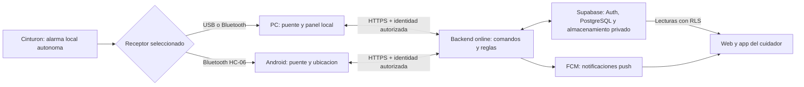
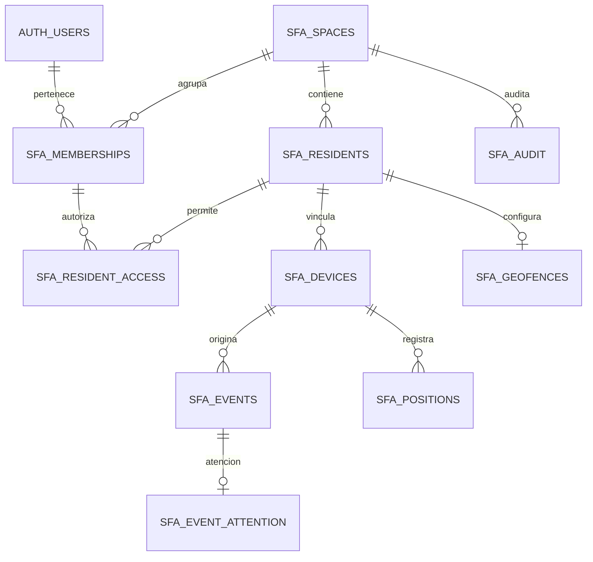

# SFA: ampliacion por etapas

## Prioridad operativa actual

El orden activo de trabajo y sus condiciones de cierre se encuentran en
[Plan de integracion operativa](PLAN_INTEGRACION_OPERATIVA.md), auditado el
21 de octubre de 2026. Prioriza flujos reales de SOS/geocerca a cuidadores y web,
emisor online sin PC obligatoria, permisos y seleccion independiente de fuentes.
Las secciones siguientes se conservan como registro historico; no son una
afirmacion de que todas sus funciones ya esten integradas.

## Actualizacion rc3: 21 de octubre de 2026

Implementados GPS Android directo a Supabase y laboratorio de pruebas, conservando
el modo local. Ver [prueba actual](PRUEBA_GPS_Y_ALARMAS.md) y
[validacion](VALIDACION_AMPLIACION.md). Pendientes: pruebas fisicas, editor y
eventos de geocerca cloud, firma de distribucion y portabilidad multiadministrador.
La siguiente etapa se detalla en [Portabilidad para alumnos](PORTABILIDAD_ALUMNOS.md).
Los apartados fechados a continuacion registran las etapas anteriores.

## Estado al 20 de octubre de 2026

La etapa 1 prepara arquitectura, esquema y pruebas. No activa cuentas, nube,
sincronizacion ni APK en la aplicacion existente. No modifica el firmware,
la interfaz ni los perfiles de la base local. No publica cambios en GitHub.

| Etapa | Entrega | Estado / condicion de cierre |
| --- | --- | --- |
| 1 | Modelo de datos, permisos y diagnostico de migracion | Esquema aplicado y RLS probado tambien en Supabase; ver registro de preparacion |
| 2 | Auth, invitaciones, comandos autorizados y migracion | Login real y rol administrador comprobados; escrituras PC mediante RPC restringidos |
| 3 | Puente local, cola persistente, sincronizacion y modos | Vinculacion PC real comprobada; cola y deduplicacion probadas; falta recorrido con cinturon fisico y seleccion global de transporte |
| 4 | Centro de inicio unico en PC | Implementado y probado: inicio, detencion, instancia unica, HTTPS y base compartida; BAT conservados como herramientas de desarrollo |
| 5 | App Kotlin / Compose, Android 12+ (minSdk 31) | APK de prototipo en validacion: GPS foreground hacia PC, Bluetooth local y consulta cloud; instalacion/GPS/HC-06 fisicos pendientes |
| 6 | Seguimiento, historial, geocerca y push | Historial y geocerca locales implementados; FCM con SDK, registro privado y emisor PC preparados, migracion aplicada; faltan identidad de envio y prueba real. GPS cloud pendiente |
| 7 | Empaquetado y demostracion integral | Windows y Android se validan por separado; no declarar demostracion integral aprobada sin las pruebas fisicas y remotas |

Ver ANDROID.md y VALIDACION_AMPLIACION.md. Los diagramas siguientes describen
la arquitectura objetivo; no significan que todas sus flechas esten activas.

## Arquitectura acordada



La PC no requiere ngrok para acceder a la nube. La web online tampoco requiere
instalar el puente local. El Arduino actual no posee GPS ni medicion de bateria:
la ubicacion sera del telefono y no se inventaran valores del cinturon.

El modo local seguira disponible. Sin internet no habra entrega remota a Supabase;
la futura app podra obtener posicion GNSS cuando sea posible, evaluar la zona
guardada y encolar eventos. Bluetooth no requiere internet. La nube mostrara
ultima comunicacion y ausencia de datos, nunca seguridad presunta.

## Modelo y permisos



Un espacio separa los datos de cada grupo familiar o demostracion. Cuenta y
residente no son lo mismo. Un residente puede no tener cuenta; la futura
vinculacion del telefono usara una identidad limitada y revocable.

| Actor | Permiso previsto |
| --- | --- |
| Administrador | Gestion de su espacio, invitaciones, dispositivos y configuracion |
| Cuidador | Lectura de residentes vinculados y confirmacion de atencion |
| Cuidador con can_configure | Ademas, cambios permitidos sobre ese residente |
| Persona cuidada / dispositivo vinculado | SOS y envio de datos propios; consentimiento visible |
| Sin sesion o sin vinculo | Ningun dato de residentes |

La migracion SQL inicial implementa lecturas RLS. Las escrituras de todos los
clientes estan bloqueadas incluso para administradores. La migracion 002 agrega
RPC restringidos para vincular PC y enviar muestras, comprobando sesion,
espacio, permiso y revocacion. Ver SINCRONIZACION.md para el alcance actual.
No desactivar RLS para hacer funcionar un boton. El primer administrador se
asignara con una operacion controlada, no desde metadatos editables del usuario.

Las claves secretas elevadas pertenecen solo al backend online controlado:
nunca al frontend, APK o puente distribuido en PCs. Estos usaran clave publicable
y sesion individual. El esquema no almacena contrasenas, tokens QR, SMTP ni FCM.
Storage privado, politicas de fotos, tokens de dispositivo, consentimiento,
invitaciones temporales, cola de avisos y Realtime se incorporaran despues;
no estan implementados por esta migracion.

## Contrato de comunicacion a implementar

- Modos: usb_pc, bluetooth_pc, bluetooth_android. Un receptor principal por cinturon.
- Cambio sensible mediante comando autenticado; configurado no significa conectado.
- Estados separados: receptor conectado, lecturas recibidas, entrega a nube y antiguedad.
- Evento/muestra con UUID estable, residente, dispositivo, observed_at y received_at UTC.
- Reintento conserva UUID; conflicto no sobreescribe otro evento.
- Backend valida identidad del emisor, origen, precision y tiempos, no confia en IDs enviados.
- Muestras atrasadas se conservan como historia; no activan alertas de posicion actual.
- Push enviado, entregado y atencion confirmada son estados distintos.
- La confirmacion concurrente requiere comando atomico; un cuidador atiende y los demas lo ven.
- No considerar una notificacion push como mecanismo de entrega garantizada.

## Historial y migracion

Se conservaran perfiles, fotos y configuraciones existentes. Primero copia
privada consistente de SQLite, despues mapeo UUID por instalacion + ID local,
importacion idempotente y comparacion de campos/fotos. No se ha ejecutado el
importador ni creado una nueva copia privada en esta etapa de solo lectura.

El diagnostico local encontro 1 perfil con foto y 23483 registros en ese momento.
El total de registros puede cambiar si el servidor sigue recibiendo datos.
Los registros antiguos no tienen resident_id: mantenerlos como legado, no
asignarlos a una persona por adivinacion. El residente activo es una seleccion
del puesto, no una autorizacion global, y se preservara por separado.

El modulo actual de ubicacion conserva la ultima posicion y limita su bitacora
a 500 eventos por residente. El esquema nuevo guarda todas las posiciones
recibidas y no incluye limpieza automatica. No puede recuperar rutas que nunca
se guardaron. No cambia aun el comportamiento del modulo local existente.

Geocerca nueva: radio admitido desde 5 m, con indicador de simulacion. Eso no
garantiza precision fisica de 5 m. Las reglas de calidad y permanencia se
validaran antes de utilizar esas zonas con GPS real. El minimo local sigue en 25 m.

## Evidencia y proximas pruebas

Ejecutar desde la raiz, sin tocar los datos originales:

```powershell
.\.venv313\Scripts\python.exe -m servidor_pc.diagnostico_migracion
.\.venv313\Scripts\python.exe -m unittest discover -s tests -v
npm --prefix supabase/validation ci --ignore-scripts
npm --prefix supabase/validation test
```

Resultado de esta etapa: 32 pruebas Python y 12 comprobaciones de SQL/RLS
aprobadas. SQL ejecutado en PostgreSQL WASM (PGlite), con identidades Auth
ficticias. Se verificaron aislamiento entre espacios, acceso por residente,
revocacion, bloqueo de escritura de clientes, coordenadas y deduplicacion.
El diagnostico tiene 4 pruebas, incluyendo ausencia de modificaciones y de PII.

Esto NO demuestra login de Supabase, seguridad extremo a extremo, Storage,
notificaciones, APK, Bluetooth fisico ni precision del detector. Antes de nube
con datos reales: probar dos familias ficticias y revocacion con JWT reales;
despues importar con copia previa. No exponer el servidor LAN existente a internet.
Se aplico y probo el esquema en el proyecto nuevo, con roles PostgreSQL y
rollback de datos ficticios. Ver [estado de Supabase](SUPABASE_ESTADO.md).
El portal HTTPS y su respaldo local se describen en [acceso SFA](ACCESO_SFA.md).

Prueba final: PC por una red y cuidador por datos moviles; repetir con Android
como puente. Probar tambien perdida de internet/Bluetooth, bloqueo de pantalla,
detencion forzada, reinicio, sincronizacion sin duplicados y conservacion de historia.

Fuentes tecnicas:
- [Supabase Auth y datos de usuario](https://supabase.com/docs/guides/auth/managing-user-data)
- [RLS y funciones privadas](https://supabase.com/docs/guides/database/postgres/row-level-security)
- [Claves publicables y secretas](https://supabase.com/docs/guides/getting-started/api-keys)
- [PGlite: motor PostgreSQL aislado](https://pglite.dev/docs/)
