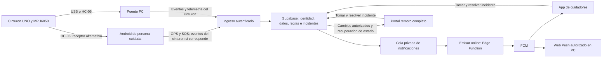
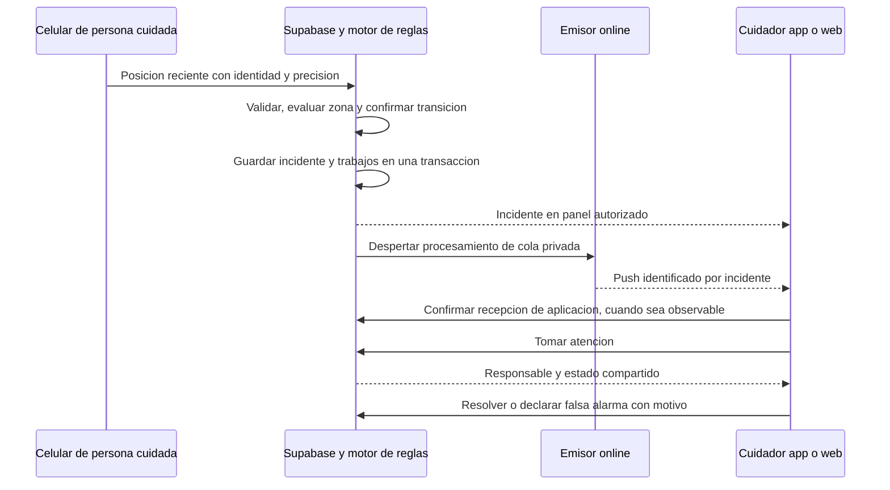

# Plan de integracion operativa SFA

Fecha: 21 de octubre de 2026. Estado: implementacion por etapas en curso,
con pruebas integrales pendientes. Equipo y permisos activados; SOS y atencion
preparados, pendientes de activacion de migracion 006. Ver PRUEBA_SOS_Y_ATENCION.md.
Este documento reemplaza el orden de trabajo
anterior; no convierte las funcionalidades propuestas en funcionalidades activas.

## 1. Objetivo de entrega

Una persona comparte GPS desde Android por internet. Un administrador configura
su zona y sus cuidadores. Una salida confirmada o un SOS genera un incidente,
avisa a los cuidadores en app y web y permite registrar atencion compartida.
El flujo remoto no depende de misma red, certificados LAN, ngrok ni PC encendida.
El cinturon se incorpora como fuente adicional de caidas, sin reemplazar el GPS.

No se considerara terminada una etapa porque exista un boton, una tabla o una
APK compilada: debe superar su recorrido completo con origen y destino reales.

## 2. Resultado de la auditoria actual

| Pieza | Evidencia en fuentes / prueba | Falta para uso integrado |
| --- | --- | --- |
| GPS Android a Supabase | NativeApi, CloudGpsSession, sfa_ingest_phone; usuario confirma inicio por datos moviles | Pruebas de continuidad, identificacion limitada del emisor y reglas integradas |
| Geocerca Android | GeofenceEngine evalua incertidumbre, permanencia e histeresis; TrackingService consulta contexto | Editor cloud, estado autoritativo y eventos remotos; hoy la salida solo notifica en ese celular |
| Cinturon en Android | TrackingService recibe HC-06, registra localmente y genera aviso local | Subida autenticada de eventos y telemetria del cinturon |
| Cinturon en PC | Puente serie y sfa_ingest_pc | Selector de receptor/fuente, pruebas fisicas y politica de exclusividad |
| Notificaciones | Registro Android y cola FCM; prueba dirigida al propio solicitante | Emisor online, destinatarios asignados, recepcion y atencion trazables |
| Portal remoto | RemoteMonitor consulta residentes, muestras, GPS y eventos por polling | Centro de incidentes, acciones, geocerca, usuarios, dispositivos y laboratorio |
| Roles | memberships admin/caregiver/resident y acceso por residente | Invitaciones desde UI, vinculacion de emisor sin darle administracion y gestion cotidiana |
| Atencion | Existe sfa_event_attention | Comandos atomicos y UI compartida para tomar/resolver incidentes |

Referencias verificadas: interfaz_web/src/RemoteMonitor.tsx,
android_app/app/src/main/java/org/sfa/asistencia/TrackingService.kt,
GeofenceEngine.kt y supabase/migrations/202610200001_base_sfa.sql,
202610200002_pc_sync.sql, 202610210003_push.sql y 202610210004_phone_location.sql.
El portal no es solamente login, pero todavia es principalmente una consulta.

## 3. Arquitectura objetivo

La PC sera receptor de hardware opcional, no requisito del GPS ni del emisor
remoto. Se conserva el modo LAN independiente para demostraciones sin nube.
No se expone FastAPI a internet como solucion principal.

## 4. Fuentes de datos seleccionables por residente

La configuracion separa fuente, transporte y destino. No es un unico selector
USB/Bluetooth/Internet. La nube valida las selecciones; no basta ocultar botones.

| Perfil operativo | Caidas | Ubicacion | Receptor necesario |
| --- | --- | --- | --- |
| GPS y SOS movil | Sin detector de caidas activo | Celular | Android con internet |
| Cinturon conectado a PC + GPS movil | Cinturon | Celular | PC para el cinturon; Android para GPS |
| Cinturon conectado a Android + GPS movil | Cinturon | Celular | Android con HC-06 e internet |
| Todo desde celular, futuro experimental | Acelerometro/giroscopio del telefono | Celular | Android; detector movil validado antes de habilitar |
| Demostracion local | Cinturon o simulador explicitamente seleccionado | Fuente local disponible | PC; sin promesa de avisos remotos offline |

Campos previstos: fall_source, location_source, belt_receiver, dispositivo
asignado por capacidad, version de configuracion, destinatarios y reglas.
El SOS manual no exige disponer de un detector de caidas.

Reglas: un receptor principal por cinturon; cambio auditado y confirmado por el
dispositivo; mostrar configurado, conectado y entregando datos por separado.
Si falla una fuente no se cambia silenciosamente a otra. El GPS del cuidador
nunca sustituye la ubicacion de la persona cuidada. Una alerta conserva su
fuente original aunque despues se cambie el perfil operativo.

## 5. Un solo incidente, varias formas de recibirlo

Separar estado del incidente (abierto/en atencion/resuelto/falsa alarma) de
estado de cada entrega (pendiente/aceptado por FCM/recibido por app/error).
No llamar entregado a un HTTP 200 de FCM. Un acuse de software tampoco demuestra
que una persona vio la notificacion. La lectura y la atencion son acciones aparte.
Registrar evidencia por destinatario y canal; no exponer tokens FCM a clientes.

UUID estable en origen, deduplicacion y colision detectada, hora de observacion
y recepcion, origen y modo prueba/real. Las transiciones de geocerca deben tener
clave unica por residente, version de zona y episodio. La resolucion es atomica:
dos cuidadores no pueden apropiarse silenciosamente de la misma atencion.

Un push lleva texto generico e ID; los detalles, GPS y notas se consultan despues
de autenticarse. No usar topics publicos para datos de residentes.

## 6. Geocerca realmente remota

Editor en web: elegir residente, centro por mapa o ultima posicion valida,
nombre, radio desde 5 m, guardar y mostrar revision aplicada en Android.
La geocerca se guarda en Supabase, no en SQLite. No migrar la zona local sin
mostrarla y pedir confirmacion al administrador del residente vinculado.

El motor cloud sera autoritativo para generar incidentes remotos. Evaluara
posiciones validadas en la ingesta, con calculo geografico probado (PostGIS
geography si esta disponible), incertidumbre GPS, antiguedad, histeresis y
permanencia. Android mantendra evaluacion local para avisar sin internet; sus
evaluaciones no se convierten en un segundo incidente duplicado al reconectar.

Estados: sin datos, dentro, fuera, confirmando e incierto. No se interpreta
ausencia de datos como dentro. Definir aviso inicial si el seguimiento empieza
ya fuera y aviso de reingreso; cambios de zona reinician el episodio de forma
auditada. Sin posicion fresca, no se inventa una salida ni una llegada.

5 m se permite para demostracion, pero no garantiza resolucion GPS de 5 m.
Si la incertidumbre impide decidir, mostrar incierto. Una simulacion puede
ensayar 5 m sin enviar una emergencia real. No reducir controles de calidad
para conseguir que una demostracion genere una alerta.

Historial recibido conservado, sin purga automatica. Lo atrasado se marca como
historia y no se reinterpreta como emergencia actual. Revisar el tratamiento
actual que descarta muestras antiguas de la cola Android antes de afirmar que
tambien se conserva todo lo capturado durante una desconexion.

## 7. Emisor online y ausencia de PC

Mantener Supabase y FCM. Agregar un emisor Edge Function de vida corta que
reclame trabajos privados con lease, envie a FCM y registre resultado.
Un webhook autenticado despierta el procesamiento despues de crear trabajos;
la cola persistente, no el webhook, es la fuente de verdad. Reintentos con
backoff, vencimiento y recuperacion programada acotada; sin bucles recursivos.

No invocar una funcion por cada lectura GPS: usar la ingesta SQL existente y
despertar el emisor por eventos/trabajos, agrupando destinos. Ajustar las RPC
de claim para un worker servidor sin reutilizar el JWT personal del administrador.
Emisor PC anterior solo como alternativa explicita, con leases compartidos y
sin duplicar envios. No mantener dos emisores independientes sobre el mismo evento.

La credencial FCM permanece en secretos del backend online, nunca en APK,
GitHub Pages ni paquetes para alumnos. Su traslado a Supabase requiere
autorizacion explicita al desplegar. Verificar JWT de usuarios, firma/secreto
del webhook, limites de uso y revocacion; no abrir un endpoint anonimo de envio.

La funcion de invitaciones tambien corre en backend. El cliente no obtiene
service_role ni puede otorgarse administracion mediante metadatos editables.

## 8. Web remota y responsabilidades

GitHub Pages puede alojar la SPA completa ya construida con React/TypeScript.
Las operaciones sensibles se realizan en Supabase/RPC/Edge; no se intenta
ejecutar Python ni custodiar secretos en Pages.

| Vista | Administrador | Cuidador asignado | Persona cuidada / emisor |
| --- | --- | --- | --- |
| Resumen, mapa e incidentes | Todo su espacio | Solo residentes autorizados | Estado propio limitado |
| Tomar/resolver atencion | Si, auditado | Si, si tiene permiso de atencion | No resolver incidentes de otros |
| Geocerca y fuentes | Si | Solo con permiso de configuracion | Consultar configuracion asignada |
| Usuarios, invitaciones y roles | Si | No | No |
| Enviar GPS/SOS | Solo si el dispositivo fue vinculado | No implica ser emisor por ser cuidador | Solo identidad/residente/dispositivo propios |
| Credenciales de infraestructura | No desde el panel cotidiano | No | No |

Pantallas: Resumen, Incidentes, Ubicacion/geocerca, Dispositivos y fuentes,
Equipo y permisos (admin), Laboratorio y estado de entregas.
El inicio responde: quien necesita ayuda, que paso, donde, hace cuanto y quien
atiende. La telemetria detallada pasa a una vista tecnica secundaria.

Actualizar incidentes/atencion mediante Realtime autorizado y reconciliar con
consulta al reconectar. Mantener polling acotado como alternativa. El historico
de incidentes es independiente del almacenamiento efimero de Realtime.

En PC con pagina abierta: aviso visible y notificacion de sistema con permiso;
sonido habilitado por gesto del operador y estado visible si esta bloqueado.
Web Push en HTTPS con service worker para segundo plano, donde sea compatible.
No prometer avisos con PC apagada, navegador forzado a cerrar o sistema dormido.
En esos casos la app del cuidador sigue siendo el canal movil principal.

Una sola APK con modos y permisos distintos: Compartir para emisor y Cuidar
para receptor. Dos celulares y dos cuentas distintas para la prueba real.
Vinculacion del emisor por invitacion o codigo temporal de un solo uso, limitado
al residente; no exigir que el adulto mayor opere con la cuenta administradora.

## 9. Orden de implementacion y condiciones de cierre

| Etapa | Entrega completa | Prueba que permite avanzar |
| --- | --- | --- |
| 0. Base y contrato | Copias privadas, inventario, contrato de eventos, pruebas de aislamiento y presupuesto gratuito | Fuentes actuales reproducibles y regresiones verdes; sin alterar perfiles ni historiales |
| 1. Identidades y destinos | Equipo/invitaciones, roles, permisos de atencion y emisor limitado, dispositivos receptores | Admin invita cuidador; este solo ve al residente asignado; revocacion efectiva; emisor no puede administrar |
| 2. Bus de incidentes y avisos | Ingesta SOS autenticada, cola, emisor online, panel de incidentes minimo y atencion atomica | Celular A envia SOS; celular B y web lo reciben; B atiende y web refleja el mismo ID con PC puente apagada |
| 3. Geocerca integral | Editor cloud, revision aplicada, motor cloud y espejo offline Android | Cambiar zona en web, confirmar recepcion en Android, salida/reingreso reales, aviso a B/web y atencion compartida; GPS impreciso no dispara falso fuera |
| 4. Fuentes y cinturon | Seleccion por capacidad, PC USB/BT y Android HC-06 con subida real | Cinturon por PC + GPS movil y luego cinturon por Android; sin duplicados al cambiar receptor; desconexion no finge seguridad |
| 5. Portal operativo y laboratorio | Navegacion por rol, historial, estado de entregas, Web Push compatible, pruebas cruzadas | Web a celular y celular a web/celular; app en segundo plano; escenarios de prueba no se confunden con emergencias |
| 6. Cierre portable | Windows/APK, guias, stack, changelog y prueba desde otra PC con credenciales propias | Extraccion limpia, ausencia de rutas/secretos personales y todos los recorridos reales registrados |
| 7. Detector movil futuro | Acelerometro/giroscopio, calibracion y estudio de falsos positivos | Prueba independiente de postura/bolsillo/cintura y actividades diarias; no habilitar como detector confiable por compilar |

El laboratorio basico debe acompanar las etapas 2 y 3 para validarlas; la etapa
5 completa su ergonomia y canales secundarios. No esperar hasta el final para
probar avisos. La primera entrega util es el conjunto 1-3, sin esperar cinturon.

## 10. Laboratorio y matriz de aceptacion

Cada caso registra origen, destinatarios autorizados, revision, ID, tiempos,
red y evidencia observada. Un unico celular que se envia su propio push no
valida comunicacion entre persona cuidada y cuidador.

- Web a celular: prueba elegida por operador a un receptor autorizado que acepta
  ensayos; aviso etiquetado PRUEBA, recepcion y confirmacion visibles en web.
- Celular A a celular B y PC: SOS de prueba; datos moviles frente a otra Wi-Fi;
  ambos destinos ven el mismo incidente, no mensajes locales independientes.
- Geocerca: dentro, transicion, fuera, reingreso, arranque fuera, precision mala,
  coordenada vieja y cambio de radio; simulacion separada de recorrido fisico.
- Cinturon: evento serie sintetico etiquetado primero; despues hardware sin
  provocar caidas de personas. HC-06 real se valida por separado del parser.
- Entrega: token FCM revocado, permiso denegado, destinatario sin sesion, funcion
  pausada, webhook perdido, reintento, proceso muerto despues de enviar y antes
  de guardar; no prometer exactamente una notificacion visual ante todo fallo.
- Concurrencia: dos cuidadores toman un incidente; una operacion gana y la otra
  ve el responsable actual. Cambio de cuenta elimina datos y suscripciones previas.
- Privacidad: dos espacios ficticios, cuidador ajeno, emisor revocado y usuario
  sin rol; acceso denegado en servidor, no solo botones ocultos.
- Android: pantalla bloqueada, cambio Wi-Fi/datos, permisos retirados, ahorro de
  bateria, reinicio y cierre forzado; limitaciones del sistema informadas.
- Offline: alerta local y cola; reconexion sin duplicar ni actualizar falsamente
  una muestra antigua. Si se impide la entrega, mostrarlo claramente.

Objetivos de demostracion, no SLA: medir antiguedad de GPS, tiempo de confirmacion
de regla, llegada de evento a web y recepcion de app por separado. Buscar aviso
en menos de 15 s desde incidente confirmado con conectividad estable; el tiempo
de permanencia de geocerca se mide aparte. Publicar tiempos reales, incluidos
fallos; no afirmar entrega garantizada ni eficacia medica del detector.

## 11. Costo, conservacion y decisiones de despliegue

Regla critica: sin facturacion, tarjetas, pruebas renovables ni nuevos planes.
No usar Firebase Cloud Functions como atajo si exige cambiar de plan. La propuesta
usa Supabase Free y FCM existentes, condicionada a verificar funciones y cuotas
disponibles antes de habilitar cada recurso. Si exige pagar, detener ese paso.

La documentacion actual incluye 500.000 invocaciones Edge mensuales en Free,
500 MB de base y 5 GB de transferencia. No son recursos ilimitados ni garantia
de disponibilidad; Free puede pausarse tras inactividad. Presupuestar frecuencia
GPS, indices, Realtime, reintentos, invitaciones y correos antes de la demostracion.
Con una lectura cada 10 s se generan 8.640 muestras/dia por emisor si funciona
24 horas: usar ese numero para medir consumo, no extrapolar gratuidad infinita.

No borrar historiales automaticamente para entrar en cuota. Mostrar consumo y
advertir antes del limite; exportacion y cualquier cambio de conservacion solo
por decision explicita. No activar simuladores en bucle ni backups de pago.

Antes de despliegue: confirmar migraciones restringidas, habilitacion Realtime,
secretos del emisor online y metodos de invitacion disponibles sin contratar
correo externo. Si el correo gratuito restringe destinatarios, informar el
bloqueo y evaluar vinculacion segura de cuentas existentes, sin contrasenas
predefinidas ni roles autoasignados.

No se aplican migraciones ni se trasladan claves con este plan. Mantener los
perfiles actuales, exportaciones y retorno local. Publicar solo cuando las
pruebas de la etapa correspondiente esten registradas y el paquete sea verificado.

## 12. Fuentes oficiales verificadas

- [Supabase Edge Functions](https://supabase.com/docs/guides/functions): backend TypeScript de vida corta.
- [Cuotas Edge](https://supabase.com/docs/guides/functions/pricing) y [planes](https://supabase.com/pricing): presupuesto y limites gratuitos.
- [Secretos del backend](https://supabase.com/docs/guides/functions/secrets): nunca claves elevadas en clientes.
- [Database Webhooks](https://supabase.com/docs/guides/database/webhooks): disparo asincrono; no reemplaza cola persistente.
- [RLS](https://supabase.com/docs/guides/database/postgres/row-level-security) y [cambios de base](https://supabase.com/docs/guides/realtime/subscribing-to-database-changes).
- [PostGIS](https://supabase.com/docs/guides/database/extensions/postgis): distancia geografica en base.
- [FCM y entorno servidor](https://firebase.google.com/docs/cloud-messaging/server-environment).
- [FCM web](https://firebase.google.com/docs/cloud-messaging/web/receive-messages): primer y segundo plano con service worker.
- [Invitaciones Auth](https://supabase.com/docs/reference/javascript/auth-admin-inviteuserbyemail).
- [Restricciones Android](https://developer.android.com/develop/background-work/services/fgs/restrictions-bg-start): el rastreo no evita las restricciones del sistema.
