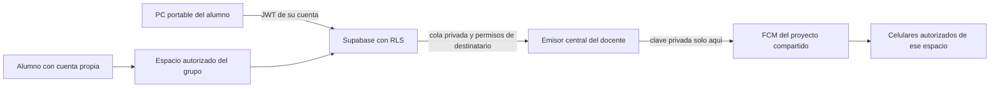

# Siguiente etapa: portabilidad y administraciones propias

Esta es una propuesta para la proxima etapa, no una funcion entregada en rc3.

## Lo que ya puede compartirse

El ZIP Windows incluye Python y bibliotecas; resuelve recursos y datos desde su
ubicacion, no desde las carpetas del autor. Fuera de las fuentes usa `data/` junto
al EXE y no incluye la base o configuracion privada del desarrollador.
La APK incorpora configuracion publica del proyecto Firebase, nunca su clave privada.
Las cuentas Supabase ven solo los residentes de sus espacios autorizados.

## Lo que falta para usar infraestructura comun con cuentas propias

| Capa | Objetivo | Verificacion necesaria |
| --- | --- | --- |
| Inicio Windows | Un solo centro, ruta elegible y deteccion de datos | Otra cuenta y PC limpia; carpeta con espacios, permisos restringidos |
| Configuracion | Asistente inicial, sin editar `.env` manualmente | Direcciones publicas separadas de secretos; importacion/exportacion segura |
| Administracion | Un espacio por grupo y administradores propios | Invitaciones, revocacion y prueba de aislamiento entre dos espacios |
| Emisor FCM | Servicio central de confianza del docente | Ningun alumno recibe clave privada; cuotas y permisos por espacio |
| Seguimiento | Celular emisor limitado al residente asignado | Bloqueo por revocacion, cambio de usuario y cambio de red |
| Distribucion | Actualizaciones firmadas y version visible | Plan de migracion desde debug sin perder datos |

## Flujo propuesto

Usar el mismo proyecto Firebase no implica compartir cuenta o contrasena Google.
La configuracion cliente no permite enviar push por si sola. No incluir ni pedir
que los alumnos copien `secrets/firebase-service-account.json`.

Como primera opcion sin contratar alojamiento, el emisor central podria correr
en una PC de confianza; dependeria de que este encendida, conectada y autenticada.
Un servicio alojado, sus condiciones y cuotas se evaluaran antes de adoptarlo.
No activar facturacion, pruebas que se renueven, suscripciones ni upgrades.

## Condicion de cierre

Instalar el ZIP en una PC distinta, iniciar sesion como administrador del grupo,
crear su residente, enviar GPS desde otra red y recibir una prueba push en su
celular, sin acceso a residentes de otros grupos ni a secretos del docente.
