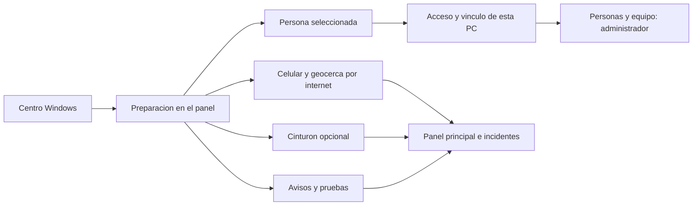

# Preparacion unificada - etapa 1

**La rc10 descrita abajo es el origen de esta función.** El recorrido actual para Windows rc13.1 está en el [manual de uso](MANUAL_USO_PC.md). Esta página conserva decisiones y pruebas de las etapas anteriores.

Esta etapa reorganiza el panel local y el Centro Windows. No cambia las tablas,
roles, permisos RLS, destinos de autenticacion ni servicios de Supabase o FCM.
Android conserva su version actual. Los ZIP publicados anteriormente no cambian.
Esta etapa corresponde a la candidata local Windows **1.2.0-rc10**:
`release/SFA-Asistencia-1.2.0-rc10-Windows.zip`. No esta publicada en GitHub.
La correccion **1.2.0-rc10.1** muestra el vinculo habilitado como guardado y
reserva la casilla de autorizacion para una nueva vinculacion. El estado se
consulta en el servidor; no se persiste una casilla generica en el navegador.

## Recorrido del operador

1. Abrir el Centro habitual y elegir **Preparar sistema**.
2. Seleccionar a la persona cuidada en el selector superior. **Gestionar perfiles**
   lleva al directorio local y permite crear o editar su ficha.
3. Para trabajar por internet, iniciar sesion en **Acceso por internet**, dentro
   de Preparacion. Un administrador puede vincular el perfil local al espacio
   autorizado, con consentimiento explicito para los datos minimos indicados.
   Si ya existe el vinculo, puede **Reanudar envios**. No se vincula al abrir la vista.
   En rc10.1, **Vinculo de este perfil guardado** reemplaza la casilla cuando el
   perfil y el espacio coinciden con un vinculo habilitado. No equivale a verificar
   la vigencia de los permisos: el servidor los comprueba al ejecutar las acciones.
4. Elegir **Celular y geocerca** para consultar GPS por internet y editar la zona.
   El celular debe haber iniciado seguimiento para el mismo residente remoto.
   La sesion del panel no inicia el GPS ni lo vincula automaticamente.
5. Si se usara el sensor, elegir **Cinturon USB o Bluetooth**. No hace falta
   conectarlo para utilizar GPS remoto. Las fuentes no se sustituyen solas.
6. Elegir **Avisos y pruebas** para abrir Ajustes > Notificaciones directamente.
   La prueba FCM exige un celular registrado de la misma cuenta y confirmacion.
7. Volver a **Panel principal** o pulsar **Ir al monitoreo**. Los incidentes
   persistentes siguen en ese panel y el indicador del menu se conserva.

La persona seleccionada se mantiene al navegar entre estos apartados. Cuenta
autenticada y persona cuidada son identidades diferentes; no se fusionan perfiles
locales y remotos ni se reasignan historiales automaticamente.

## Que significa cada estado

| Indicador | Alcance real |
| --- | --- |
| Cinturon conectado | Conexion serial con esta PC; no demuestra que llegue GPS ni que el sensor este enviando muestras recientes. |
| Perfil vinculado | Existe un vinculo habilitado del perfil local seleccionado; no demuestra que el celular este siguiendo a esa persona. |
| Sesion activa | El servidor conserva una sesion de envio en memoria; no garantiza acceso continuo a internet ni recepcion del destinatario. |
| Emisor FCM configurado | Se declaro la configuracion del emisor de esta PC; no valida por si sola las credenciales ni confirma registro o entrega. |
| No se pudo verificar | Fallo la consulta. No se muestra como preparado o seguro. |

El mapa conserva la evaluacion de precision y antiguedad del GPS. No se presenta
la ausencia del cinturon como un fallo general del seguimiento por internet.
Las zonas local y remota siguen separadas y no se copian automaticamente.

## Acceso y seguridad

- La preparacion de la sesion de esta PC se realiza desde localhost, no desde
  una IP LAN. El panel no ofrece el formulario integrado en otros hosts.
- El formulario reutiliza Supabase Auth, verificacion de identidad y permisos.
  El backend sigue validando cada comando; no se agregan escrituras anonimas.
- La sesion del navegador usa sessionStorage del mismo origen y pestana. No se
  guarda una contrasena ni un JWT en SQLite o en enlaces de navegacion.
- Cerrar sesion desde Preparacion pausa antes los envios de la PC. Si la pausa
  falla, se informa el error y no se anuncia un cierre exitoso.
- Recuperar contrasena sigue retornando al portal local ya autorizado:
  `/acceso/acceso.html?flow=recovery`. No se registran nuevos destinos en Supabase.
- Los cuidadores no reciben el control de vincular la PC ni el de invitar equipo.

La copia independiente `/acceso/acceso.html` y el portal remoto se conservan
como accesos de compatibilidad. El Centro ya no exige abrir esa segunda pagina
para la preparacion habitual. Para GPS remoto no hacen falta hotspot ni red
compartida; LAN/HTTPS sigue disponible como alternativa local avanzada.

## Desarrollo y verificacion

`interfaz_web/.env.acceso` mantiene solo URL y clave **publicable**. Vite reutiliza
esas dos variables tambien al construir el panel local; la configuracion del modo
actual o del entorno tiene prioridad. Nunca introducir claves secretas en VITE.

Validacion automatica: pruebas de interfaz y Python, compilacion de panel y
portal, navegacion con Playwright en 1920x1080, 1366x768 y 390x844 con datos
ficticios. Las capturas quedan en `build/preparation-qa/`, no contienen residentes
reales. El script es `scripts/verificar_preparacion.cjs` y requiere Playwright;
admite `SFA_PLAYWRIGHT_MODULE` y `SFA_QA_BROWSER` para runtimes externos.

Estas comprobaciones no son una prueba fisica de GPS, cinturon ni entrega FCM.
El emisor FCM sigue dependiendo de la PC encendida con sesion activa. No se
implemento todavia un emisor autonomo en la nube ni se reorganizo Android.
## Indicadores desde rc11.2

La navegacion comparte la consulta de estado con Preparacion (cada 5 segundos).
El contador ambar suma: perfil sin vinculo habilitado, sesion pausada y error
del emisor FCM. Se aplica al perfil seleccionado; una consulta fallida muestra
un signo de interrogacion sin afirmar que el sistema este listo.

El cinturon desconectado y FCM sin configurar son opcionales para GPS y no
inflan el contador. El indicador verde confirma solo la conexion preparada,
no entrega de avisos ni posicion GPS. FCM configurado conserva la leyenda
de entrega sin verificar. Los estados individuales permiten revisar vinculo,
sesion, dispositivo o avisos; el enlace correctivo del principal enfoca el
acceso integrado, sin abrir otra ventana.
