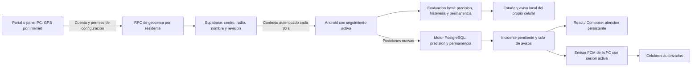

# Geocerca por internet desde 5 metros

Estado: migraciones 007, 008 y 009 aplicadas en el proyecto de
pruebas. Configuracion y motor persistente activos para posiciones nuevas.
Usar portal/Centro actualizado y Android 0.6.1-prototipo para ver la atencion
persistente en la app. Validacion fisica de esta candidata pendiente.

## Que cambia

Esta ruta no necesita red compartida, hotspot, certificados LAN ni ngrok.
La geocerca local de SQLite sigue siendo independiente. No se copia a la nube
sin una seleccion y guardado deliberados. El editor no confirma que el celular
recibio la zona ni que la persona permanezca dentro.

## Probar despues de la activacion

1. Mantener Android 0.6.1-prototipo en Compartir > Por internet, con la persona
   vinculada, consentimiento y seguimiento activos. Puede usar datos moviles.
2. Iniciar sesion en el portal; o, para editar desde el panel PC, reanudar la
   sincronizacion de esta PC y usar el mismo perfil vinculado.
3. Abrir el mapa por internet. Usar la posicion recibida como centro o activar
   Elegir centro en el mapa. Se pueden escribir coordenadas manualmente.
4. Elegir 5, 10, 25, 50, 100, 200 o 500 m, o introducir otro entero desde 5 m.
5. Revisar la vista previa y pulsar Guardar zona remota. Sin guardar, Android
   conserva la zona anterior. Otro cuidador que guarde primero obliga a recargar.
6. Esperar aproximadamente 30 segundos con internet y seguimiento activos.
   En Android, Zona de referencia pasa de Sin zona consultada a su evaluacion
   cuando recibe la zona y obtiene una lectura GPS util.
7. Verificar en campo precision, permanencia y cambios de estado. No afirmar
   que funciona por observar solamente el circulo del mapa.

## Precision y seguridad de la demostracion

Un radio de 5 m no hace que el GPS tenga precision de 5 m. Si la lectura tiene
incertidumbre mayor, la app puede mostrar Incierta o GPS impreciso.
El intervalo completo debe quedar fuera/dentro con margen, al menos dos
lecturas y 10 segundos. No se reducen estas salvaguardas para forzar una salida.
La zona verde representa el perimetro; el circulo celeste representa precision.

Solo administradores o cuidadores asignados con permiso de configuracion
pueden guardar. El permiso de emitir GPS no permite cambiar su propia zona.
Las consultas desde la PC requieren localhost y la sesion del propietario del
vinculo; no se expone el contexto cloud privado a toda la LAN.

El mapa conserva zoom y encuadre durante las consultas. Ver zona y Centrar en
el celular son acciones explicitas. Cambiar de residente elimina el mapa anterior.

## Atencion persistente y repeticion

La situacion de zona se muestra separada de los incidentes: despues de cerrar
la atencion, una salida confirmada mantiene "Atencion cerrada, pero continua
fuera". Si la precision se degrada o pasan 90 s sin posicion evaluada, cambia a
"Ultima salida confirmada; reingreso no confirmado", no a un estado seguro.
Solo posiciones fiables con permanencia confirman el reingreso. Cambiar la zona
invalida la evaluacion de su revision anterior. No se elimina el historial.
Si hay varios emisores recientes, un estado exterior confirmado mantiene la
advertencia; el estado de un emisor revocado no se usa como evaluacion vigente.

Una salida confirmada crea un incidente real. No se crean duplicados mientras
continua fuera ni mientras ya exista una salida pendiente del residente.
El reingreso se registra, pero no resuelve el incidente. Tomar atencion y luego
confirmar Atencion realizada o Falsa alarma es una accion del cuidador autorizado.
Despues de resolver, una nueva secuencia de reingreso y salida genera otro aviso.
No hay sirena repetitiva automatica ni recordatorios periodicos en esta version.

La banda naranja aparece en el portal, el panel local autenticado y Android
0.6.0 aunque no se conceda permiso de notificaciones. Con fallo de red conserva
el ultimo estado recibido con advertencia y bloquea acciones hasta reconectar.
Una revocacion de acceso retira los datos protegidos. Reabrir la app con sesion
autorizada consulta los pendientes del servidor; no depende del aviso descartado.

La entrega FCM a cuidadores requiere que la PC tenga el emisor configurado y
la sincronizacion administrativa reanudada. Los incidentes se guardan en la nube
aunque ese emisor no este activo. No confundir cola/aceptacion FCM con lectura
confirmada por el cuidador.

## GPS y pruebas pendientes

### Demora de confirmacion frente a entrega

Hay tramos distintos: el GPS Android solicita posiciones aproximadamente cada
10 s, el motor exige al menos dos lecturas que abarquen 10 s con precision
util, la PC consulta su cola FCM cada 2 s y la web consulta incidentes cada 3 s.
Son intervalos configurados, no una medicion ni una garantia de latencia total.
La red, el bloqueo de pantalla, el sistema operativo y FCM pueden sumar demora.
No bajar permanencia ni ignorar precision para hacer parecer instantanea la salida.

La cabecera naranja de incidentes tiene la misma prioridad para geocerca, SOS
y caidas. Incluye tiempo sin resolver, contadores y Revisar pendientes. La web
aplica el permiso de escritorio previamente concedido; sin el permiso conserva
la alerta interna. Navegadores en segundo plano pueden limitar las consultas.
Si no actualiza, revisar el indicador del canal y, en panel local, reanudar la
sincronizacion de la PC con el mismo residente que emite desde el celular.
La web no recibe FCM: consulta los incidentes persistentes en Supabase. FCM y
las notificaciones del navegador son canales adicionales, no la fuente del estado.

Android evita reemplazar una lectura precisa reciente por otra mucho peor
durante 30 segundos. No suaviza coordenadas ni inventa precision. Cuando deja
de disponer de una buena lectura admite la alternativa imprecisa y lo indica.
Revisar permiso Ubicacion precisa y probar al aire libre. Con +/-100 m no es
posible comprobar un recorrido de 5 m de manera fiable. Usar un radio mayor
para una demostracion real, o un escenario simulado claramente identificado.

- 63 comprobaciones SQL aisladas, 72 pruebas web y 87 pruebas Python aprobadas.
- Compilacion, pruebas unitarias y lint Android aprobados.
- Motor activado y permisos comprobados sin insertar posiciones de prueba.
- Navegador con datos ficticios: alerta, toma, confirmacion y cierre comprobados.
- ZIP Windows rc6 extraido en carpeta limpia: HTTPS LAN, vinculacion, posicion
  sintetica y cierre autenticado aprobados. Sin usar la base del desarrollador.
- Pendiente: APK instalada, GPS real, pantalla bloqueada, recepcion FCM y
  resolucion compartida entre dos cuentas en dispositivos fisicos.
