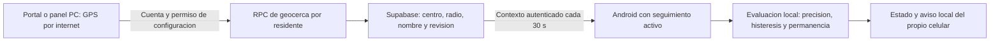

# Geocerca por internet desde 5 metros

Estado: preparada en fuentes, migracion 007 pendiente de autorizacion y
activacion en el proyecto de pruebas. No equivale a una geocerca ya instalada
en un celular ni a notificaciones remotas de salida.

## Que cambia

Esta ruta no necesita red compartida, hotspot, certificados LAN ni ngrok.
La geocerca local de SQLite sigue siendo independiente. No se copia a la nube
sin una seleccion y guardado deliberados. El editor no confirma que el celular
recibio la zona ni que la persona permanezca dentro.

## Probar despues de la activacion

1. Mantener Android 0.5.0-prototipo en Compartir > Por internet, con la persona
   vinculada, consentimiento y seguimiento activos. Puede usar datos moviles.
2. Iniciar sesion en el portal; o, para editar desde el panel PC, reanudar la
   sincronizacion de esta PC y usar el mismo perfil vinculado.
3. Abrir el mapa por internet. Usar la posicion recibida como centro o activar
   Elegir centro en el mapa. Se pueden escribir coordenadas manualmente.
4. Elegir 5, 10, 25, 50, 100, 200 o 500 m, o introducir otro entero desde 5 m.
5. Revisar la vista previa y pulsar Guardar zona remota. Sin guardar, Android
   conserva la zona anterior. Otro cuidador que guarde primero obliga a recargar.
6. Esperar aproximadamente 30 segundos con internet y seguimiento activos.
   En Android, Zona de referencia pasa de Sin zona consultada a su evaluacion
   cuando recibe la zona y obtiene una lectura GPS util.
7. Verificar en campo precision, permanencia y cambios de estado. No afirmar
   que funciona por observar solamente el circulo del mapa.

## Precision y seguridad de la demostracion

Un radio de 5 m no hace que el GPS tenga precision de 5 m. Si la lectura tiene
incertidumbre mayor, la app puede mostrar Incierta o GPS impreciso.
El intervalo completo debe quedar fuera/dentro con margen, al menos dos
lecturas y 10 segundos. No se reducen estas salvaguardas para forzar una salida.
La zona verde representa el perimetro; el circulo celeste representa precision.

Solo administradores o cuidadores asignados con permiso de configuracion
pueden guardar. El permiso de emitir GPS no permite cambiar su propia zona.
Las consultas desde la PC requieren localhost y la sesion del propietario del
vinculo; no se expone el contexto cloud privado a toda la LAN.

El mapa conserva zoom y encuadre durante las consultas. Ver zona y Centrar en
el celular son acciones explicitas. Cambiar de residente elimina el mapa anterior.

## Limites y validacion

- 55 comprobaciones SQL aisladas, 60 pruebas web y 83 pruebas Python aprobadas.
- Navegador con datos ficticios: seleccion de 5 m, edicion de centro y GPS nuevo
  sin reiniciar encuadre; sin desbordamiento horizontal al activar edicion.
- Sin prueba fisica de recepcion/evaluacion en Android todavia.
- Avisos a cuidadores por salida, centro de pruebas FCM y motor cloud de
  geocerca quedan para la etapa siguiente. No se activan por guardar la zona.
