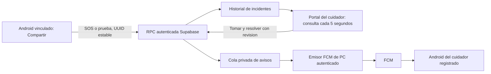

# SOS y atencion compartida

Estado al 21 de octubre de 2026: migracion 006 aplicada con autorizacion y
permisos comprobados en Supabase alojado. Prueba fisica entre celulares pendiente.
La publicacion de la APK se registra en sus notas de release, no se deduce de
la activacion SQL.

## Que depende de que

El GPS y el registro SOS no necesitan la misma red ni la PC encendida.
El emisor push actual SI necesita la PC encendida y la sesion de sincronizacion
activa. El emisor online independiente de PC es una etapa posterior.
Los avisos de escritorio del portal requieren pagina abierta y permiso
explicito del navegador; no constituyen Web Push con el navegador cerrado.

## Preparacion

1. Para otra instalacion Supabase, aplicar las migraciones 001 a 006 en orden,
   sin repetir las ya aplicadas. En SFA Asistencia - Pruebas ya estan activas.
2. Desplegar el portal compatible y Android 0.5.0-prototipo (versionCode 6).
3. Desde Equipo y permisos, el administrador asigna al emisor su residente y
   permiso explicito de compartir ubicacion; no necesita darle administracion.
4. El cuidador inicia sesion, registra su celular en alertas y acepta recibir
   pruebas SOS de las personas a su cuidado. No se activa por defecto.
5. Para probar push, mantener el emisor FCM PC activo con credencial privada
   exclusivamente en esa PC. Nunca incluir esa clave en APK, web o repositorio.

## Recorrido seguro de demostracion

1. En el celular emisor, abrir Compartir, seleccionar la persona y vincular.
2. Usar Probar SOS con mis cuidadores; confirmar que es una prueba.
3. Comprobar el registro remoto. Registrado en Supabase no significa que
   el cuidador haya recibido, abierto o atendido la notificacion.
4. Abrir el portal con cuenta cuidadora: debe aparecer PRUEBA, no emergencia.
5. Comprobar la notificacion en el celular cuidador autorizado que acepto pruebas.
6. Tomar atencion desde el portal; otro cuidador debe verla ocupada.
7. Resolver con confirmacion y comprobar el historial sin borrar el incidente.

No usar SOS real para demostrar. Un SOS real avisa a receptores autorizados
aunque no hayan aceptado pruebas. La prueba no confirma eficacia anticaidas.

## Fallos y limites

- Sin conexion: solicitud conservada localmente; reintentar pendientes.
- Tras cinco minutos no se reenvia como emergencia nueva; se conserva historica.
- Reintentos usan el mismo identificador para evitar duplicados.
- Hay limite de frecuencia y rechazo de fechas invalidas o emisor revocado.
- Solo quien tomo atencion puede cerrarla. Reasignacion auditada pendiente.
- No hay aun confirmacion de entrega del dispositivo ni lectura del cuidador.
- Geocerca cloud, fuentes combinadas y atencion desde Android son etapas siguientes.
- Validacion automatica: 51 comprobaciones SQL aisladas, 47 pruebas web,
  pruebas unitarias Android, ensamblado y lint. Prueba fisica completa pendiente.
