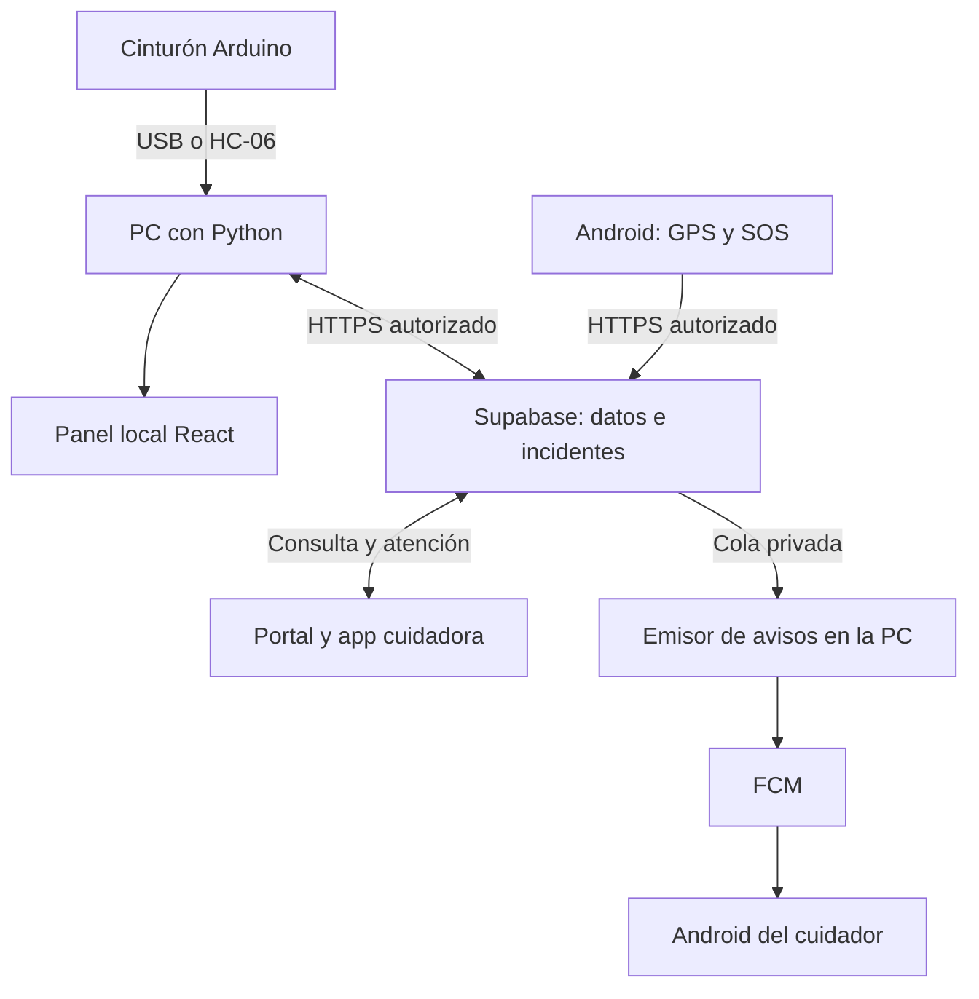

# Entender y usar SFA Asistencia

SFA conecta un cinturón experimental y la ubicación de un celular con información que un cuidador puede revisar y atender. Estas guías acompañan ese recorrido: primero usarlo, después entender sus tecnologías y finalmente seguir el código.

**Empieza por la tarea que necesitas resolver.** No hace falta leer todos los documentos para abrir el sistema o preparar una exposición.

| Quiero… | Guía | Qué encontraré |
| --- | --- | --- |
| Preparar la PC y usar el panel | [Manual de uso en Windows](MANUAL_USO_PC.md) | Preparación, fichas, fuentes e incidentes, con capturas |
| Compartir ubicación o cuidar desde otro equipo | [Portal y Android](MANUAL_PORTAL_Y_ANDROID.md) | Cuentas, GPS, geocerca, avisos y límites por rol |
| Entender por qué se usa cada tecnología | [Guía del stack tecnológico](GUIA_STACK_TECNOLOGICO.md) | Conceptos, bibliotecas, tablas, ejemplos breves y diagramas |
| Encontrar las funciones que conectan el sistema | [Código y puntos de nexo](GUIA_CODIGO_Y_NEXOS.md) | Cinco recorridos entre archivos, con entradas y resultados |
| Preparar una presentación | [Guía para la exposición](GUIA_EXPOSICION.md) | Ideas esenciales, un caso completo y preguntas para ensayar |
| Comprobar un recorrido o resolver un fallo | [Comprobación y diagnóstico](COMPROBACION_Y_DIAGNOSTICO.md) | Resultados observables y cómo localizar el tramo que falla |

## El proyecto en una mirada

**La PC es opcional para enviar GPS a Supabase, pero sigue siendo necesaria para el emisor push actual.** El cinturón conserva su señalización local aunque se corte su enlace con la PC.

## Antes de empezar

Las referencias de esta colección son **Windows 1.2.0-rc13.1 y Android 0.7.1**. Los números de versión de web, firmware y aplicaciones no tienen por qué coincidir. [Descarga de ejecutables y notas](https://github.com/hfreedo/SFA-Asistencia-Anticaidas/releases).

Las capturas nuevas muestran **la aplicación ejecutada con datos ficticios**, no residentes reales. Su procedencia, límites y pruebas se describen en [Estado de la documentación](ESTADO_DOCUMENTACION.md). Una captura o un test de navegador no valida el sensor, la precisión GPS o la recepción física de FCM.

## Para continuar con más detalle

- [Instalar y ejecutar desde las fuentes](MANUAL_REPRODUCCION.md).
- [Cableado, velocidades y protocolo del cinturón](HARDWARE_Y_PROTOCOLO.md).
- [Firma e instalación Android](ANDROID_RELEASE.md).
- [Personas y equipo](PERSONAS_Y_EQUIPO.md).
- [Recuerdos en Android](RECUERDOS_ANDROID.md).
- [Cambios de versión](../CHANGELOG.md) y [plan de integración](PLAN_INTEGRACION_OPERATIVA.md).

Los documentos que empiezan por *Etapa*, las pruebas de una rc concreta y la galería 1.1.0 conservan contexto histórico. **Para el recorrido habitual utiliza los manuales de esta página; para reproducir una entrega anterior, lee sus notas específicas.**
