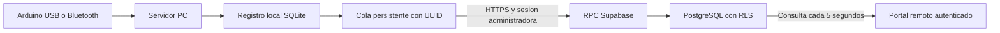

# Etapa 3A: PC y monitoreo remoto

## Recorrido implementado



No se necesita ngrok: la PC envia hacia Supabase y el portal consulta Supabase.
GitHub Pages sirve archivos publicos, no almacena datos de residentes.
El panel local original sigue funcionando independientemente del portal.

## Primera vinculacion

1. Iniciar el servidor actualizado desde las fuentes del proyecto.
2. Seleccionar en el panel local el perfil que corresponde al cinturon.
3. En esta misma PC abrir `https://localhost:8780/acceso/acceso.html` si el
   servidor esta en HTTPS, o `http://localhost:8780/acceso/acceso.html` en HTTP.
   HTTPS local requiere confiar el certificado existente; no omitir advertencias.
4. Iniciar sesion personalmente con la cuenta administradora invitada.
5. En Sincronizacion de esta PC, verificar perfil y espacio, marcar el
   consentimiento de datos minimos y pulsar Vincular y sincronizar.
6. Conectar el sensor desde el panel local. Comprobar pendientes y enviados.
7. Abrir el portal HTTPS publicado con una cuenta autorizada, incluso desde
   otra red. Comprobar nombre, referencia, hora de muestra y eventos.

La vinculacion solo se ofrece desde localhost y a administradores. La pagina
publicada no puede administrar directamente el servidor de la PC.
No introducir contrasenas en scripts ni compartir tokens para probarlo.

## Datos y limites

- Se autorizan nombre, referencia del perfil, nuevos eventos y telemetria.
- No se envian telefonos, notas medicas, fotos ni ubicacion. Tampoco eventos
  de geocerca o ubicacion. No se reasignan ni suben registros historicos locales.
- Nombre y referencia se copian al vincular por primera vez; las ediciones
  posteriores del perfil no se sincronizan automaticamente en esta entrega.
- Se encolan todos los nuevos eventos y como maximo una muestra cada 2 segundos.
- Cada envio conserva su UUID. Reintentar no duplica evidencias; un conflicto
  con contenido distinto se rechaza, no sobrescribe el registro previo.
- Las fechas representan recepcion en PC, no un reloj UTC propio del Arduino.
- Una lectura de mas de 15 segundos o simulada no se presenta como estado vivo.
- El portal consulta lecturas cada 5 segundos y directorio cada 10 segundos;
  no es una promesa de alerta instantanea ni de notificacion push.
- Las simulaciones quedan etiquetadas y no disparan Telegram/correo externos.

## Sesion y recuperacion

El JWT de envio se mantiene solo en memoria. Reiniciar el servidor o vencer la
sesion requiere iniciar sesion y pulsar Reanudar envios en la copia local.
No hay aun una credencial autonoma de dispositivo ni renovacion desatendida.

Sin internet, las muestras quedan en SQLite. Los reintentos tienen espera
creciente hasta 300 segundos. Un rechazo 401/403 pausa la sesion; los pendientes
se conservan. Datos rechazados por validacion quedan bloqueados para revision,
sin borrarse. Un lote invalido puede bloquear hasta 50 muestras.

Pausar envios detiene la transmision pero sigue encolando nuevos registros de
perfiles vinculados. No borra datos ni revoca por si mismo el dispositivo cloud.
Las muestras atrasadas se muestran como historia, no como seguridad actual.

No exponer el servidor LAN a internet: sus endpoints originales no incorporan
todavia el control de acceso cloud. Esta entrega es un prototipo educativo.

## Construccion y evidencia

Desde la raiz del proyecto:

```powershell
.\.venv313\Scripts\python.exe -m unittest discover -s tests -v
npm --prefix interfaz_web test
npm --prefix interfaz_web run build:access
npm --prefix supabase/validation test
```

La revision original tuvo 48 pruebas Python, 18 frontend y 19 comprobaciones SQL
aisladas. Los conteos ampliados y limites actuales estan en VALIDACION_AMPLIACION.md.
La migracion 002 se aplico en Supabase de pruebas; una transaccion de validacion
comprobo vinculacion, envio, deduplicacion y aislamiento y revirtio sus fixtures.
Eso no sustituye la prueba real con cuenta, PC y sensor.

El portal compilado esta publicado en la rama codex/portal-acceso. Las nuevas
fuentes aun no se publicaron en main ni se reconstruyeron los EXE/releases.
La APK, GPS remoto, geocerca cloud, push y el iniciador unico siguen pendientes.
