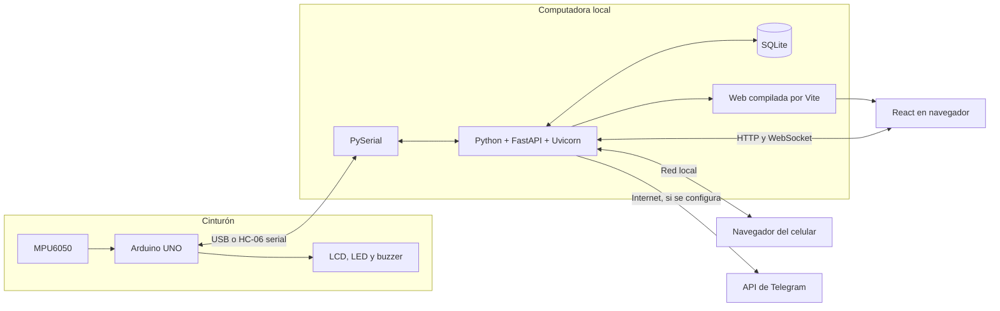
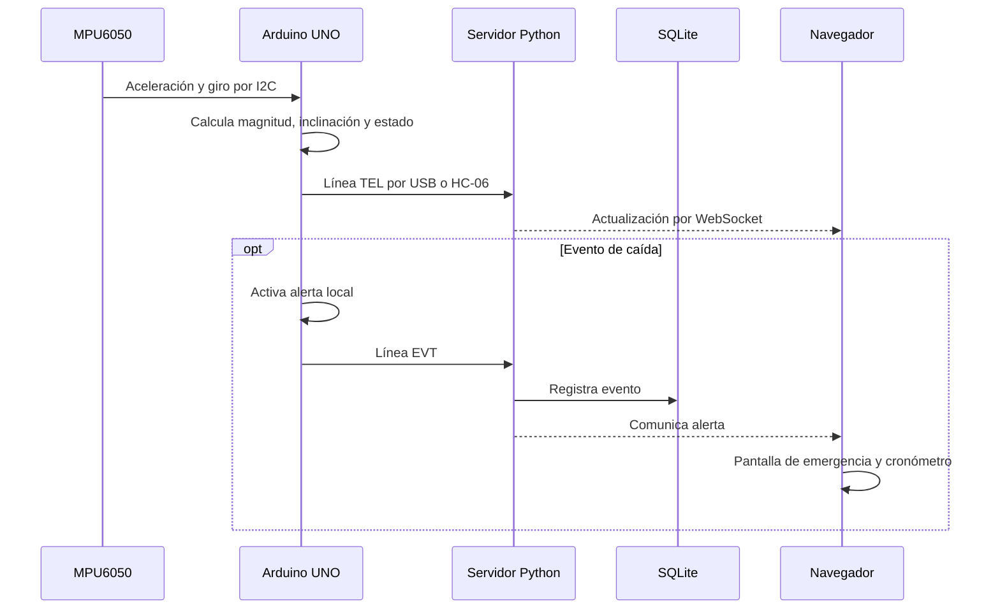
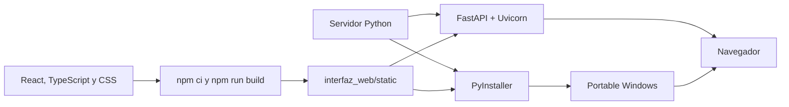

# Stack Tecnológico de SFA Asistencia

## Qué Construimos

Una aplicación web local conectada a un cinturón Arduino. La computadora recibe
telemetría, conserva eventos y sirve el panel al navegador. El celular abre ese
mismo panel mediante un QR cuando comparte la red de la computadora.
No es todavía una app Android nativa ni una plataforma en la nube.

## Tecnologías y Programas

| Capa | Tecnología | Programa o entorno | Función |
| --- | --- | --- | --- |
| Firmware | C/C++ y framework Arduino | Arduino IDE, placa Uno | Leer MPU6050 y controlar LCD, buzzer y LED |
| Comunicación | USB serial, HC-06 y PySerial | Monitor Serie; después servidor Python | Transportar telemetría, eventos y comandos |
| Backend | Python, FastAPI, Pydantic | Python 3.13 y editor como VS Code | Procesar datos y validar solicitudes |
| Servidor web | Uvicorn | Terminal o BAT del proyecto | Servir HTTP y WebSocket |
| Base de datos | SQLite (`sqlite3` de Python) | No requiere un servidor adicional | Guardar perfiles, fotos, eventos y ajustes |
| Interfaz | React y TypeScript | Editor, Node.js y npm | Construir vistas e interacciones |
| Diseño | Tailwind CSS y CSS propio | Editor y navegador | Distribución, estados y adaptación de pantalla |
| Iconos y fuentes | Lucide React, Geist, Geist Mono, Fraunces | Dependencias npm | Recursos locales incluidos en el build |
| Compilación web | Vite y TypeScript | Node.js y npm | Generar los archivos que sirve FastAPI |
| Tiempo real | WebSocket | Servidor y navegador | Actualizar sin recargar la página |
| Mapa | Leaflet y proveedor de teselas | Navegador, Internet para calles | Mostrar mapa y geocerca |
| QR | Biblioteca `qrcode` | Navegador y cámara del celular | Abrir el panel sin escribir direcciones |
| Avisos externos | API de Telegram | Bot y chat configurados | Enviar mensajes por Internet |
| Distribución | PyInstaller y Tkinter | Python en Windows | Construir el EXE y su ventana de inicio |
| Versiones | Git y GitHub | Git o GitHub Desktop | Conservar cambios y distribuir entregas |

VS Code es una opción de editor, no una dependencia de ejecución. GitHub Desktop
facilita Git, pero no sustituye Arduino IDE, Python ni npm. Las versiones exactas
del frontend están en `interfaz_web/package-lock.json`; las dependencias del
backend están en `servidor_pc/requirements.txt`.

## Arquitectura

La alerta local del cinturón no depende de la página. La PC sí debe permanecer
encendida y con el servidor activo para mantener el panel y el acceso móvil.

## Ejemplo: de la Lectura a la Alerta

No todas las muestras son eventos persistidos: telemetría en vivo, incidentes y
configuración son responsabilidades diferentes.

## Desarrollo y Uso Final

Para desarrollar se necesita Python, Node.js/npm para compilar la interfaz y
Arduino IDE para modificar/cargar el firmware. Para usar el portable no se
instalan Python ni Node.js por separado. El controlador CH340/CH341 es opcional,
según la placa. Crear el EXE y armar el ZIP completo del release son tareas distintas.

## Comparación con XAMPP

SFA no usa PHP, Apache ni MariaDB. No necesita XAMPP.

| Necesidad | Solución en SFA |
| --- | --- |
| Atender HTTP/WebSocket | Uvicorn + FastAPI |
| Lógica del servidor | Python |
| Almacenamiento | SQLite local |
| Pantallas interactivas | React + TypeScript |
| Enlace con Arduino | PySerial |

## Alcance Real

- Incluido: telemetría, alertas, perfiles/fotos, preferencias, mapa/geocerca,
  QR y configuración de Telegram.
- Batería y GPS están contemplados por la interfaz, pero el UNO/MPU6050 no los
  aporta por sí solo. No se deben mostrar valores inventados.
- Una geocerca dibujada no demuestra seguimiento GPS ni cálculo de rutas o llegada.
- El QR no conecta automáticamente al Wi-Fi ni crea una cuenta: abre una URL.
- Kotlin, Firebase y Supabase no forman parte de esta implementación.
- El acceso LAN no tiene autenticación. Usar una red de confianza, sin exponer
  el panel a Internet ni abrir puertos del router.
- Compilar o simular no demuestra detección física. Es un prototipo educativo,
  no un dispositivo médico certificado.

## Recorrido Para Estudiantes

1. Leer [hardware y protocolo](HARDWARE_Y_PROTOCOLO.md).
2. Seguir el puente serial en `servidor_pc/main.py`.
3. Distinguir los endpoints `/api` del canal `/ws`.
4. Localizar recepción y presentación de datos en `SfaDashboard.tsx`.
5. Separar cambios visuales de cambios en la detección de caídas.
6. Registrar qué se probó por software y qué requiere pruebas físicas.

GitHub muestra los bloques Mermaid como diagramas; un editor sin soporte puede
mostrar su código textual, que también es editable.
