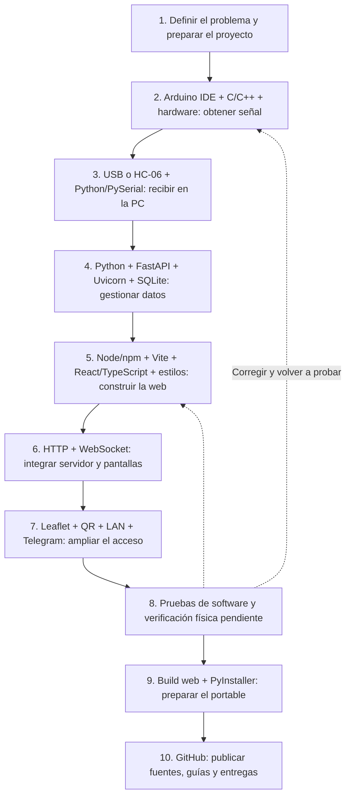
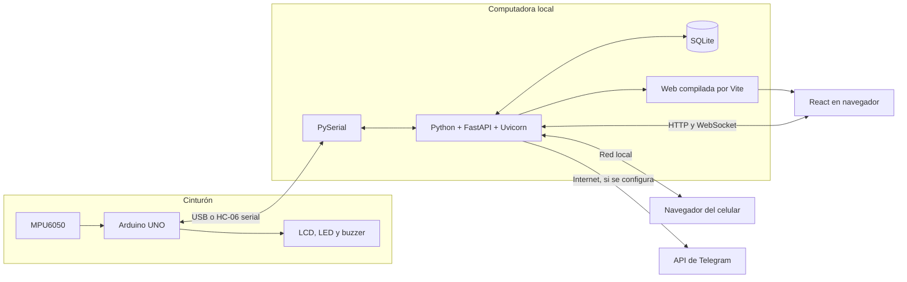
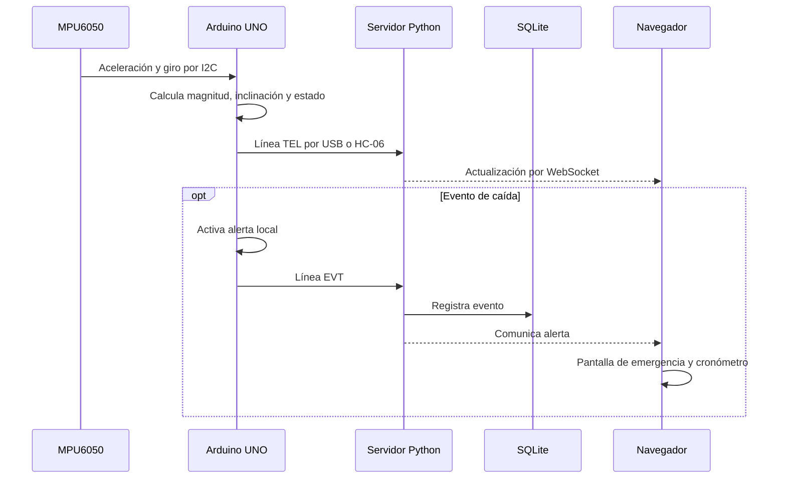
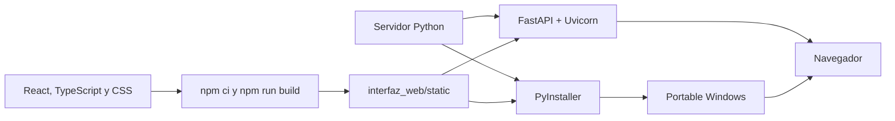

# Stack Tecnológico de SFA Asistencia

## Qué Construimos

Una aplicación web local conectada a un cinturón Arduino. La computadora recibe
telemetría, conserva eventos y sirve el panel al navegador. El celular abre ese
mismo panel mediante un QR cuando comparte la red de la computadora.
No es todavía una app Android nativa ni una plataforma en la nube.

## Cómo Leer el Recorrido

No construimos el sistema instalando un único programa equivalente a XAMPP.
Combinamos grupos de herramientas: primero conseguimos una señal del cinturón,
después la interpretamos en la PC, construimos las pantallas, conectamos ambas
partes y finalmente preparamos la distribución.

El siguiente orden es una reconstrucción pedagógica de la implementación actual,
no una bitácora cronológica de cada edición. En la práctica se vuelve sobre las
etapas para corregir y probar. VS Code y GitHub Desktop se mencionan como opciones
para los alumnos, no como programas obligatorios ni como un registro de los
editores empleados en cada cambio.

## Recorrido de Inicio a Fin

### 1. Definir Qué Necesita el Cuidador

**Trabajan juntos:** requisitos del proyecto, documentos Markdown y editor.

Se define qué debe detectar el cinturón, qué información necesita el cuidador y
qué acciones puede realizar ante una alerta. Se separan capacidades actuales de
expansiones como GPS, batería o app Android. Aquí todavía no se necesita un
servidor: se decide qué vamos a construir y cómo reconocer sus límites.

**Resultado:** alcance, componentes y flujo esperado: señal, interpretación,
alerta y confirmación de atención. Git puede registrar cambios desde esta etapa;
no es una herramienta reservada para el final.

### 2. Construir y Programar el Cinturón

**Trabajan juntos:** Arduino UNO, MPU6050, periféricos, Arduino IDE y C/C++.

Se conecta el hardware y se escribe el firmware. El programa de diagnóstico
permite inspeccionar el sensor en el Monitor Serie. El firmware principal calcula
el estado y controla LCD, buzzer y LED. Arduino IDE permite editar, compilar y
cargar; Arduino CLI permite compilar desde terminal y se utilizó para las
comprobaciones documentadas de las fuentes.

**Resultado:** un dispositivo que produce lecturas y mensajes. Archivos:
`arduino/Test_MPU6050/` y `arduino/SFA_Cinturon_Alerta/`.
El diagnóstico no sustituye al firmware principal para conectar el panel.

### 3. Llevar la Señal a la Computadora

**Trabajan juntos:** puerto USB o HC-06, protocolo serial, Python y PySerial.

Primero se definen mensajes reconocibles (`TEL`, `EVT`, `RSP`). Después Python,
mediante PySerial, abre el puerto, recibe las líneas y las interpreta. Por USB se
utilizan 115200 baudios; con HC-06, 9600. El Monitor Serie debe cerrarse antes de
que el servidor use el puerto.

**Resultado:** la PC recibe datos estructurados del cinturón. Esta parte está en
el puente serial de `servidor_pc/main.py`. Todavía no necesita una pantalla bonita:
primero debemos comprobar que llegan datos válidos.

### 4. Construir el Servidor y el Almacenamiento

**Trabajan juntos:** Python, FastAPI, Pydantic, Uvicorn y SQLite.

Python implementa la lógica. FastAPI expone las operaciones del sistema;
Pydantic valida los datos recibidos; Uvicorn ejecuta el servidor; SQLite conserva
residentes, fotos, preferencias y eventos en un archivo local. Son piezas del
mismo backend, no programas independientes que el alumno deba abrir uno por uno.

Se utiliza un entorno virtual `.venv313` y `pip` para instalar las dependencias
del backend en la carpeta del proyecto. SQLite se usa mediante `sqlite3`, incluido
en Python: no instalamos MySQL ni un servidor adicional de base de datos.

**Resultado:** operaciones `/api`, persistencia y gestión del dispositivo en
`servidor_pc/main.py`. La base se crea localmente; no se descarga con las fuentes.

### 5. Construir las Pantallas

**Trabajan juntos:** editor, Node.js, npm, Vite, React, TypeScript y estilos.

Node.js ejecuta las herramientas de desarrollo. npm instala las dependencias y
ejecuta scripts. Vite ofrece el servidor de desarrollo y genera la compilación.
React construye la interfaz; TypeScript ayuda a comprobar los tipos de datos.
Tailwind CSS y CSS propio definen composición, estados y adaptación de pantalla.
Lucide React aporta iconos; Geist, Geist Mono y Fraunces aportan las fuentes.

Un editor como VS Code permite trabajar con estos archivos; no genera por sí
solo la aplicación ni es necesario para usarla. En esta etapa se construyen
panel, perfiles, ajustes y pantalla de emergencia en `interfaz_web/src/`.

**Resultado:** fuentes editables de la web y, con `npm run build`, archivos
compilados en `interfaz_web/static` que FastAPI puede servir.

### 6. Unir la Interfaz con el Servidor

**Trabajan juntos:** React en el navegador, FastAPI, HTTP y WebSocket.

HTTP sirve para operaciones como cargar o guardar perfiles y conectar el puerto.
WebSocket mantiene una conexión por la que el servidor comunica cambios de estado
y telemetría sin recargar toda la página. No es una base de datos ni otro programa
que deba instalar el usuario.

Durante la edición, Vite sirve la interfaz y reenvía `/api` y `/ws` a Python.
En el modo normal, FastAPI sirve la interfaz ya compilada y las operaciones del
sistema desde el mismo servidor.

**Resultado:** la pantalla responde a los datos y a las acciones del operador.
Se sigue el flujo entre `servidor_pc/main.py` y `interfaz_web/src/SfaDashboard.tsx`.

### 7. Incorporar Mapa, Celular y Avisos

Estas funciones complementan el sistema integrado, pero no son la misma conexión:

| Grupo | Piezas que trabajan juntas | Qué obtenemos |
| --- | --- | --- |
| Mapa y zona | React + Leaflet + teselas de OpenStreetMap | Mapa de referencia y geocerca; las calles requieren Internet |
| Acceso móvil local | Servidor Python en LAN + biblioteca `qrcode` + cámara/navegador | Abrir el panel desde el celular sin escribir la dirección |
| Avisos externos | Servidor Python + API de Telegram + bot/chat configurados | Enviar mensajes por Internet |

El QR se genera en la interfaz, pero no crea el Wi-Fi ni una cuenta. PC y celular
deben compartir una red accesible. Telegram es un canal aparte: no necesita que
el teléfono mantenga abierto el panel web local. Su configuración no demuestra
por sí sola entrega real de una alerta.

**Resultado:** funciones en el dashboard, `servidor_pc/acceso_movil.py`,
`servidor_pc/red_local.py` y la integración Telegram del backend.

### 8. Comprobar las Partes y el Conjunto

**Trabajan juntos:** Arduino CLI, `unittest` de Python, herramientas de compilación
web y pruebas de comunicación. El navegador sirve además para revisar la interfaz.

Se comprueba que los sketches compilan, las dependencias se instalan, la web se
construye y el servidor responde por HTTP/WebSocket. Las pruebas de red están en
`tests/`. Las comprobaciones realizadas y sus límites se registran en
[Validación de fuentes](VALIDACION_FUENTES.md).

**Resultado:** evidencia de lo probado y una lista explícita de pendientes.
Compilar, recibir una respuesta HTTP o simular una alerta no valida una caída
física ni garantiza atención al adulto mayor.

### 9. Convertir el Desarrollo en un Programa Distribuible

**Trabajan juntos:** build de Vite, servidor Python, Tkinter y PyInstaller.

Primero se compila la interfaz con npm/Vite. Después PyInstaller empaqueta Python,
el backend, la web compilada y la ventana de inicio Tkinter según
`SFA_Asistencia.spec`. El resultado es el EXE. Luego se prepara el ZIP de entrega
con iniciadores, instrucciones, licencias y controlador opcional CH340/CH341.

**Resultado:** portable Windows. El usuario final no necesita instalar Arduino
IDE, VS Code, Node.js ni Python para abrirlo. El firmware debe estar cargado en
la placa y el controlador debe estar disponible si ese hardware lo requiere.
Crear el EXE y preparar/verificar el ZIP completo son tareas diferentes.

### 10. Publicar y Mantener

**Trabajan juntos:** Git, GitHub, documentación Markdown y diagramas Mermaid.

Git registra versiones; GitHub aloja fuentes y documentación; Releases distribuye
paquetes preparados. GitHub Desktop es una alternativa gráfica para operar Git,
no un compilador ni el servidor de la aplicación. Antes de publicar se excluyen
perfiles, bases de datos, fotografías personales, credenciales y dependencias
instaladas. Los diagramas explican las relaciones sin publicar esos datos.

**Resultado:** fuentes consultables, instrucciones reproducibles y entregas
identificadas. Publicar un commit no publica automáticamente un release en borrador.

## Qué Instala Cada Persona

| Objetivo | Herramientas necesarias |
| --- | --- |
| Editar/cargar el firmware | Arduino IDE y soporte de la placa/bibliotecas; CLI es alternativa para terminal |
| Editar y ejecutar las fuentes completas | Editor, Python, Node.js/npm y navegador; Arduino IDE para cambios del cinturón |
| Guardar/publicar versiones | Git o GitHub Desktop, más acceso a GitHub |
| Construir el portable | Entorno anterior, interfaz compilada y PyInstaller en Windows |
| Usar un portable ya preparado | Windows compatible, navegador, placa con firmware y driver si corresponde |
| Abrir el panel desde el celular | Cámara/navegador, red compartida y servidor de la PC activo |

Las versiones exactas del frontend están en `interfaz_web/package-lock.json`;
las dependencias del servidor, en `servidor_pc/requirements.txt`. Los comandos
para reproducir este recorrido están en [Desarrollo](DESARROLLO.md).

## Arquitectura

La alerta local del cinturón no depende de la página. La PC sí debe permanecer
encendida y con el servidor activo para mantener el panel y el acceso móvil.

## Ejemplo: de la Lectura a la Alerta

No todas las muestras son eventos persistidos: telemetría en vivo, incidentes y
configuración son responsabilidades diferentes.

## Desarrollo y Uso Final

Para desarrollar se necesita Python, Node.js/npm para compilar la interfaz y
Arduino IDE para modificar/cargar el firmware. Para usar el portable no se
instalan Python ni Node.js por separado. El controlador CH340/CH341 es opcional,
según la placa. Crear el EXE y armar el ZIP completo del release son tareas distintas.

## Comparación con XAMPP

SFA no usa PHP, Apache ni MariaDB. No necesita XAMPP.

| Necesidad | Solución en SFA |
| --- | --- |
| Atender HTTP/WebSocket | Uvicorn + FastAPI |
| Lógica del servidor | Python |
| Almacenamiento | SQLite local |
| Pantallas interactivas | React + TypeScript |
| Enlace con Arduino | PySerial |

## Alcance Real

- Incluido: telemetría, alertas, perfiles/fotos, preferencias, mapa/geocerca,
  QR y configuración de Telegram.
- Batería y GPS están contemplados por la interfaz, pero el UNO/MPU6050 no los
  aporta por sí solo. No se deben mostrar valores inventados.
- Una geocerca dibujada no demuestra seguimiento GPS ni cálculo de rutas o llegada.
- El QR no conecta automáticamente al Wi-Fi ni crea una cuenta: abre una URL.
- Kotlin, Firebase y Supabase no forman parte de esta implementación.
- El acceso LAN no tiene autenticación. Usar una red de confianza, sin exponer
  el panel a Internet ni abrir puertos del router.
- Compilar o simular no demuestra detección física. Es un prototipo educativo,
  no un dispositivo médico certificado.

## Ejercicio Para Seguir el Código

1. Leer [hardware y protocolo](HARDWARE_Y_PROTOCOLO.md).
2. Seguir el puente serial en `servidor_pc/main.py`.
3. Distinguir los endpoints `/api` del canal `/ws`.
4. Localizar recepción y presentación de datos en `SfaDashboard.tsx`.
5. Separar cambios visuales de cambios en la detección de caídas.
6. Registrar qué se probó por software y qué requiere pruebas físicas.

GitHub muestra los bloques Mermaid como diagramas; un editor sin soporte puede
mostrar su código textual, que también es editable.
